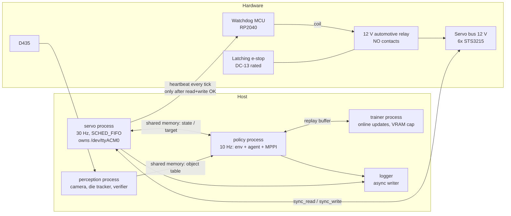

# SO-101 Self-Learning RL — Architecture

> **Status:** v0.35 (2026-10-10). This describes the *target* architecture for Stage A. **Implemented so far:**
> - *Wave 0:* the package skeleton, the pixi environments, `config/`, the shared-memory primitive, the bus, timing and safety-type contracts, the vendored TD-MPC2 and the MJCF assets.
> - *Wave 1:* the servo backends and heartbeat link (U1), the safety layer (U2), the MuJoCo backend (U4), Stage A perception (U5), episode logging (U6), and the watchdog firmware with the hardware checklist (U7).
> - *Wave 2:* the servo core, the servo process and CLI, the soak harness and gate, and the latency hooks (U3). Exercised on the fake and MuJoCo backends only; nothing has run on the real arm yet.
>
> - *Sim-first track SU0 (S0, 2026-10-05; `plans/sim-track-implementation-plan.md`):* one MuJoCo 3.14 / torch 2.11 in every env, MuJoCo Warp (`sim/warp_model.py`, failing overflow detector, S0 gate passed), and the frozen FS3 observation layout (`env/obs.py`) and FS4 task specs (`env/tasks.py`, modular non-positive reward in `env/reward.py` after the SU0 review, 2026-10-06).
>
> - *Sim-first wave 1 (2026-10-06, branch `integration/sim-wave1`):* SU1 batched servo-parity env (`sim/batched_servo.py` FS5, `sim/sim_tracker.py` FS6, `env/batched_env.py` FS9, the start-well tray and `tray-check`, parity Layers A–C), SU2 sysid software (`sim/sysid/`, `calib/sim_params.yaml`), SR1 real-arm goal env (`env/backend.py`, `env/goal_env.py`, `env/goals.py`; FS12) and SUV training visualisation (`viz/`, FS11). Integrated with the 2026-10-06 decisions: box floor table + 5 mm, sysid gate 1 %, servo ratio-group fit, one goal sampler, die-centroid convention.
>
> - *Camera parity unit SUC (2026-10-07, branch `feature/camera-parity`, `plans/camera-parity-plan.md`):* `calib/camera.yaml` as the one source of the D435 model (intrinsics read from the device; pose PROVISIONAL until `camera-calibrate` passes on the rig), the read-only joint probe, the table-plane + arm-shape calibration, the sim cameras `d435_color` / `d435_depth`, the oblique-camera tracker (camera-pose DR, distractors) and the parity tests.
>
> - *MVP (2026-10-08, branch `integration/mvp`, `plans/mvp-plan.md`):* reach DR stages (`sim/domain_rand.py`, M1), FastSAC + GPU replay, the reach L1/L2 gates, the sim training loop, sim eval + numeric exit gate and policy export (`rl/`, M2–M4), and the minimal connector `so101_rl.lab` with the stdio MCP server (M5); `rl/deploy_policy.py` (`deploy-policy`, M7 software: the exported policy over shm against a running servo, the zero-shot reach protocol), tested against `servo --backend mujoco|fake` only.
>
> **Still interface-only:** the full curriculum (S3.2), SB3 SAC+HER / TD-MPC2 learners, S5 beyond the M7 reach deploy (die mode, gap report, real fine-tuning) and the world-model code (SR2/SR3).
> **Source of truth for decisions:** `so101-self-learning-rl-plan.md` §10 (decision log). This doc describes *how* the system is built; the plan describes *what* and *why*.
> **Keeping it current:** every change that adds, removes or renames a module, a process, or a cross-process interface updates this file in the same commit. See §10 at the bottom of this file.

## 1. Purpose and scope

The system is a goal-conditioned, RL-driven manipulation stack for one SO-101 arm, one fixed RealSense D435 and one RTX 3080 (10 GB). It is packaged as a single pixi package, `so101_rl`.

It goes through three stages (plan §1):

| Stage | Scope |
|---|---|
| **A: Research** | This version of the architecture. Covers the safety layer, the die tracker, the world model, and reach with SAC + HER and TD-MPC2 + HER. |
| B: Demo | Grasp, transport and release, plus the SAM2 / Grounding DINO perception and the LLM task planner. |
| C: Platform | A learned task policy and per-skill adapters. |

Everything marked *(Stage B)* or *(Stage C)* below is a placeholder. It is not built in Stage A.

## 2. Layered view

```
            Command ("move die to zone")
                      │
   ┌──────────────────▼──────────────────┐
   │ TASK LEVEL            (Stage B/C)   │  LLM planner (API) → skill sequence
   └──────────────────┬──────────────────┘
                      │ skill id + goal params
   ┌──────────────────▼──────────────────┐
   │ SKILL LEVEL                         │  goal-conditioned RL policies
   │ reach (A) · grasp/transport/        │  SAC+HER (baseline) · TD-MPC2+HER (main)
   │ release/push (B)                    │
   └──────────────────┬──────────────────┘
                      │ joint-delta action @ 10 Hz
   ┌──────────────────▼──────────────────┐
   │ SAFETY LAYER (policy-independent)   │  clamp → tracking-error clamp → limits →
   │                                     │  thermal → safe-state → deadman heartbeat
   └──────────────────┬──────────────────┘
                      │ absolute Goal_Position @ 30 Hz
   ┌──────────────────▼──────────────────┐
   │ MOTOR LEVEL                         │  world model (state first; pixels in parallel)
   └──────────────────┬──────────────────┘
                      │
         Feetech bus (6× STS3215, 1 Mbps)  ── 12 V via watchdog relay
```

Perception runs alongside all the layers. It supplies the object table, the success verifier and the reward terms.

## 3. Process view (runtime)

The load-bearing design rule is that the **safety-critical loop is its own OS process** and owns the serial port. Python's GIL would otherwise let MPPI planning and the camera starve the safety tick.



| Process | Rate | Owns | Must never |
|---|---|---|---|
| `servo` | 30 Hz, absolute-deadline, SCHED_FIFO, `gc.freeze()` | Serial port, the heartbeat, every safety check, the delta→absolute conversion | Allocate per tick, block on the policy, extrapolate a stale target |
| `policy` | 10 Hz | Gym env, agent inference, MPPI planning | Talk to the bus directly |
| `perception` | ≥ 5 Hz (Stage A colour tracker: 30 Hz) | Camera, object table, success verifier, camera-moved fiducial check | Share a CUDA context with training without a memory cap |
| `trainer` | Asynchronous | Gradient updates, checkpoints | Exceed its per-process VRAM fraction |
| `lab-mcp` (MVP M5, stdio) | on request | The run registry `runs/lab/` (one dir per run), launching jobs | Touch the arm, a serial device or the camera; hold a job (jobs outlive it) |
| lab job (one transient `systemd --user` unit `so101-job-<run>` per run segment) | the trainer's | One run dir's `status.json` / `usage.json` / `heartbeat` / `events.jsonl`; the GPU (one job at a time) | Run another checkout's code (`PYTHONPATH=<repo>/src` pinned, refused otherwise); count a thermal hold as progress |
| watchdog MCU | 1 s timeout | Relay coil | Close the relay without heartbeat pulses. After a trip, only a physical reset re-closes it. |
| `joint-probe` / `calib-check` / `camera-calibrate` / `camera-overlay` (one-shot tools, SUC; `calib-check` H7) | once | Nothing while running: they take the servo's serial-port lock (`servo.shm.SerialPortLock`), ping and block-read, then release | Write a register, enable torque, or run while the servo process owns the port (they refuse) |
| `zero-adjust` (one-shot, `servo/zero_adjust.py`; plan §10 2026-10-10) | once, attended | With `--apply --attended` only: the servo's serial-port lock, then `Lock` / `Homing_Offset` / `Min_Position_Limit` / `Max_Position_Limit` of the chosen arm joints, a timestamped backup of the calibration JSON, the JSON (atomic, after every read-back passed), `runs/hw/zero-adjust-<ts>.json`. Dry-run (default): read-only through the probe | Run next to the servo process, with torque on on any motor, or with servo registers that differ from the JSON; write the gripper, any other register, or a partial JSON; enable torque |
| `deploy-policy` (MVP M7, `rl/deploy_policy.py`; the policy process of the zero-shot eval) | 10 Hz | The policy side of an EXISTING servo's shm segment (`ShmBackend` + `So101GoalEnv`), `runs/deploy/<ts>/` | Start or stop the servo, open a serial device, keep sending RUN after an episode ends, run on the real arm without `--attended`, attach to a real servo started with `--no-mcu` or with a command line that does not parse cleanly |
| `viz` viewer (optional, SUV) | `viewer_hz` (30 Hz) | A GUI window (`mujoco.viewer.launch_passive` on a CPU `MjModel`) | Touch CUDA, block or slow the trainer (≤ 5 % measured), open a serial device; its crash or close never stops training |

**Lab jobs (MVP M5, `so101_rl.lab`).** The MCP server (`pixi run lab-mcp`, stdio, six sim-only tools) and the CLI (`pixi run lab`) start each run segment as a **transient user unit** (`systemd-run --user --unit so101-job-<run> --collect`; a detached subprocess where no user manager exists), so a run outlives Claude Code; liveness is re-checked by unit name or pid + start time, and a dead job becomes `interrupted` (resumable). The job (`python -m so101_rl.lab.job <run_dir>`, pinned argv `pixi run --frozen --manifest-path <repo>/pyproject.toml -e <trainer env> python ...`, env `PYTHONPATH=<repo>/src` + `SO101_LAB_REPO`) refuses with exit 3 when `so101_rl` is not imported from `<repo>/src`. Heartbeat and GPU-h are progress-coupled (trainer hooks); thermal fail-closed via NVML (P8) has ONE owner, the job (`fastsac_sim` runs with `thermal_guard` off; the trainer's own pause is for the standalone CLI only, and a thermal timeout ends `stopped` / `thermal_timeout` with a checkpoint, resumable, never `failed`). The budget has one owner per layer: the trainer always gets the run's FULL `budget_min` (the checkpoint's `train_s` carries the history across resumes); the job's progress time is the lab's backstop. One GPU job at a time; budgets from a ledger derived from the run dirs (P6): a run that can still continue (queued / running / paused / interrupted / thermal-timeout-stopped) reserves its unused `budget_min`, a start must fit used + reserved + requested, and a resume re-checks `HALT` and used + reserved. An eval run evaluates its own copy of the checkpoint (`evaluated_ckpt.*` in the eval dir, `ckpt_sha256` checked), so `run.json` stays reproducible. Trainer artefacts: `metrics.csv` (rows after the resumed checkpoint dropped on resume; `eval_frac` column; `train_success_rate` is completion-biased, annotated in `get_run`), the last 3 numbered checkpoints + `ckpt_last.pt` + `ckpt_best.pt`; evals are deferred so they stay ≤ 10 % of training time (`eval_max_fraction`). Lab default `nworld` 1024 (UTD 8/1024 ≥ the 0.005 review trigger).

**Deployment (MVP M7, `rl/deploy_policy.py`).** `deploy-policy --policy <export> [--protocol zero-shot] [--attended]` (or `--resume <run dir>`) attaches to an already-running servo (started by the human on the arm; by the tests as `servo --backend mujoco|fake`). Real vs sim is read from the servo that owns the segment: the shm lock file's pid → `/proc/<pid>/cmdline`, parsed with the servo's own `build_parser()` (which has `allow_abbrev=False`), fail-closed: anything but `--backend mujoco` / `fake` is the arm and needs `--attended` (Tier 0); a command line with unknown or abbreviated options is refused even with `--attended`, and so is a real servo with `--no-mcu` (`summary.json` records `servo.mcu`). The servo's `--config` is the default for ours (a different `--config` is refused), its `--calibration` (else its config's `calibration_path`, resolved against the servo's `/proc/<pid>/cwd`; a different `--calibration` is refused) is the FK's, and its `--tick-log` is recorded in the summary. Obs, action mapping, the reach goal rule (`BoxGoalSampler` + near-start redraw) and success are `So101GoalEnv`'s; the action is `policy(obs ++ desired_goal) × speed_scale`. The goal list is pre-drawn from `--seed` before RUN, independent of any measurement: per episode a (first draw, redraw) pair; the env's near-start rule then picks the redraw if the first draw is within 2 success radii of the MEASURED start tip. So a sim twin with the same seed, config and calibration gets the same pairs, but which member of a pair is used can differ between sim and real when a first draw lies near that radius; the pairs are in `summary.json` (`goals`), the used goal and `goal_redrawn` per episode in `episodes.jsonl`. Because a servo in RUN safe-stops 0.5 s after the last command (STALE_CMD), the client must be attached before RUN and keeps one invariant: **from the attach until the servo is in RUN, HOLD goes out every 100 ms** (an absolute grid). The order is: find and classify the servo read-only (`/proc`; every refusal happens here, nothing sent), attach at once, start a HOLD keep-alive thread, and only then do the slow set-up (the `BoxGoalSampler` goal table, ~7 s on a cold cache, the goal pairs, the env, the first `summary.json`); the main thread's `wait_for_run` HOLD loop takes over at RUN-wait. The same order holds for `--resume`, whose goal-list check is then the only refusal after the attach (HOLD only). On the arm the human may press the reset button at any time after the attach; `servo --backend mujoco` presses it itself. The servo pid is re-checked after RUN. An episode ends at success (the env sends HOLD; no RUN until the next `ShmBackend.reset`), 100 steps, or when the servo left RUN for a non-success reason (any `fault_bits`, including 0) or stalled. The ladder (0.5 → 0.75 → 1.0, 10/10/50 episodes) climbs a rung only if the finished rung had no trip / stall and ≥ 80 % successes (plan §10, 2026-10-08; the full-speed rung has no advance check), and stops at the first trip, stall or failed reset (exit 1, `halt_reason`). `--resume <run dir>` (plan §10, 2026-10-08) continues a stopped run with a restarted servo: finished episodes are kept, the seeded goal list continues at the next unfinished episode of its rung, new episodes are appended, `summary.json` is rewritten over all of them and each resume is recorded (`resumes`); a different policy, seed, protocol, rung counts, servo real/sim class or calibration file (sha256, 0.35) is refused. The policy export carries the sha256 of the calibration file it was trained under (`calibration_sha256`, from the training env's metadata via the checkpoint, 0.35); deploy compares it with the servo's file and logs a WARNING when it differs (a note when the export predates the field), never a refusal; `summary.json` records `calibration_sha256` and `calibration_changed_since_training`. SIGINT / SIGTERM are handled from the start of `main`: before the attach exit 130 with nothing sent; after it HOLD, write, exit 130, with further signals ignored while the final HOLD and the summary are written; the servo's own stale-command rule then runs the safe-state sequence. Outputs `episodes.jsonl` and `summary.json` (written before RUN and at the end; Wilson 95 % per rung and overall; `finetune_eligible` only for `--protocol zero-shot` with the whole ladder run and the last run not halted, and lower bound ≥ 0.60 with n ≥ 50 on the full-speed rung).

**When the policy is late:** the servo process holds the last target. After N consecutive misses it trips to the safe state.

**The live viewer (SUV, `viz/live_viewer.py`).** A separate OS process, so the GUI never holds the training process's GIL or its GPU. The trainer side (`LivePublisher`, inside `TrainingMonitor`) copies only the selected worlds' rows (qpos, qvel, goal, tracker ghost, return, flags) with one non-blocking device-to-host copy into pinned memory every `1/viewer_hz` s and writes the finished copy into a `servo.shm.SeqlockBlock` segment one tick later: no host sync, no waiting for the viewer, and publishing pauses while no viewer is attached. Selectors: integers (fixed worlds), `best` / `worst` by episode return, re-picked at the shown world's episode boundary. `pixi run viz-attach --run runs/<run>` drops `viz/attach.request` into the run directory; the trainer (polling once a second) creates the segment and `viz/viewer.json`, the attach process opens the window; closing it removes `viz/viewer.pid` and the publisher pauses. Headless: the viewer refuses with a clear message; videos and TensorBoard carry on.

**The servo process as built (U3).**
- **Entry point:** `python -m so101_rl.servo.main --backend {feetech,fake,mujoco} [--port] [--heartbeat-port] [--no-mcu] [--shm-name] [--require-rt] [--max-ticks N] [--tick-log PATH] [--summary PATH] [--calibration PATH] [--config PATH] [--arm-timeout-s S] [--fake-start {home,rest}]` (pixi tasks `servo`, `servo-fake`).
  - `fake`: FakeBus powered up at home (`--fake-start rest`: at rest, so the boot re-energise ramps for a few seconds), plus an in-process FakeMcu that boots latched and a simulated operator who presses the reset button.
  - `mujoco`: MujocoBus, limp at the `rest` keyframe, with the physics stepped in real time.
  - `feetech`: the real arm. It refuses to start without a watchdog port unless `--no-mcu` is given explicitly.
- **Start-up (as built, U3 review item 1):** RT setup → the single-instance locks (the shm segment, then every serial port the servo owns) → the bus and heartbeat factories → `build_servo_core`, which runs `validate_geometry` → open the bus port **without a handshake** (the servo side of the relay is unpowered before ARM) → BOOT, waiting for the physical button with no bus traffic (the operator message repeats every 10 s) → ARM closes the relay → ping until every motor answers → one good read, goal write and **ACKED** heartbeat, all within 0.8 s of ARM → `reenergize` → RUN. lerobot's `connect(handshake=True)` before ARM would fail on every real start; `FakeBus(power=FakeMcu.relay_closed)` models that, and the fake backend uses it.
- **RT setup:** `mlockall` (only under an RLIMIT_MEMLOCK of at least 512 MB), `SCHED_FIFO` priority 50, and pinning to one CPU (`SO101_SERVO_CPU`, else the last CPU). It is best effort. `rt_active` = SCHED_FIFO and mlockall both worked. `--require-rt` or `REQUIRE_RT=1` turns a failure into exit code 3.
- After start-up: `gc.collect(); gc.freeze(); gc.disable()`.
- **Loop:** absolute deadlines (`deadline += period`). A tick that ends a full period or more past its *next* deadline (two periods after its own) skips to the next grid point (a resync, counted) instead of bursting. Overruns are counted in the state record and the tick log and reported on stderr at most once per second.
- **Exits:** SIGINT, SIGTERM, SIGHUP (the ssh session closed) and SIGQUIT only set a flag; a running `reenergize` polls it once per tick (`should_abort`), and a thermal resume never starts after it. A stop before `set_torque(True)` never energises; a stop during the re-energise ramp hands over to the bounded safe-state sequence back to rest, heartbeat continuing (plan §10, 2026-10-02 "Stop during re-energise"). A **second** stop signal escalates (`ServoRunner.immediate`, passed as `ServoCore.start(immediate_stop=...)`): the next tick of any safe-state run (shutdown or hand-over) cuts torque in place. The summary records `stop_signals` and `immediate_stop`. `--max-ticks`, a signal and an exception all leave through `ServoCore.shutdown`. Exit codes: 0 normal, 1 exception (after the shutdown), 2 start-up failed (bad geometry, calibration mismatch, re-energise failed, MCU never armed), 3 RT required but unavailable, 4 another servo owns the shm segment.
- **Single instance (review carry-forward C1, U3 review item 14):** `ServoShm.create` holds an exclusive `flock` on `/dev/shm/<name>.so101.lock` until `close()`, and `run(..., serial_ports=...)` holds a `SerialPortLock` on `/dev/shm/so101-serial<resolved path>.lock` for every serial port it owns (the feetech bus and the watchdog port; the device itself is never opened for the lock). A second servo gets `ServoAlreadyRunning` (exit 4), also when it uses another shm name or another alias of the same port. The kernel releases the locks when the owner dies, even by `kill -9`, so a crashed servo's stale segment is still replaced.
- **Outputs:** a binary tick log (`servo.core.TICK_LOG_DTYPE`, one record per tick, written through `RingWriter`) and a JSON summary at exit.
- **Soak:** `python -m so101_rl.servo.soak --backend B --minutes M` (pixi task `soak`; `soak-fake` adds `--backend fake` and the repository calibration) runs the servo as a child process plus a random-policy shm client, then writes `runs/soak-<ts>/report.json`. `check_soak_report(strict=rt_active)` is the Tier-1 gate: at least 30 minutes, p99.9 tick jitter below 5 ms, no heartbeat gap over 200 ms (the window's start and end count as gap endpoints), no HOLD entry, no thermal trip and no calibration mismatch. On a non-RT host the gate is advisory: failures become warnings. A run that is not a valid soak fails on any host: a nonzero servo exit, no summary, a safe-state entry while the policy drove it, less than 90 % of the requested minutes, or less than 90 % of the expected loop-tick samples or policy steps (an empty run never passes).

## 4. Module view (package layout)

```
rl-trainer/
├── pyproject.toml                # [project] + [tool.pixi]: features sim/perception/train/gpu/cpu, envs default/cpu/robot
├── pixi.lock
├── README.md                     # environment verdict (solved versions), entry points
├── so101-self-learning-rl-plan.md
├── docs/ARCHITECTURE.md          # this file
├── plans/                        # implementation plans per phase
├── scripts/                      # fetch_assets.py, extract_kinematics.py, vendor_tdmpc2.py (reproducible generators),
│                                 # bench_warp.py (MuJoCo Warp throughput/VRAM/overflow/parity + the S0 gate)
├── assets/so101/                 # official TheRobotStudio MJCF (+ licence), jaw primitives, keyframes
│   └── upstream/                 # fetched unmodified at a pinned commit (UPSTREAM.json holds sha + sha256 per file)
├── calib/                        # camera.yaml (THE D435 model: intrinsics + pose, SUC), distractors.yaml (C.5), hand_eye.yaml,
│                                 # fiducial.yaml, sim_params.yaml (FS7 schema 2; committed artifacts)
├── firmware/watchdog_mcu/        # deadman watchdog. main.py: MicroPython, RP2040, a pure-logic Core plus hardware glue.
│                                 # PROTOCOL.md: the F4 wire protocol. test_vectors.json: shared by the host tests, FakeMcu and the real MCU (H3).
├── docs/HARDWARE_CHECKLIST.md    # procedures for H1–H13, BOM, power-path wiring, results table
├── src/so101_rl/
│   ├── config/                   # single source of truth: so101.yaml, schema.py, loader.py, so101_kinematics.yaml (FK chain, generated from the MJCF)
│   ├── servo/                    # core.py: ServoCore.tick / start / shutdown; process.py: RT runner, deadline loop, exit codes;
│   │                             # main.py: so101-servo CLI; soak.py: soak harness + gate; latency.py: latency hooks;
│   │                             # bus backends: feetech_bus.py (real STS3215), fake_bus.py (plant, thermal, fault injection);
│   │                             # heartbeat.py: MCU link + FakeMcu; timing; shm (seqlock + single-instance lock);
│   │                             # probe.py: the read-only joint probe (ping + block read, no write path, refuses next to the servo);
│   │                             # read_calibration: the same path for the calibration registers (calib-check);
│   │                             # zero_adjust.py: joint zeros from the camera fit (Homing_Offset + limits; dry-run unless --apply --attended)
│   ├── safety/                   # clamp, fk (pure-numpy FK + box + gripper floor points), transit (rest<->home transit-zone planner), config_check (safe-state geometry/time-bound validation), thermal, stuck, safe_state, reenergize,
│   │                             # calib_check (+ the read-only calib-check CLI, H7), state_machine, pipeline. Never imports rl, wm or env.
│   ├── env/                      # goal-conditioned envs (FS3/FS4/FS9/FS12): obs (FS3 frozen
│   │                             # policy/critic layout, numpy + torch builders), tasks (FS4 REACH / DIE_TO_ZONE: the
│   │                             # one success / settle-debounce definition for sim and real, built from the `tasks:`
│   │                             # config section; terminal trips + trip_penalty), reward (FS4 modular reward terms,
│   │                             # validators: every step reward < 0, trip_penalty worse than any trip-free episode),
│   │                             # goals (BoxGoalSampler: THE reach-goal sampler of the real and the batched env),
│   │                             # reset_path (ShmBackend.reset's lift-then-return path: pure numpy FK + IK),
│   │                             # backend (ShmBackend: the real arm via the servo shm; SimBackend: in-process ServoCore +
│   │                             # MujocoBus reference rig), goal_env (So101GoalEnv, gymnasium So101Reach-v0 /
│   │                             # So101DieToZone-v0), batched_env (BatchedGoalEnv: N worlds on MuJoCo Warp, FS9)
│   ├── perception/               # camera (D435 by serial, FakeCamera, colour-only mode), die_tracker (HSV + depth, None when
│   │                             # occluded or cut by the border; centroid along the viewing ray), frames (Umeyama hand-eye,
│   │                             # default_T_base_cam), fiducial (ArUco camera-moved gate), object_table (shm),
│   │                             # calibrate_hand_eye (driver); SUC: camera_calib (calib/camera.yaml schema, strict loader,
│   │                             # plane-constrained / provisional poses), camera_intrinsics (camera-intrinsics),
│   │                             # table_plane (RANSAC, ported from LIT), arm_registration (arm-shape ICP + gate),
│   │                             # camera_calibrate (camera-calibrate), camera_overlay (camera-overlay), distractors
│   │                             # (camera-distractors)
│   ├── sim/                      # model (load_model via MjSpec, primitive jaw geoms), mujoco_bus (the F2 Bus on MuJoCo,
│   │                             # with action delay), gripper_map (0–100 % <-> rad <-> ticks), compare_real (sysid check),
│   │                             # warp_model (WarpSim: MuJoCo Warp, N worlds on the GPU, torch views, failing overflow
│   │                             # detector; FS2), batched_servo (BatchedServoChain: the clamp chain in torch, FS5),
│   │                             # sim_tracker (SimDieTracker + CameraModel + Occluders + DistractorModel, FS6), tray_check
│   │                             # (H9 sim twin), d435 (the D435 cameras from calib/camera.yaml, RealSense<->MuJoCo frames,
│   │                             # camera-pose DR, window back light), arm_cloud (arm surface samples at given angles);
│   │                             # domain_rand (MVP M1: fixed reach DR stage list, per-episode servo group / friction /
│   │                             # delay, proprio noise, next_stage widening rule);
│   │   └── sysid/                # FS7 (SU2): params (SimParams, BatchedSimParams, ServoGroup, DrRanges, the
│   │                             # sim_params.yaml schema), excitation (plans), run_excitation (sysid-excite: sim /
│   │                             # real-attended / synthetic), dataset (tick-log segments), replay (multiple shooting,
│   │                             # CPU + Warp), fit (sysid-fit: ratio group + delay, held-out gate)
│   ├── wm/                       # world models: state (Stage A), pixel fused encoder (parallel track)
│   ├── rl/                       # MVP sim reach (M2-M4): replay_gpu (GPU ring replay, pre-reset next_obs), fast_sac
│   │                             # (FastSAC, SB3-shaped actor, asymmetric critics), gates (sim-gates: L1/L2 reach),
│   │                             # train_sim_sac (FROZEN API: SimSacConfig / TrainHooks / TrainResult / run_training),
│   │                             # eval_sim (eval-sim + numeric exit gate), policy_export (export-policy, load_policy),
│   │                             # deploy_policy (deploy-policy: shm client of a running servo, zero-shot ladder),
│   │                             # toy_batched_env (CPU test env); toy_env, smoke_tdmpc2. Planned: SAC+HER, TD-MPC2+HER
│   ├── lab/                      # minimal AI connector (MVP M5): runs (run dirs, P6 ledger), trainers (fake, fastsac_sim),
│   │                             # job (one run segment in a transient unit), launcher (systemd-run / subprocess, import
│   │                             # pinning), thermal (NVML fail-closed), api (Lab), mcp_server (lab-mcp), cli (lab), errors
│   ├── viz/                      # training visualisation (SUV, FS11): monitor (TrainingMonitor/VizConfig, TensorBoard),
│   │                             # live_viewer (publisher + viewer process), video (d435 + 3/4 rollout mp4s),
│   │                             # demo (viz-demo), dashboard (TensorBoard wrapper)
│   ├── logging/                  # schema, episode_logger (HDF5, atomic .tmp -> rename, applied action),
│   │                             # checks (artifact gates, prune, disk budget), ring_writer (preallocated tick log)
│   └── _vendor/tdmpc2/           # vendored TD-MPC2 (MIT, LICENSE kept; PATCHES.md + UPSTREAM.json generated by scripts/vendor_tdmpc2.py)
└── tests/                        # pytest; hardware tests marked and skipped without the arm; tests/data holds the calibration copy
```

**Dependency direction** (the arrows point at what a module may import; nothing imports upward):

```
rl, wm ──► env ──► servo(shm client) , perception(shm client: object table)
rl ──► viz ──► sim, env (read-only), servo.shm (SeqlockBlock), perception.camera_calib (camera pose)
env ──► sim            safety ◄── servo
env/batched_env ──► sim (WarpSim, batched servo chain, sim tracker)
env/backend (SimBackend) ──► servo.core, sim.mujoco_bus   (the in-process reference rig)
env ──► safety.fk, safety.types   (FK and the goal-sampler table; TripCause bits; no clamp code)
sim ──► safety.types, safety.fk   (constants only: TripCause, KinematicChain; D-DEPS)
sim/sysid ──► servo.core, servo.shm, servo.heartbeat (synthetic rig, shm excitation client), logging, safety.fk
sim/tray_check ──► env.tasks (die_start constants)      sim/sim_tracker, sim/model, sim/d435 ──► perception.camera_calib
perception/camera_calibrate, camera_overlay, distractors ──► servo.probe (read-only), sim (model, arm_cloud, d435; tools only)
safety/calib_check (CLI main only, imported lazily) ──► servo.probe.read_calibration (read-only; the bus stays in servo/)
servo/zero_adjust ──► safety.calib_check (check_calibration), servo.probe (dry-run reads), servo.feetech_bus (apply)
rl ──► sim.domain_rand (through env/batched_env)      sim/domain_rand ──► sim.sysid.params
lab/trainers ┄┄► rl.train_sim_sac, rl.eval_sim, rl.policy_export   (lazily, inside the job process only)
lab ──► (nothing of safety, servo, perception or serial; test-enforced, tests/test_lab_deps.py)
all ──► config, logging
```

`safety` has no dependency on `rl`, `wm` or `env`. That is what "policy-independent" means in the code. Sim-first additions (plan §10 2026-10-05, D-DEPS): `rl → env`; `rl/` and `env/` never import the `safety/` clamps (the batched sim re-implements the chain in `sim/batched_servo.py`, pinned to `safety/pipeline.py` by the parity test); `env/obs.py`, `env/tasks.py` and `env/reward.py` import only `config` and each other (test-enforced). `viz/` never imports `safety`; `safety/` imports none of `env`, `sim`, `viz`, `rl`, `wm`.

## 5. Key interfaces (Stage A)

The exact signatures are frozen in `plans/phase0-implementation-plan.md` ("Frozen Interfaces": F1 config, F2 bus, F3 shared memory, F4 heartbeat, F5 safety, F6 servo core, F7 env, F8 logging, F9 perception, F10 sim, F11 rl/wm). This section only gives their shape. Implemented so far: F1 (`config/`), F2's `Bus`/`BlockRead` (`servo/bus.py`), F3 (`servo/shm.py`, including `LocalIpc`), the F6 clocks (`servo/timing.py`) and the F5 enums and `Verdict` (`safety/types.py`). Wave 1 added the F2 backends, F4, F5 in full, F8, F9 and F10. The rest of this section records how they behave.

**Bus (U1).**
- `FeetechBus.read_block` issues **one** 11-byte `GroupSyncRead` at address 56 (position, speed, load, voltage, temperature, the unused byte 64, Status 65, Moving 66). The firmware protection bits are therefore checked every tick.
- On any communication error, `ok=False` and the arrays keep their previous values.
- `connect()` opens the port **without** lerobot's handshake (U3 review item 1); `connect(handshake=True)` is for bench tools on an externally powered bus.
- `write_goal` is an un-acked `sync_write`: True means *transmitted*, not received (U3 review item 13). The next block read is the evidence. FakeBus matches this: a dropped or unpowered motor never makes `write_goal` fail, only an injected transmit fault does, while the acked `set_torque` / `read_reg` / `write_reg` fail on a silent motor.
- `FakeBus(power=callable, boot_ms=...)`: with `power=FakeMcu.relay_closed` the motors are silent while the relay is open (torque drops to off on power loss) and answer `boot_ms` after it closes.
- `disconnect()` never touches torque.
- `write_registers()` writes every F1 register, including the protection registers LeRobot never writes. It refuses to run while torque is on.
- `Bus` is `@runtime_checkable`.

**Safety (U2).**
- `SafetyPipeline.apply` runs only in RUN. In every other state (HOLD, SAFE_STOPPING, TORQUE_OFF) the core must call `monitor_only(block, v)` every tick, so the thermal dwell keeps advancing.
- Call `resync(present)` when `SmOutputs.resync_target` is set.
- When `SmOutputs.reenergize_requested` is set, run `reenergize(..., tick_hook=hb)`. Then call `mark_energized()` if it succeeded, or `notify_reenergize_failed()` if it failed.
- `reenergize(bus, cfg, calibration, clock, block, *, timeout_s=5.0, tick_hook=None, heartbeat_gap_s=0.8, fk=None, should_abort=None, hand_over_on_abort=False)`.
  - `should_abort()` is polled once per tick in every waiting loop and in the ramp; when true it raises `ReenergizeAborted` (U3 review item 7). Before `set_torque(True)` the arm is never energised (`torque_on=False`). During the ramp the default turns torque off first; with `hand_over_on_abort=True` (the servo core) torque is left on and `ReenergizeAborted.torque_on` is True: the caller must run the safe-state sequence at once (plan §10, 2026-10-02). Every other failure after torque-on still turns torque off.
  - The core's hand-over: `SafeStateSequencer.run(..., tick_hook=<shutdown hook>)` from present (home, then rest, bounded by `bound_s`), then torque off; the re-energise then counts as failed (`notify_reenergize_failed`; at boot `StartupError`, exit 0 when a signal caused it).
  - Escalation: in every safe-state run the shutdown hook checks `immediate_stop()` (a second stop signal) and the MCU's `last_status.latched` (relay open, e-stop) first; either raises `ImmediateStop` out of the sequencer and torque goes off on that tick.
  - It calls `tick_hook(ok)` once per servo tick, with ok = the read succeeded AND the write was accepted. The core sends the heartbeat only when ok is true.
  - With a hook, the first good tick and every later one must come within 0.8 s.
  - **Start rule** (plan §10 2026-10-06 "Re-energise start rule"): it raises `UnsafeStartPose` unless every arm joint is within `rest_tolerance_ticks` of rest, OR the tip is inside the box AND at z ≥ `safe_state.start_min_tip_z_m` (0.010 m in the base frame = **3 cm above the table**, the old box floor; plan §10 2026-10-07 "Re-energise start floor value"; strict-loaded, loader range [table + 1 cm, box top)). The running box floor (−0.015 m) does not apply to a start, so lowering it did not widen this rule: a fallen arm with its tip near the table needs a human (`test_fallen_pose_with_tip_near_the_table_is_refused_before_any_goal_or_torque`).
- `SafeStateSequencer(cfg, clock, *, tracking_error_ticks, motor_ids, fk)` has no defaults: all three arguments are required, so none of its protections can be dropped silently. `run(bus, block, *, servo_hz, tick_hook)` is the blocking driver used for shutdown.
- **Box tolerance:** BOX_PRESENT trips only when the present pose is more than `box.present_tolerance_m` (5 mm) outside the box. The commanded target is clamped to the exact box.
- **Gripper floor check** (plan §10 2026-10-06 "Gripper floor check", 2026-10-07 "Gripper floor clearance"). Besides the tip box, the LOWEST point of the wrist and gripper must stay at or above `box.gripper_floor_z_m` = `safe_state.table_z_m` + `box.gripper_floor_clearance_m` (**1 mm above the table**, z −0.019 m); the tip floor stays −0.015 m. BOX_PRESENT for the points uses its own `box.gripper_present_tolerance_m` (**2 mm**, so nothing presses more than ~1 mm into the table; the loader refuses a tolerance > clearance + 1 mm); both keys strict, range-checked, no hidden default.
  - Points: `floor_points` in `so101_kinematics.yaml` (63 in the wrist frame, 106 in the gripper frame), generated by `scripts/extract_kinematics.py` from the MJCF collision meshes; the moving jaw is swept over its whole range (the check never reads the gripper; conservative). In any orientation the lowest point is at most 0.5 mm above the lowest mesh vertex (`tests/test_gripper_floor.py`: measured worst 0.44 mm on 1500 random poses vs the exact MuJoCo meshes).
  - `So101FK.tip_and_floor_z` (tip xyz + lowest point z; point z = ((x·r20 + y·r21) + z·r22) + t2 elementwise) and `So101FK.in_box_gripper` (tip box with `margin`, point floor with `point_margin`) are used by `SafetyPipeline.apply` step 5 and re-implemented identically in `BatchedServoChain` (Layer A bit-identical; 1148 ticks of the (d) sequences are decided by the point floor). The FK floats agree to ~1e-16 m (libm vs torch cos/sin and 4×4 matmuls), so a decision can only differ within ~1e-15 m of a face. `sysid.check_plan_in_box` previews the same face.
  - Die reach (`tests/test_die_reach_feasibility.py`, against the EXACT meshes, gripper at its commanded angle): best pose margin **1.38 mm** (well) / **1.41 mm** (zone) to the nearest limit (exact-mesh lowest vertex −0.0176 vs −0.019; jaw-tip centres −0.0054 vs the die top −0.004). Shown to fail: the old 0.010 m tip floor and the superseded 5 mm gripper clearance.
  - Unchanged: the start rule, `config_check` and the transit planner use the tip. The rest pose's lowest point is below the gripper floor (points −0.024 m with the swept jaw; exact mesh −0.019 m): RUN is never entered at rest (re-energise ramps to home first; the rest pose is admitted by the rest-tolerance branch).
- **Calibration check:** `calib_check` does not compare `drive_mode`, because no servo register holds it. A motion-sign test is needed instead, on the hardware track or in U3.
- **`calib-check` CLI (H7, 0.30):** `python -m so101_rl.safety.calib_check [--port] [--calibration JSON] [--timeout] [--out-dir runs/hw]` is read-only on the bus: `servo.probe.read_calibration` takes the servo's `SerialPortLock` (refuses while the servo holds it), pings the six motors and SYNC_READs `ID` (5), `Min/Max_Position_Limit` (9, 11) and `Homing_Offset` (31, sign-magnitude decoded) over the probe's write-less link; `check_calibration` compares them with the JSON (default `calibration_path`). Prints a per-joint file/servo table. Exit 0 = match → `runs/hw/calib-check-<ts>.json`; 1 = mismatch (joint + field named) and 2 = unable to read (calibration file, port missing, port held by the servo, silent motor, failed read) → `runs/hw/failed/calib-check-<ts>.json`, so a failed run never satisfies the presence-only H7 gate of `sysid-excite --backend real`. Before 0.30 the task had no `__main__` and exited 0 silently; `tests/test_pixi_tasks.py` now fails on any `python -m` task whose module has no `__main__` guard.
- **`zero-adjust` (0.33, plan §10 2026-10-10 "Joint zeros set numerically"):** `python -m so101_rl.servo.zero_adjust (--from-report runs/camera-calib/<ts> | --joint NAME=DEG ... | --restore <json>.bak-<ts>) [--min-deg 0.5] [--max-sigma-deg 0.5] [--apply --attended]`. Offsets are `q_true = q_read + offset` (the `tilt_vs_offsets` convention: the model is posed at `qpos_from_ticks(ticks) + delta`). The reading must move by `Δ = round(s · offset_deg · 4096/360)` ticks (`s` = −1 for `drive_mode` 1); the STS3215 reports `Present_Position = Actual − Homing_Offset` (lerobot 0.6.1 `_get_half_turn_homings`; consistent with the 2026-10-09 recal: shoulder_lift −930 → −937 moved the reading by +7), so `Homing_Offset ← old − Δ` and `Min/Max_Position_Limit ← old + Δ` (limits are in reading coordinates, so the physical range is unchanged). `--from-report` takes shoulder_lift / elbow_flex / wrist_flex (wrist_roll only via `--joint`, the gripper never) and refuses unless the verdict is `joint_offsets`, every σ ≤ 0.5°, every |offset| ≤ 10° and the calibration JSON is older than the report (this also blocks a second apply of the same report); joints below `--min-deg` are skipped; a new homing beyond ±2047 (12-bit sign-magnitude) or limits outside 0..4095 are refused. Dry-run (default) prints joint, offset, Δticks, old → new homing / min / max and the present reading → predicted (read through the read-only probe). `--apply` needs `--attended`, refuses while the servo holds the port lock, with torque on on ANY motor, when the registers differ from the JSON or the arm moves; then backs up the JSON (`<json>.bak-<ts>`), per chosen motor `Lock` 0, `Homing_Offset`, `Min_Position_Limit`, `Max_Position_Limit` (lerobot `write_calibration` order), `Lock` back to its previous value, reads everything back, checks the reading moved by Δ (±2 ticks; the other joints by 0), writes the JSON atomically, re-runs the calib-check comparison and writes `runs/hw/zero-adjust-<ts>.json`. A failure after a write (exit 3) prints every write, the old values, the backup and `zero-adjust --restore <backup> --apply --attended` (writes the backup's registers to every joint that differs and puts the backup back as the JSON); `runs/hw/failed/zero-adjust-<ts>.json`. Exit 0 / 2 refused (nothing written) / 3. `so101.yaml` `rest_ticks` / `home_ticks` are not changed: the physical pose they name moves by Δ (printed; e.g. shoulder_lift −56 ticks against `rest_tolerance_ticks` 100). `FakeBus.write_reg("Homing_Offset")` models the same `Present = Actual − Homing_Offset` shift (`tests/test_zero_adjust.py`: a fake arm at a known physical angle reads it after the adjust).
- **In TORQUE_OFF** the core keeps writing goal = present and keeps sending the heartbeat. Otherwise the MCU would latch during the thermal dwell and the automatic resume would need a human.
- **Further obligations on the servo core (U3)**, found in the 2026-10-01 verification review, are implemented in `servo/core.py` and tested in `tests/test_servo_core.py`:
  - Reset `consecutive_misses` after `mark_energized()`.
  - Do not feed `McuStatus.latched` into the state machine until the button has been pressed and ARM has succeeded, because the MCU boots latched.
  - Send a heartbeat immediately before calling `reenergize`, because `heartbeat_gap_s` is measured from when it is entered.
- **Hardware risk (H-track):** the register phase of re-energise is about 132 single-register transactions, and it must fit the 0.8 s pre-torque heartbeat budget over USB serial. Measure it. If it doesn't fit, switch to `sync_write` / `sync_read`.
- `So101FK(chain, calibration)` needs the calibration, or the `drive_mode` signs default to +1.
- The stuck monitor is fed the sanitized *commanded* delta, because under anti-windup the post-clamp delta of a blocked joint decays to 0.
- **Rest and home poses.** Both are marked NEEDS H5.
  - *rest* is the gravity-stable pose measured on 2026-09-30: [2050, 2200, 2301, 2745, 2040, 2065], tip at z = −0.012 m: **inside the box** since the floor moved to table + 5 mm (plan §10 2026-10-06; it was 2 cm below the old 0.010 m floor). `reenergize` starts from rest by the rest-tolerance branch, never by the box: its other branch needs the tip at z ≥ `start_min_tip_z_m` = 0.010 m, independent of the running floor. The table-based transit checks are unchanged (a pose near rest can still sag below the box).
  - *home* is an in-box placeholder: [2047, 960, 2700, 2748, 2047, 2047], tip at (0.20, 0, 0.15).
- **What `safety.config_check.validate_geometry(cfg, calibration, chain)` checks.** `load_config` does not run these checks, because `config` must not import `safety`, and an AST test enforces that. **The servo entry point (U3) must call it before building the safety stack.**
  - FK(home) is at least 10 mm inside the box.
  - FK(rest) is at least 5 mm above the table and inside the box's x/y footprint. This approximates "clear of the D435", because the camera mount pose is not in the config.
  - Replaying the exact rest-to-home and home-to-rest transits tick by tick never takes the tip below the table plus 5 mm.
  - `bound_s` is at least the worst limit-to-home time plus the home-to-rest time plus 1 s. That is 15.33 s for the shipped calibration, and 19.23 s for a full 0..4095 range.
  - **One table height** (v0.31): `safe_state.table_z_m` is the only place the table is written. The loader derives the box tip floor `box.z[0]` = table + `box.floor_above_table_m` (5 mm) and the gripper floor = table + `box.gripper_floor_clearance_m` (1 mm), and checks only `-0.2 m ≤ table_z_m ≤ 0.02 m` (shipped: table −0.020 m, box floor −0.015 m). `config.load_geometry()` returns `(table_z_m, box)` from the yaml without a calibration for `env/tasks.py` (reach/die goal box, die zone height) and `sim/model.py` (`TABLE_Z_M`; `build_spec` moves the table geom, the zone/fiducial sites, the tray, the die and the keyframe die z there from the XML's authored −0.02, so the camera code that reads `TABLE_Z_M` follows too). `tests/test_table_single_source.py` greps `src/` for table-height literals and `WorkspaceBox()` defaults.
  - The replay assumes the arm follows perfectly. At run time the time bounds end any stall with torque off.

**Servo core (U3).**
- **Construction:** `build_servo_core(cfg, calibration, bus, ipc, heartbeat, clock, *, chain=None, tick_log=None, log=None)` is the one place the safety stack is wired. It calls `validate_geometry` first. Use it: the `ServoCore` constructor validates nothing.
- `ServoCore(cfg, bus, ipc, heartbeat, pipeline, sm, safe, clock, tick_log=None, *, calibration, fk, thermal, log=None)`. The keyword-only arguments extend F6, because `reenergize` needs the calibration and the FK, and the state machine needs `ThermalMonitor.may_resume()`.
- **`tick()` order:**
  1. `read_block`.
  2. `read_cmd`, deduplicated by `seq`.
  3. Outside RUN, `monitor_only` first. Then `sm.step`.
  4. In RUN with `use_policy`: `resync`, then `new_command`, then `apply`. If `apply` reports a state-machine cause (anything except the TRACKING, JOINT_LIMIT and BOX clamps), the machine is stepped again on the same tick, so that target is never written.
  5. The state's duty:
     - RUN: `check_range`, then `write_goal`.
     - HOLD: re-write the target latched on entry (the last RUN target).
     - SAFE_STOPPING: `SafeStateSequencer.start` / `next`, then `notify_safe_done`.
     - TORQUE_OFF, CHECK and BOOT: torque off, and goal = present.
     - LATCHED: torque off, with **no goal write and no heartbeat**, so the MCU drops the relay too.
  6. The heartbeat, only if the read succeeded and every write of the tick was accepted. `max_bus_failures` consecutive ticks with a good read but a refused write add BUS_FAIL to the next step (the state machine itself only counts failed reads), so a bus that reads but no longer writes latches even without an MCU.
  7. `write_state` (every tick, in every state) and one tick-log record.
- **Command timing:** a command's age is measured on the servo clock from when the servo received it. `consecutive_misses` = age // policy period. Both restart at `mark_energized()`.
- **Heartbeat link (plan §10, 2026-10-02; U3 review items 2 and 5):** `HeartbeatLink.send(seq) -> HbSend` is tri-state: `NOT_DELIVERED` (write timeout, dead link: the core reuses the sequence number), `DELIVERED_NO_ECHO` (written, no acknowledging echo, or the echo reports the MCU not armed: the number is consumed, since repeating it would also latch) and `ACKED`. Links expose `last_status` (the MCU's last reported status). In normal running (RUN, HOLD, SAFE_STOPPING, TORQUE_OFF, CHECK) a send that is not ACKED is a miss; the core passes `SmInputs.hb_misses` (consecutive misses) and, after ARM only, `SmInputs.mcu = last_status`. The machine latches after `HB_MISS_BUDGET` = 5 consecutive misses (about 150 ms, HEARTBEAT_FAIL) or at once when the MCU reports latched (DEADMAN). Re-energise stays strict: the heartbeat right before it and every heartbeat inside it must be ACKED, one miss aborts it (`HeartbeatLost`, torque off), and then `hb_ok = False` latches. The shutdown ramp is lenient: misses do not stop it.
- **Thermal resume:** on `reenergize_requested` the core runs the full `reenergize` right after that tick's heartbeat, but only if it was ACKED and no stop was requested (STOP_REQ or the runner's flag). Otherwise it retries on the next CHECK tick.
- **Commands (U3 review item 8):** only a RUN-mode command is fresh for the state machine, so an IDLE or HOLD command never turns HOLD into RUN. A RUN delta that arrives on a tick without `use_policy` (failed read) stays pending until the next tick that applies it; a newer command replaces it; any stop drops it. After every `mark_energized()` the command block is drained, so a command written while waiting for ARM (or during the dwell) is not fresh on the first RUN tick (a STOP_REQ in it still counts).
- **`tick()` returns the same preallocated `TickResult` every call.** A `tracemalloc` test shows no net allocation in `servo/core.py`, `safety/` and `servo/shm.py` over 1000 RUN ticks after warm-up.
- **State record:** `present_ticks` is read at the start of tick *k*, and `target_ticks` is written in tick *k*. `read_ok` = this tick's block read succeeded; when it is 0, `present_ticks` … `moving` repeat the last good reading (boot-wait records always have `read_ok = 0`). `applied_delta_ticks` and `clamped_mask` are zero on every tick where `pipeline.apply` did not run (HOLD, SAFE_STOPPING, TORQUE_OFF, …). `fault_bits` = the state-machine faults plus this tick's non-clamp trips. `hb_ok` = a heartbeat was sent and ACKED this tick. `servo.core.log_row(last record of step i, first record of step i+1)` produces the F8 row that satisfies the log convention below.
- **Tick log:** one record per tick, including the re-energise and shutdown ticks. It holds the jitter, duration, state, ok/wrote/hb flags, trips, present, target, temperatures, `obs_to_cmd_ns` (state publish → command apply) and `cmd_age_ns` (policy write → servo receipt). `servo.latency.measure_obs_to_cmd` summarises it.
- `FakeBus(record_writes=False)` turns off the `written_goals` / `torque_events` intercepts for long runs.

**Sim (U4).**
- `load_model()` compiles `so101_rl_scene.xml` through `MjSpec`. It adds primitive jaw box geoms and a `gripper_tip` site, and disables collisions on the jaw meshes.
- **Timestep (S0.2, D-TIMESTEP):** the scene sets `timestep = 1/510 s`, so `MujocoBus.steps_per_tick` = 17 substeps are exactly one 1/30 s servo tick and one policy step exactly 100 ms (with upstream's 0.002 s a tick was 34 ms). CPU MuJoCo and MuJoCo Warp use the same substep count.
- **`jaw_col` margin = 0 (S0.2):** MuJoCo Warp rejects non-zero margins on box pairs; both engines run the same model.
- `MujocoBus` implements `Bus` using the real calibration.
  - **Registers:** `Present_Position`, `Goal_Position`, `Torque_Enable`, `Present_Temperature` and `Present_Voltage` are live. Every other register is stored and read back.
  - **Limits and signs:** `write_goal` clips to the Min/Max_Position_Limit registers, and the reported velocity follows the `drive_mode` sign.
  - **Torque:** it starts **de-energised**, like FakeBus and the real arm. `reset_to_keyframe` energises the bus.
  - **Unstable simulation:** `step_ticks` raises `RuntimeError` if MuJoCo reports a non-finite state, instead of resetting silently.
  - **Keyframes:** the scene's `rest` and `home` keyframes follow the config ticks.
- `reenergize` is tested end to end on FakeBus and on MujocoBus (`tests/test_reenergize_backends.py`).
- The gripper uses its own linear map between the calibration `range_min`/`range_max` and the MJCF joint range.
- `so101_rl.sim` re-exports lazily, so importing it does not load `mujoco`.

**MuJoCo Warp (S0.3, FS2 of `plans/sim-track-implementation-plan.md`).**
- `WarpSim(model, cfg.sim_warp, nworld, *, device="cuda:0", capture_graph=True)` holds one MJWarp `Model` + `Data` for N worlds. `qpos`, `qvel`, `ctrl`, `actuator_force` and `site_xpos` / `body_xpos` / `body_xquat` are zero-copy torch views (`wp.to_torch`). `step(nsteps)` replays one captured CUDA graph per distinct `nsteps`; Warp runs on its own stream, fenced both ways against torch's current stream with events (no host sync).
- **Sizes come from the `sim_warp:` config section** (FS1, `SimWarpConfig`: `njmax` 256 per world, `nconmax_per_world` 32 with `naconmax = 32 × N` shared by all worlds, `nworld_default`, `overflow_check_every_steps`, `overflow_policy: fail`). The loader is strict: every key required, `njmax ≥ 64`, the others ≥ 1, and `overflow_policy` has no value other than `fail`.
- **Overflow fails.** MJWarp only prints on overflow and silently drops rows/contacts. `check_overflow()` reads MJWarp's sticky per-world `Data.overflow` bitmask (folded into an accumulator before any reset clears it) plus `nefc` / `nacon` in one device→host copy and raises `ContactBufferOverflow` on any capacity bit. Solver iteration-limit bits are counted, not raised. `close()` runs the check too, so a run cannot end with an undetected overflow; the batched env (S1) calls it every `overflow_check_every_steps` policy steps.
- `reset_worlds(mask, qpos, qvel, ctrl)` (full-size tensors, masked rows applied) then `mjw.forward`; `set_world_params(BatchedSimParams, *, validate=True)` writes per-world kp/kv (gainprm/biasprm), damping/armature/frictionloss, forcerange, die mass (inertia scaled) and die/table friction into model arrays allocated with a world dimension (`put_model(batch_sizes=...)`), then `mjw.set_const`. Every FS7 field batches in MJWarp 3.14, including `geom_size` (die-size DR). `stat.meaninertia` is outside `batch_sizes` (it lives in `Model.stat`) but every kernel indexes it per world, so the wrapper replaces it with an `[N]` array before any capture. Writes are in place, so a captured step graph sees parameters changed after the capture (test-pinned). `validate` rejects non-finite values, `kp`/`forcerange`/`die_mass` ≤ 0 and negative others before writing: host inputs (the samplers' output) cost no device sync, GPU inputs one sync for all fields; `validate=False` for callers that validated at the sampler.
- Leaving `with WarpSim(...)` with an exception never masks it: a failing final overflow check is added to the original exception as a note. Not bitwise deterministic: the shared contact pool is filled with atomics (two identical 256-world runs differed by up to 0.041 rad after 1020 steps); short smooth runs agree to float32 rounding.
- `contact_count(geoms_a, geoms_b) -> int32[N]` (geom-set masks cached per pair), `copy_world_to(world, MjData)` (rendering), `vram_bytes` (Warp mempool only).
- `scripts/bench_warp.py` (`pixi run bench-warp`) measures env-steps/s, process VRAM, peak `nefc`/`nacon` and CPU-vs-Warp parity. Exit 0 = S0 gate PASS, 1 = FAIL (N=1024: ≥ 500k env-steps/s, ≤ 1.5 GB, no overflow at njmax 256 / nconmax 32, arm parity ≤ 1e-6 rad over 300 steps), 2 = NOT EVALUATED (N=1024 not run, `--no-parity`, `--njmax`/`--nconmax` overrides, or `--steps` < 2000). Measured 2026-10-05: 731k env-steps/s and 786 MB at N=1024, parity 3.9e-7 rad, peak nefc 188/256.
- `so101_rl.sim` stays lazy: importing it loads neither `mujoco`, `mujoco_warp` nor `warp` (test-enforced).

**Sim-first interfaces (FS-series, `plans/sim-track-implementation-plan.md`).** FS1 (`SimWarpConfig`, the `sim_warp:` section) and FS2 (`WarpSim`) are built (S0.3, above). FS3 and FS4 are frozen in code (S0.4):
- **FS3 observation** (`env/obs.py`, `OBS_LAYOUT_VERSION = 1`, supersedes F7's 15-D layout): `q_norm` 6 = (present − 2047)/2048, `dq_norm` 6 = Present_Speed [ticks/s] / servo_hz / `max_ticks_per_tick` clipped ±2, `last_applied` 6 = `applied_delta_ticks / max_delta_ticks` clipped ±1, `tip_xyz` 3 (FK of present); die tasks add `die_xyz` 3 (last-known, held), `die_visible` 1, `die_age` 1 = min(frames since seen, 30)/30. Reach 21, die 26; policy input + 3 goal = 24 / 29. `build_policy_obs_np` / `build_policy_obs_torch` agree to 1e-6 (test). `PRIV_OBS` (61, critic only, sim only) is a layout.
- **FS4 tasks** (`env/tasks.py`, `env/reward.py`; plan §10 2026-10-06): `REACH` (100 steps = 10 s at 10 Hz, plan §10 2026-10-08; γ 0.97, success |tip − goal| ≤ 15 mm, debounce 1) and `DIE_TO_ZONE` (100 steps, γ 0.98, debounce 2 + settle, zone (0.22, 0.10) ± 30 mm from the scene site, die start well (0.20, −0.05) σ 5 mm, `measured_on_hardware: false` until H9). The configurable part is the strict `tasks:` section of `so101.yaml` (`config.parse_tasks` → `TasksConfig`; `task_from_config(name, cfg.tasks)`; the module constants come from the shipped yaml). **Reward** = Σ weight × term over named, non-positive terms, each a pure function of one step's (achieved, desired, visible, info): `distance` (−dist/`scale_m`, optionally 0 on success steps), `success` (−1 until the instantaneous predicate holds), `clamp` (−`info["action_clamped"]`), `action_l2` (−mean(`info["applied_action"]`²)), `time` (constant −1, not zeroed on in-zone steps). Default for both tasks: −dist/0.30 − 1 off success, 0 on success, minus 0.05 (`time`) on every step. `validate_reward_spec` (run by every `TaskSpec` constructor) proves every step reward ≤ −w_time < 0 and unsuccessful steps ≤ −(w_success + w_time) (known terms, weights ≥ 0, every term ≤ 0, `success` and `time` weight > 0), so finishing beats dipping in and out of the zone, hiding the die, or keeping it moving inside the zone forever (tests: discounted returns over 3000 steps, and a hypothesis property test). `reward_*` / `reward_terms_*` in numpy and torch agree. The die predicate uses the **tracker-reported** position and needs `visible` (missing `visible` is an error; invisible is UNKNOWN, never SUCCESS), the centroid's xy inside the zone square around `desired` and the centroid at most `max_height_m` = 16 mm above `desired` (relative to `desired`, so HER-relabelled goals stay consistent; 25 mm up fails). Termination (`debounce_*`): 2 consecutive predicate steps **and** ≤ `settle_mm` = 3 mm tracker displacement between them (a slide at 0.05 m/s or a nudge out never terminates); termination only, the reward stays instantaneous. SB3 HER's `compute_reward` takes the stored transition's visibility from `info["tracker_visible"]` (`visible_from_info`; never defaults to visible) and passes the stored `info` for the info terms. **Trip penalty** (plan §10 2026-10-08 "Trip penalty"): a step whose trip bits hit `TERMINAL_TRIPS` (NAN, RANGE, BOX_PRESENT, STUCK: the policy-caused trips the batched sim emulates) is **terminal** and pays the fixed `trip_penalty` (strict key `tasks.<name>.trip_penalty`, −310 for both tasks) instead of the step reward, whatever the goal: `step_reward_np` / `step_reward_torch` (the env's step reward and `compute_reward`) read the stored `info["trips"]` (`tripped_from_info`; a missing key is an error), so HER relabelling never turns a trip into a success. `validate_trip_penalty` (run by every `TaskSpec` constructor) proves `trip_penalty < 0` and ≤ `episode_steps` × `worst_step_reward` at `TaskSpec.max_dist_m` (the box diagonal widened by the BOX_PRESENT tolerance, 0.607 m: worst step −3.073, bound −307.3), i.e. worse than the undiscounted worst trip-free rest of any episode, for any γ. Other faults (THERMAL, protection bits, STALE_CMD, a servo leaving RUN, a stalled read) are not penalised and only truncate. `GoalBounds` = `cfg.box` shrunk by 20 mm, z ≥ 30 mm, radius ≤ 0.30 m (shared by the numpy and torch goal samplers).
- **One reach-goal sampler (integration 2026-10-06):** `env/goals.py` `BoxGoalSampler(task.goal_bounds, fk=So101FK, limits=cfg.joints, seed=0)` = the `GoalBounds` intersected with an FK-reachability table (4e6 uniform joint samples within the joint limits, 10 mm voxels, sorted int64 keys, cached per process in its inputs), **trimmed by one voxel layer** (plan §10 2026-10-08: a voxel is kept only when its 26 neighbours are reachable too, eroded on the samples of the bounds padded by 2 voxels, so only the reachability rim goes, not the box faces). **Near-start redraw, both envs:** a sampled reach goal closer than `GOAL_MIN_START_FACTOR` (2) success radii to the start tip is redrawn once (`redraw_near_start_np` in `So101GoalEnv.reset`, `redraw_near_start_torch` in `BatchedGoalEnv`). `So101GoalEnv` (numpy: `sample`/`sample_n`, rejection sampling on the env's `np_random`) and `BatchedGoalEnv` (torch: `sample_torch`, 32 candidates per world tested on the float32 value it returns, fallback (0.20, 0, 0.15), no host sync) construct the same sampler and receive the **same key array** (`reachable_torch` = `reachable` bit for bit). SU1's interim torch voxel grid is gone. Die tasks use the zone centre (`FixedGoalSampler` / the zone goal). Tests: `tests/test_goals.py` (both front ends, one table), `tests/test_batched_env.py::test_goal_sampler_matches_numpy_bounds` (GPU: the batched env's goals pass the real env's lookup, `keys is` the real env's).

**Batched servo-parity env (SU1: FS5, FS6, FS9; `plans/sim-track-implementation-plan.md` "Parity test definition").**
- **FS5 `BatchedServoChain`:** `SafetyPipeline.new_command` / `apply` for N worlds in torch, int64 tick math with the pipeline's rounding (sanitize → rint → goal += Δ → joint limits; per tick interpolate → joint limits → velocity cap → tracking with goal pull-back → box via FK → stuck-action monitor → range). Thermal and protection bits are not emulated (D-TRIPS). The **stuck-action monitor is** (plan §10 2026-10-08 "STUCK emulated in batched sim"): `apply(..., moving=)` runs `StuckActionMonitor.update` vectorised on the sanitized, rounded commanded delta of the last `new_command` (90 ticks, 0.5-tick epsilon, copied as `STUCK_REPEAT_TICKS` / `STUCK_EPSILON_TICKS` and pinned to the monitor's defaults by a test); without `moving` the stage is skipped. Only `TripCause` and `KinematicChain` come from `safety`.
- **FS9 step (the real loop's tick rules):** `delta = tasks.action_to_delta_torch(action)` (F7: `rint(float64(clip(action, −1, 1)) × max_delta_ticks)`, bit-identical to the real env's `action_to_delta_np`; ±inf clip to ±1, NaN passes through to the sanitizer), `new_command`, then three servo ticks (`ticks_remaining` 3, 2, 1), each: `present = q_to_ticks(qpos)` (MujocoBus quantisation) and `moving = |qvel| > MOVING_EPS_RAD_S` (MujocoBus, 1e-3 rad/s, same instant) → tracker frame → `chain.apply(present, rem, moving=moving)` → register clip → per-world delay FIFO → `ctrl` (clipped to `ctrlrange`) → 17 substeps. **Observation timing = the real arm's: the policy sees the 3rd tick's state record, whose `present` was read at the start of tick 3, i.e. after only two ticks of the new command** (the 3rd write still acts during the next step); obs, priv, achieved goal, reward and the tracker frame all use that instant (Layer B pins it). Episode end = the real env's rule (`env/tasks.py` "Episode end"): `terminated` = debounced success where a step with an emulated trip (NAN, RANGE, BOX_PRESENT, STUCK) never counts (it resets the debounce count), OR that emulated trip itself (a terminal trip paying `trip_penalty`, plan §10 2026-10-08; FastSAC does not bootstrap it), `truncated` = step limit or an emulated trip, independently of `terminated` (both true on a trip and when the success lands on the step-limit step, as in `So101GoalEnv`); success is `info["success"]`, a terminal trip `info["tripped"]` (consumers — `eval_sim`, `gates`, the trainer's metrics — read these, not `terminated`); pinned by `tests/test_env_parity.py`, which drives both envs through trip-on-success and step-limit-on-success; `final_*` hold the pre-reset state; done worlds auto-reset; `phase_randomise` staggers the first episode. Resets: reach = home ± 30 ticks (FK inside the box), goals from the shared `BoxGoalSampler` with the shared near-start redraw; die = the die at rest in the start well (`die_start`, D-TRAY), goal = the zone centre at resting height. Host syncs: only the overflow check every `overflow_check_every_steps` steps.
- **FS6 `SimDieTracker`:** reports the die **centroid**; the real D435 from `calib/camera.yaml` (colour + depth sensor: FOV and occlusion from both); per-frame Gaussian noise in the camera frame; per-episode TRUE camera pose drawn around the calibrated one (camera-pose DR, ≥ ±5 mm / ±1.5°; visibility from the true pose, positions converted with the calibrated one); 1–3 frames latency (FIFO), bursty dropout, invisible outside the FOV / off the table / occluded (ray cast against the jaw boxes, the arm meshes as 3 vertex-slab boxes each incl. the base, and the start-well tray; the "tip in front" fallback is off by default since the oblique camera); the real tracker's blob-area band [40, 4000] px on the die's projected area (always); distractor false positives (C.5); invisible ⇒ held last position + growing age. Agrees with `HsvDepthDieTracker` on 19/20 frames rendered from the committed camera (`tests/test_camera_parity.py`).
- **Scene (SU1):** a static start-well `tray` (collides with the die only; from the oblique D435 its rim hides a die in the well, `tests/test_die_convention.py`), no camera in the MJCF (the D435 cameras come from `calib/camera.yaml`, SUC), die/jaw contacts stiffened (`solref` 0.004) so that the CPU grasp itself holds. `tray-check`: 100/100 drops return within 2σ of the well (18/100 with the tray off).
- **Parity status:** Layer A (chain, CPU) bit-identical on 20 × 600 ticks; Layer B (closed loop, GPU) targets identical on all 20 sequences, trajectory bound 1e-4 rad missed by 3 documented sequences (mesh self-contact at the shoulder_lift limit and sustained force-limit commands; ≤ 1.7e-3 rad), accepted as **strict** xfails (`strict=True, raises=AssertionError`, only seq6b/seq7b/seq15e; each capped at 2e-3 rad, beyond which the test fails outright; plan §10 2026-10-06). Measured with the gripper floor (2026-10-07): seq6b 1.31e-3, seq7b 1.31e-3 (4.93e-3 under the tip-only floor, when the jaws pressed into the table), seq15e 1.73e-3 rad; Layer C (grasp contact, GPU) passes on the **shipped** config (box floor −0.015 m; the test-local floor override is gone): die within 4.4e-5 m, same first-contact tick. Each layer has a shown-to-fail twin.

**Real-arm goal env (SR1: FS12, supersedes F7's `So101ReachEnv`).**
- `So101GoalEnv(backend, cfg, task, *, goal_sampler=None, object_table=None)`: FS3 observation from the servo's state record (`build_policy_obs_np`), the die block from the object table (visible = a detection no older than one policy period + 2 camera frames and the fiducial OK; `die_xyz` held while invisible; zeros until first seen). Action: the F7 rule (`tasks.action_to_delta_np`, shared with the batched env's torch twin); a NaN passes through unchanged so the servo's sanitizer trips on it, ±inf clip to ±1. `compute_reward` = `tasks.step_reward_np` with the stored transition's visibility and trip bits (HER-exact; a terminal trip keeps `trip_penalty`). `terminated` = debounced (and for the die, settled) success on a step with a good read and no trip (`info["is_success"]`), or a terminal trip (`TERMINAL_TRIPS` in `fault_bits`, `info["tripped"]`; `deploy-policy` takes success from `info["is_success"]`); `truncated` = step limit, any `fault_bits`, the servo leaving RUN (`info["trip"]`), or a stalled servo (`info["servo_stalled"]`), independently of `terminated` (a success on the last step is both); a `read_ok = 0` step is observed but never terminates. Registered ids `So101Reach-v0` / `So101DieToZone-v0` default to the CPU reference backend, never to the arm (`backend="shm"` must be explicit).
- `ShmBackend` (the real arm): an absolute 100 ms schedule, then a bounded poll for a newer servo tick (`ServoStateStale` on a stalled / old / restarted servo); `reset(q0)` = HOLD, then RUN deltas of at most `max_ticks_per_tick` (never a jump) along the **lift-then-return** path of `env/reset_path.py` (plan §10 2026-10-08 "Deploy reset: lift then return") until settled: first the tip on a straight Cartesian line away from every box face it is near (x / y clipped 3 cm inside the box) and up to the start pose's tip height (IK by damped least squares on shoulder_pan / shoulder_lift / elbow_flex, wrist and gripper holding; best effort, it stops at the last waypoint that solves and stays in the box), then the return to `q0` (the tip on a straight line to FK(q0) with the other joints interpolated, else the straight joint line), every target checked with `So101FK.in_box_gripper` including the servo's 3-tick interpolation. It only chooses targets: every delta still goes through the servo's full safety pipeline, so a STUCK or other trip during the reset still halts it (`ResetFailed`). The old joint ramp could push the tip into a wall (the box clamp held it, STUCK tripped); refuses a servo outside RUN/HOLD (`ServoNotRunning`: clearing a trip needs a fresh servo or a human). `SimBackend` (the parity reference rig, not the training env): a fresh in-process `ServoCore` boot per reset on `MujocoBus` + `LocalIpc` + `FakeHeartbeatLink`, `sim_params` applied before the bus caches its gains, 3 × (`core.tick()`, `bus.step_ticks(1)`) per step. Both see the same observation timing as FS9.

**Training visualisation (SUV: FS11, `viz/`).** `TrainingMonitor(VizConfig, sim, run_dir, *, task, render_cfg)`: `on_step` (O(1), no host sync), `on_metrics` (TensorBoard scalars under `<run_dir>/tensorboard`; `metrics.csv` stays the source of truth), `maybe_record` (rollout videos: the `d435_color` view (the real camera, oblique) and a free 3/4 view side by side, CPU `mujoco.Renderer` + ffmpeg, `<run>/videos/<step>_<world>.mp4`), `close`. **Rules:** visualisation never slows training by more than 5 % (measured and printed by a GPU test; the test retries once above 5 % and asserts a ≤ 7 % ceiling, because one A/B run on a shared GPU desktop is noisy); **it never raises into the training loop**: the first failure is logged once, visualisation is switched off for the run and `viz_disabled = 1` goes into `metrics.csv` (the one place an error may be swallowed, because it is visualisation-only); a headless host only disables the window. `viz-demo` is the stand-in trainer (random walk on WarpSim) until `rl/train_sim_sac.py` exists.

**Sysid (SU2, FS7; plan §10 2026-10-06 "Sysid gate" and "Servo parameter identification").**
- **Data:** `sysid-excite --backend {sim,real,synthetic}` drives excitation plans (multisine 0.2–4 Hz, chirp, steps, slow ramps, random policy, gripper cycles; every segment returns to its start pose and is previewed kinematically inside the box) through the normal command path of a `ServoCore`, so the logged 30 Hz tick log is what the clamp chain let through. `sim` = a `servo --backend mujoco` child over shm; `real` (HS1/HS2) refuses without `--attended` and the H2/H3/H5/H7 artifacts and only attaches to an operator-started `servo --backend feetech` (the servo owns the bus); `synthetic` = an in-process rig with ground-truth `SimParams` (the recovery tests).
- **Replay:** the tick log's targets through the servo side of the model (dead-band → register clip → delay FIFO → `ctrlrange`), 17 substeps per tick, re-initialised from the log every 60 ticks (multiple shooting); CPU and Warp agree to < 1e-3 % (GPU test).
- **Fit parametrisation:** ONE scale per joint on kp, kv and armature jointly (the servo **ratio group**: through the clamp chain they act almost only through their ratios, so the ratios stay the prior's) plus the integer `delay_ticks` (grid 0..6). `frictionloss` is **not fitted** (invisible under ±1-tick noise): it stays at the prior and is always listed unidentified; `damping` and `forcerange` stay at the prior. The 1-D group search per joint is a deterministic shrinking grid (CMA-ES does not support 1-D); other field sets (`--fit kp,damping`) still use CMA-ES blocks. Spread = max(final step, Gauss-Newton profile); > 0.5 = unidentified. Synthetic recovery (fit40 plan, ±1 tick noise): delay exact, group scale within 10 % on every joint (test bound 15 %), held-out ≤ 0.07 %.
- **Gate:** `compare_real.MAX_RMS_PCT` = **1 %** of each joint's range, held-out, quantised, open-loop replay (was 5 %, which could not see a 3-tick delay ≈ 1.5 % or, on the compare-real test trajectory, a halved kp ≈ 1.2 %; noise floor 0.03–0.07 %). `sysid-fit` writes `--out` only when every joint passes; else `<run>/sim_params.unverified.yaml` and exit 1. `--max-pct` may only tighten the gate: a value above `MAX_RMS_PCT`, ≤ 0 or NaN is refused (exit 2) before anything is fitted or written, so a looser gate can never print PASS or write a verified file. The delay-0 twin of the recovery test fails the gate (worst 1.5 %).
- **`calib/sim_params.yaml` schema 2** (`SIM_PARAMS_VERSION` = 2; schema 1 is refused with a regenerate hint): `version`, `meta` (+ `unidentified`), `params` (absolute values, what `apply_cpu` / `set_world_params` write), `servo_group` (`prior: {kp, kv, armature}`, `scale` [6]; checked to reproduce `params`) and `dr` (`servo_group_rel` 0.40: the group × U(0.6, 1.4) around the fit; `frictionloss_range` [0, 0.21] N m with its `frictionloss_source`: 0 to 4 × the MJCF prior 0.052 N m = 7 % of the STS3215 12 V stall torque 2.94 N m, a bounded choice, not a measurement). Release 0 (shipped) = the MJCF prior, unverified, group scale 1, regenerated for the current scene's sha256. `from_yaml` refuses a release whose held-out RMS is missing or above 1 % unless `allow_unverified`.

**Camera parity (SUC, plan §10 2026-10-06 "Camera parity"; `plans/camera-parity-plan.md`).**
- **`calib/camera.yaml` is the one source** of the D435 model (`perception/camera_calib.py`, strict loader, schema in `calib/README.md`): `serial`, `firmware`, `color` / `depth` (width, height, fps, fx, fy, cx, cy, distortion; the loader refuses non-zero coefficients since every consumer is pinhole), `depth_scale`, `depth_to_color` (4×4, `p_color = T p_depth`; librealsense's rotation is column-major), `T_base_color` = {matrix, method `arm-shape` | `hand-eye` | `provisional`, date, residual_mm, uncertainty {trans_mm, rot_deg}, notes} or null, `table_plane` (up normal in the colour frame, camera height) or null. A calibrated pose with residual > 5 mm is refused. Consumers: `sim/model.py` (`build_spec(camera=...)` adds `d435_color` / `d435_depth`), `SimDieTracker` (`CameraModel.from_calib` / `.default`, colour + depth sensor), `viz/video.py` (`d435_camera_pose`, the scene camera), `HsvDepthDieTracker.from_camera_calib`, `perception.frames.default_T_base_cam`, the hand-eye dry run. `tests/test_camera_single_source.py` fails on hard-coded intrinsics, poses or fovy in `src/`, `scripts/` and the scene MJCF.
- **Status (2026-10-07):** intrinsics from the device (`camera-intrinsics`: colour fx 617.17 fy 617.57 cx 327.95 cy 236.12; depth fx 388.33 cx 326.99 cy 240.87; depth→colour (14.76, 0.13, 0.13) mm). The pose is **provisional**: height 345.7 mm and tilt 64° from the 2026-10-06 table plane, yaw and x/y read off a colour frame (uncertainty stated as 150 mm / 30°); the arm-shape calibration could not run (the servo bus did not answer the probe, and the D435 depth stream delivered no frames). The camera-pose DR uses the 5 mm / 1.5° floor while the pose is provisional (`CameraCalib.dr_ranges`). **A provisional pose is refused for training (0.19):** `BatchedGoalEnv` (die tasks) raises `CameraNotCalibrated` unless `allow_provisional_camera=True` (bench CLI `--allow-provisional-camera`); the env records `metadata` = {`camera_pose_method`, `camera_pose_date`, `camera_yaml_sha256`, `allow_provisional_camera`} so provisional runs are identifiable; the parity tests pass the flag explicitly.
- **Sim cameras (`sim/d435.py`, MuJoCo 3.14):** `resolution` + `sensor_size` + `focal_pixel` + `principal_pixel`; MuJoCo's principal point is an offset from the image centre with both axes flipped, so `principal_pixel = ((W−1)/2 − cx, (H−1)/2 − cy)` (measured, then pinned by the parity test). RealSense optical frame → MuJoCo camera: `R_mj = R_rs · diag(1, −1, −1)`. `d435_depth` sits at `T_base_color · depth_to_color`. Offscreen MSAA is off (`offsamples = 0`): MSAA resolves depth from one sub-pixel sample (p95 1.6 mm off on grazing table pixels; 0.02 mm without). `perturb_cameras` moves both cameras rigidly (DR); `add_window_backlight` (pixel world-model renders, C.5).
- **Parity (tests/test_camera_parity.py):** projection of 200 points vs rendered marker spheres: colour max 0.23 px, depth max 0.28 px (bound 0.5); rendered depth vs `mj_ray` at table and die pixels ≤ 1 mm (colour and depth cameras); tracker parity on the committed pose: visibility 19/20, centroid ≤ 2.9 mm (bound 3).
- **Read-only joint probe (`servo/probe.py`, `joint-probe`):** `probe_joints(calibration, port=...)` takes the servo's `SerialPortLock` (refuses with `ProbeRefused` if the servo owns it; a servo started meanwhile exits 4), pings the six motors, block-reads Present_Position `n_reads` times (refuses a moving arm, > 3 ticks spread), reads Homing_Offset and Torque_Enable back; `checked_ticks` (used by `camera-calibrate` and `camera-overlay`) refuses servo homing offsets that differ from the calibration file, and torque on when `--poses K > 1` (hand moves). The link (`ScsReadOnlyLink`: scservo_sdk PING 0x01 / READ 0x02 / SYNC_READ 0x82, no lerobot) has no write method; a source test forbids write calls, a FakeBus test shows zero writes and a byte-level spy on `PortHandler.writePort` asserts every transmitted instruction byte is in {1, 2, 0x82}. `serial.SerialException` on open is a `ProbeRefused`; `--reads` must be >= 1; the whole probe is bounded by a wall-clock timeout (`--timeout`, default 10 s).
- **Arm-shape calibration (`camera-calibrate --method arm-shape [--poses K]`):** table-plane RANSAC (`perception/table_plane.py`, ported from LIT `fit_table_plane`) on the median of `--frames` aligned depth frames fixes height, roll, pitch; `perception/arm_registration.py` registers the FK surface (`sim/arm_cloud.py`: the visual meshes sampled every ~3 mm, back-face culled + z-buffered from the camera) against the above-table depth points: a vectorised coarse search over (x, y, yaw) keeps 6 seeds, planar point-to-plane ICP from each, then 6-DOF point-to-plane ICP; then (0.29) the table plane is refitted on the workspace only (`table_plane.refit_in_workspace`: 6–35 cm from the base axis under the first registration, within 15 mm of the first plane, so people, the bed or far clutter cannot vote) and the registration runs again on it from the first pass's seeds. 6-DOF ICP (0.29): one stage per trim radius (15 mm, 8 mm), each until the step is < 1e-4 rad and < 0.01 mm (≤ 40 iterations), on a FIXED scene subsample with Tukey-biweight correspondence weights (a per-iteration random subsample and a hard trim kept the step at ~0.05° / 0.1 mm forever: the 2026-10-09 rig runs never converged); the bootstrap uses the same weights. Gate: RMS point-to-point distance of the scene points within 2 cm of the model ≤ 5 mm, model coverage (10 mm) ≥ 0.8, plane-vs-6-DOF ≤ 5 mm / 2°, FK tip ≤ 8 px from an arm pixel at its depth; plus (0.19) minimum evidence: `n_inliers` ≥ 1000, visible model samples ≥ 500 per observation, and the 6-DOF ICP must have run ≥ 3 iterations (or converged after ≥ 1) so the plane-vs-6-DOF check is not vacuous (all reported in `report.json`). Known blind spot: a ~60-tick wrist-flex error still passes (the shoulder / elbow are caught at 60-80 ticks). Bootstrap uncertainty (2σ). `report.json` `diagnostics` (0.29, report only, no gate): the table plane in the base frame under the 6-DOF pose (tilt, its axis, downhill direction, slope, table z at the base origin), the information matrix (rotation / translation axes in the base frame with 1σ, a lower bound) and the angle between the tilt axis and the weakest rotation axis, the **level-base alternative** (plane-constrained pose with a free height + zero offsets of shoulder_lift, elbow_flex, wrist_flex, wrist_roll; `Observation.model_fn`), and the global-vs-workspace plane. Artifacts in `runs/camera-calib/<ts>/`; `--from-capture <run dir>` replays saved `capture_<k>.npz` offline (no probe, no camera, report-only: never writes `calib/camera.yaml`; `runs/camera-calib/<ts>-replay/`, exit 0/1/2); `calib/camera.yaml` is rewritten only on PASS (exit 0; 1 = FAIL, 3 = hardware refused). A shoulder_pan offset is indistinguishable from a camera yaw about the base axis (the result is consistent with the FK frame). Synthetic frames (1.5 mm depth noise, clutter): 0.3 mm / 0.05° from the true pose.
- **Rig runs 2026-10-09 (4 × `--poses 1`, rest pose, all GATE FAIL on the plane tilt):** the 6-DOF pose disagrees with the table plane by 3.4–3.7° (3.9–4.2° after 0.29) about base **y** in every run, while the camera itself was moved between runs 2→3→4 (24 px image shift). Not ICP noise (the tilt axis is 84–89° from the weakest rotation axis, statistical 1σ ≈ 0.03°), not the plane surface (the workspace plane agrees with the global one to ≤ 0.3°, except run 3: 1.2° / 9 mm, now fixed by the refit), not a depth scale (±2 % moves the tilt by ±0.5°). Two explanations fit equally well from one pose: (a) the base pitched ~3.5–4° relative to the table, or (b) a level base standing on the mat (table z ≈ −5 mm in the base frame, not the assumed −20 mm) with shoulder_lift ≈ −4.5…−5.2° and wrist_flex ≈ −2…−3° FK zero errors (`level_base_alternative`, RMS 0.1–0.35 mm lower than the 6-DOF fit in all 4 runs). Both put the real table ~15 mm higher near the base than `table_z_m` assumes; resolving it needs a physical check (level, base mount) or a second, hand-moved pose. `calib/camera.yaml` stays provisional.
- **Tilt vs joint offsets (0.31, `ArmShapeRegistration.tilt_vs_offsets`, report only, no gate):** the 6-DOF camera pose and the zero offsets of shoulder_lift / elbow_flex / wrist_flex / wrist_roll fitted **together** (`offset_fit(level=False)`; the level-base alternative is the same fit with roll / pitch held to the table plane), reported as `diagnostics.tilt_vs_offsets` and one printed line: base tilt about base x / y, table z at the base, the offsets, their Gauss-Newton 1σ (a lower bound), the tilt-y ↔ shoulder_lift correlation and the **separation VIF** (how much freeing the offsets inflates the tilt's σ; pose geometry only). Verdict: `ambiguous` when VIF > 2.2, else `tilted_base` / `joint_offsets` / `both` / `neither` at tilt ≥ 1.5° / any offset ≥ 2° (above the bias an unmodelled cable + 1.5 % depth scale put on a two-pose fit: tilt ≤ 0.3°, offsets ≤ 1.35°). **Synthetic study** (`tests/test_tilt_vs_offsets.py`; d435 depth from `calib/camera.yaml`, 1.5 mm noise): (i) base pitched 3.5° about y → `tilted_base`, tilt 3.50°, offsets ≤ 0.1°, table z −19.9 mm; (ii) level base, table at −5 mm, shoulder_lift −5° / wrist_flex −2.5° → `joint_offsets`, −4.96° / −2.47°, tilt 0.01°, table z −4.9 mm (rest pose + base turned 60°, VIF 1.5); the rest pose alone is `ambiguous` (VIF 2.6–3.1; correlation 0.9; the level-base alternative explains the 3.5° tilt with shoulder_lift −5.7°, the rig runs' signature). What separates them is the **base turn** (VIF: one pose ~3.1, + turned 30° ~2.4, 45° ~2.0, 60° ~1.5–1.7; raising the upper arm adds little), so the `--poses K` prompt (`camera_calibrate.hand_pose_prompt`) asks to turn ONLY the base about 60° (≥ 45°); the arm needs no particular posture, only one that stays put by itself with torque off and the gripper resting on the table (e.g. upper arm leaning forward, wrist bent down), the whole arm incl. gripper in the image and the operator out of view (0.33; until 0.32 the prompt wrongly asked for the folded rest posture). **Replay of the 2026-10-09 rig captures** (old calibration; one camera position for runs 091041–135429): every multi-pose fit (pan spans 30–47°, 7 pooled poses) gives base tilt 0.45–0.80° and table z −3.9…−4.1 mm, i.e. hypothesis (b) (a level base standing ~15 mm higher than `table_z_m` assumes), but VIF 2.35–2.48 (verdict `ambiguous`) and the individual offsets scatter (shoulder_lift −0.5…−4.0°, wrist_flex −1.6…+3.3°) at RMS 4.7–5.3 mm, so the per-joint offsets are not trustworthy from those captures.
- **`camera-overlay`:** real frame | sim render at the probed angles | 50 % blend with both arm outlines → `runs/camera-overlay/<ts>.png`; arm-mask IoU (real mask from depth: above the table, near the sim silhouette, near the sim depth) gate ≥ 0.8.
- **Distractors (C.5):** `camera-distractors` runs the real tracker's HSV mask on a colour frame without the die and writes the blobs in the area band to `calib/distractors.yaml`. `DistractorModel` (fixed measured blobs + per-episode random red blobs, DR) in `SimDieTracker`: the largest in-band blob wins as in `HsvDepthDieTracker.detect`, so a distractor larger than the die's projected area (`die_area_px`) is a visible false positive, also while the die is hidden.

**Perception (U5).**
- The object table is one seqlock'd `OBJECT_TABLE_DTYPE` record in its own shm segment. Perception creates it, and the env attaches read-only.
- `HsvDepthDieTracker.detect` returns None when the die is not reliably visible, and the verifier maps that to UNKNOWN.
- **Die position convention (integration 2026-10-06): the object table publishes the die CENTROID**, the convention of the sim tracker (FS6), FS3's `die_xyz` and the FS4 predicate. `Detection.xyz_cam` is the deprojected median depth at the blob centre: where the viewing ray enters the die (on the oblique D435 mostly a side face; also the right point for the flat hand-eye marker, so `calibrate_hand_eye` keeps using it). `HsvDepthDieTracker.centroid_base(det, T_base_cam)` = `perception.die_tracker.die_centroid_base`: to the base frame, then on along the viewing ray by the entry depth `die_edge_m/2 / max(|d_z|, s(1+1/√2)/2)` (face-up die of unknown yaw; overhead this is the old "half an edge along the table normal"; SUC). `tests/test_die_convention.py` / `tests/test_camera_parity.py` render the same scenes for both trackers from the committed camera (agree < 3 mm; the raw surface point is > 6 mm off, the old overhead rule > 3 mm off). A blob cut by the image border is not reported (its centre is not the die's).
- `load_hand_eye` refuses a residual above 3 mm, or fewer than 10 poses.

**Logging (U6).**
- There is one HDF5 file per episode. It is written as `.h5.tmp`, then fsynced and renamed.
- `applied_delta_ticks` (after clamping) is stored next to `action_cmd`.
- Every `check_episode` gate has a test that fails it on a deliberately broken file.

**Log convention (binding for U3).** `present_ticks[i]` is the reading taken **after** `target_ticks[i]` was applied for one policy step, which is `servo_hz / policy_hz` servo ticks. `sim.compare_real` depends on this.

F3 originally asserted `STATE_DTYPE.itemsize == 192`; the listed fields need 232 bytes with natural alignment, and the plan now says 232. The state block stride is 256 B (64-byte aligned) and the shm segment is 384 B (`servo/shm.py`). Layout version 2 (2026-10-02, plan §10) adds `read_ok` (u1) at offset 225, directly after `hb_ok`, in what was alignment padding: the size, the stride and every other offset are unchanged, and `attach` refuses a version-1 segment.

Tick/angle conversion: `ticks_to_rad` / `rad_to_ticks` (`config/schema.py`) do **not** apply `homing_offset`. The STS3215 firmware applies the homing offset itself, so `Present_Position` and `Goal_Position` are already in the homed frame (mid-range of motion reads about 2047 for the arm joints). The calibration `homing_offset` is only read back and compared at connect (`CalibrationMismatch`, plan 2.4); `drive_mode` selects the sign. The gripper is not mid-range-centred; its 0-100 % mapping lives in `sim/` and uses the calibration `range_min/max`.

Config loading is strict (`config/loader.py`): unknown or missing keys in any section are errors, there are no hidden defaults, integer fields reject bools, strings and non-integral floats, and safety-relevant values (timeouts, velocity caps, STS3215 register values) are range-checked.

| Interface | Between | Shape |
|---|---|---|
| Joint-state / target shared memory | servo ↔ policy | A seqlock'd struct holding the timestamp, positions, speeds, loads, temperatures, voltage and status bits, plus the latest target and its sequence number |
| Object table shared memory | perception → policy | Per object: label, 3D **centroid** (base frame; the die's top-face detection minus half an edge, §5 Perception), confidence, visibility flag and timestamp |
| Env | policy ↔ agent | Gymnasium goal-env with `Dict(observation, achieved_goal, desired_goal)` observations and **joint-delta** actions (delta on the last target) |
| Safety verdict | inside servo | `apply(action, state) -> (applied_target, trips[])`. Only the *applied* target is logged. |
| Verifier | perception → env | Per skill, one of `SUCCESS \| FAILURE \| UNKNOWN`. It returns UNKNOWN whenever the die is occluded. |
| Episode record | env → logger | Observations, the **applied** action, reward, verifier verdict, trips, and the `truncated` flag |

## 6. Safety architecture

These are ordered from the outermost layer to the innermost.

1. **Hardware (independent of all software).**
   - A latching e-stop and the watchdog MCU's relay, both in the 12 V feed.
   - A TVS diode across the bus.
   - A PSU of at least 8–10 A.
2. **Deadman.**
   - The servo process pulses the heartbeat each tick, but only after a successful read and write.
   - The MCU opens the relay if the pulses stop for 1 s.
   - The host latches the state machine after 5 consecutive unacknowledged heartbeats, or as soon as the MCU reports itself latched (plan §10, 2026-10-02). During re-energise one miss aborts.
   - **Wire protocol (F4):**
     - Commands: ARM `0x5A`; HEARTBEAT `0xA5 seq ~seq`; STATUS_REQ `0xE0`; TEST_DROP `0xE1`.
     - Each complete frame gets one status byte back: bit0 relay, bit1 latched, bit2 armed, bit3 undervolt, bits4–7 reason.
     - The first heartbeat after ARM sets the sequence baseline, and every later one must be +1 mod 256.
     - A gap, a repeated seq or a bad complement latches the MCU with reason 3.
     - The MCU **boots LATCHED** with reason 6 (MCU_RESET) after every reset, whether from power, the hardware WDT or USB re-enumeration (status `0x62`). Only the physical button re-enables power.
     - **Arm timeout (FW1):**
       - DISARMED → LATCHED with reason 8 (status `0x82`) after 120 000 ms in DISARMED without an accepted ARM.
       - The timer is wrap-safe (`ticks_diff`) and uses `>=`. It is checked together with the heartbeat timeout, before the button rows and before any frame of the loop tick.
       - A button press therefore means "arm within 2 minutes". Serial traffic never moves the window.
       - A later 500 ms press re-enters DISARMED (`0x80`, reason kept) and restarts the window.
       - `FakeMcu` mirrors this (`REASON_ARM_TIMEOUT`, `ARM_TIMEOUT_MS`).
       - The host decodes reason names via `McuStatus.reason_name`; an unknown nibble becomes `UNKNOWN_<n>`.
     - **Two timers, two origins:**
       - The servo's `--arm-timeout-s` (CLI default `None`; a session unit passes 110) bounds the servo's own wait from servo start.
       - The MCU's 120 s runs from DISARMED entry and bounds a press nobody arms.
       - The human is asked to press only once the servo is waiting.
     - Trip reasons:

       | Code | Reason |
       |---|---|
       | 1 | TIMEOUT (≥ 1000 ms) |
       | 2 | UNDERVOLT |
       | 3 | SEQ_ERROR |
       | 4 | ESTOP_PIN |
       | 5 | TEST |
       | 6 | MCU_RESET |
       | 7 | WELD |
       | 8 | ARM_TIMEOUT (DISARMED ≥ 120 000 ms from entry without an accepted ARM; FW1) |
     - A partial heartbeat frame is dropped after 100 ms.
     - **Host side** (`SerialHeartbeatLink`):
       - A heartbeat counts as delivered only once all 3 bytes are out. A partial write returns NOT_DELIVERED, and the next send with the same seq completes the tail.
       - A tail older than 80 ms is dropped, never sent. The link writes nothing until 120 ms after the last byte, so a stale tail can't be read as commands (for example seq 0x5A as ARM).
     - The spec is `firmware/watchdog_mcu/PROTOCOL.md`. `FakeMcu` is kept byte-identical to the firmware `Core` by replaying every test vector through both.
   - **Voltage sensing (two dividers):**
     - The PSU-side divider sits before the e-stop and relay (GP26). It gates ARM on undervoltage.
     - The servo-side divider sits after the relay (GP27). It is used for drop timing, and for a "bus dead" check before ARM.
     - It also detects a welded relay: if the relay is commanded open but the servo side reads at least 1 V for 500 ms, the MCU latches with reason 7 (WELD).
   - **Host link:** `SerialHeartbeatLink.send` never raises and returns an `HbSend`. A write timeout is `NOT_DELIVERED` (the sequence number is reused); any other serial failure, such as a USB unplug, is `NOT_DELIVERED` and sets `dead`. A missing echo, or one that reports the MCU not armed or latched, is `DELIVERED_NO_ECHO`. A refused TEST_DROP raises `TestDropRefused` immediately.
   - **Latching:**
     - Trips latch in the MCU. Only the physical reset button, held for 500 ms and not while the e-stop is asserted, clears them. Serial never can.
     - The e-stop input is wired through an NC contact, so a broken wire reads as asserted.
     - The hardware WDT is 250 ms, so an MCU hang opens the relay.
3. **Servo-process checks, every tick.** This is the order as implemented in `safety/pipeline.py`:
   1. NaN sanitisation and the per-command delta clamp, both on each new command at 10 Hz.
   2. Interpolation over 3 ticks, then the joint limits, then the per-tick velocity cap, then the tracking-error clamp |target − present| ≤ E. The tracking-error clamp pulls the stored goal back, so a blocked joint cannot wind up.
   3. The Cartesian box (`box:` in `so101.yaml`: x 0.08–0.34, y ±0.22, **z −0.015–0.28 m** for the tip; the floor is table + 5 mm since plan §10 2026-10-06, derived by the loader from `safe_state.table_z_m` + `box.floor_above_table_m` since v0.31), plus the **gripper floor**: the lowest wrist/gripper point ≥ table + 1 mm (plan §10 2026-10-07; see the gripper floor bullet in §5), through FK of the target:
      - **BOX** (the commanded target is outside) is a clamp that reverts to the previous target.
      - **BOX_PRESENT** (the present position is outside: tip by more than 5 mm, or the lowest gripper point by more than 2 mm) is a trip.
   4. The thermal trip:
      - It fires at 60 °C or above and latches once.
      - Resuming needs 50 °C or below for 30 s.
      - A temperature reading older than 1 s, or a raw value of 0 or 255, is also a trip.
   5. The firmware protection bits: any non-zero `Status` is a trip.
   6. The stuck-action monitor.
   7. `check_range` (integer dtype, 0..4095) as the pipeline's last step. The servo core repeats it immediately before every `write_goal`, including the safe-state targets. A target that fails it is never written, and the RANGE trip stops the arm on the same tick. A limit above 4095 is caught there too (`tests/test_action_units.py`, Test 3).

   Clamps (TRACKING, JOINT_LIMIT, BOX) never change the state-machine state.
4. **Safe-state sequence, bounded by `bound_s` (20 s).**
   - The user decided on 2026-10-01 to keep the slow 240 ticks/s ramp. `validate_geometry` computes the minimum `bound_s` from the calibration: 15.33 s for the shipped calibration.
   - The sequence ramps home, then to the gravity-stable rest pose, through the transit zone (`safety/transit.py`):
     - it lifts first;
     - the target tip never goes below the table plus 5 mm;
     - otherwise it holds.
   - It then turns torque off.
   - If it cannot finish, it falls back to torque-off in place, then to the deadman.
   - The heartbeat continues through `tick_hook`.
   - A refused torque-off (3 attempts) raises.
   - All process exits go through it, and so does a stop during the re-energise ramp (plan §10, 2026-10-02).
   - Escalation: a second stop signal, or the MCU reporting latched (e-stop, relay open), cuts torque in place on the next tick.
5. **Resume policy, by cause.**

   | Cause | State path | Resume |
   |---|---|---|
   | Thermal | RUN/HOLD → SAFE_STOPPING (to rest) → TORQUE_OFF → after the dwell → CHECK (`reenergize_requested`) → full `reenergize` → RUN (resync on a good read). It never holds pose energised; COOLDOWN is unused (decided 2026-10-01). | Automatic, at most 3 per hour, counted by the state machine. A 4th trip, or a failed re-energise, needs a human. |
   | NaN, stuck action, OOD, RANGE, BOX_PRESENT, N stale commands | → SAFE_STOPPING → TORQUE_OFF | A fresh process and a checkpoint |
   | Protection bit, calibration mismatch, user stop | → SAFE_STOPPING → TORQUE_OFF | A human |
   | Heartbeat failure (5 consecutive missed acks in normal running; 1 during re-energise), MCU latched, deadman, 3 consecutive bus failures | → LATCHED (absorbing) | A human and a physical reset |

   - Every resume requires `block_ok`.
   - LATCHED and TORQUE_OFF send torque-off every tick.
   - TORQUE_OFF keeps writing goal = present and sending the heartbeat. LATCHED does neither, so the MCU also opens the relay.

   **Re-energise order** (`safety/reenergize.py`):
   1. `ping_all`
   2. calibration registers
   3. Lock = 0, check that Torque_Enable == 0, write every register, then read every register back
   4. a block read. The start pose must be near rest, or inside the box with the tip at z ≥ `start_min_tip_z_m` (0.010 m, 3 cm above the table); temperatures below the trip and not 0 or 255, and Status 0.
   5. goal = present (this is the first heartbeat tick)
   6. read back Goal_Position
   7. `set_torque(True)`
   8. ramp home through the transit zone, re-checking temperatures on every read

   Any failure after torque is on turns torque off (3 attempts), then re-raises. The exception is a stop during step 8: the servo core hands over to the safe-state sequence (layer 4) instead, so the arm is ramped to rest rather than dropped. A stop before step 7 never energises.
6. **Autonomy tiers.**
   - Tier 0 is attended.
   - Tier 1 is unattended, and is allowed only after the soak gates pass: 30 minutes, then 2 hours goal-directed, with p99.9 tick overrun below 5 ms.

## 7. Data and learning flow (Stage A)

**Sim-first** (plan §10, 2026-10-05; plan §5 "Sim-first track"). Status: **S0 built** (2026-10-05): version pin, MuJoCo Warp backend with the S0 gate passed (N=1024: ~0.73–0.80 M env-steps/s, 786 MB, no overflow at `sim_warp` njmax 256 / nconmax 32, CPU-vs-Warp arm parity 3.9e-7 rad over 300 steps), FS3/FS4 interface freeze. **S1 built** (SU1, 2026-10-06): the batched servo-parity env with parity Layers A–C green (3 accepted Layer B xfails) and the grasp-level contact parity (Layer C) closed on the shipped config. **S2 software built** (SU2): excitation, replay, fit; the real-arm runs are HS1–HS3 (attended, after H2/H3/H5/H7; `docs/HARDWARE_CHECKLIST.md`). The real-arm env (SR1) and the visualisation (SUV) are built. **MVP sim reach built** (2026-10-08, `plans/mvp-plan.md` M1–M5): reach DR stages (S3.1 reach part), FastSAC + GPU replay, `sim-gates --task reach` all 8 L1/L2 rows PASS after the 100-step episode and the one-voxel goal-table trim, `train-sim-sac` / `eval-sim` / `export-policy`, and training driven through the lab MCP server; S4.5 (reach pre-training to the exit gate) is done (99.2 % over 1000 batched episodes) and the M7 software (`deploy-policy`) is built and tested on the CPU `servo --backend mujoco` (the M6 policy at speed 1.0, with the v0.24 goal draw: 50/50 goals of seed 1 and 32/33 of seed 7, whose 33rd goal ends with the tip pressed into the box wall and a STUCK trip, which halts the ladder; the batched env did not emulate STUCK then (D-TRIPS), and now does (plan §10 2026-10-08, `trip_causes` in `eval.json`). M6 attempt 2 with STUCK emulated: in-loop gate at stage 4 after 7.3 GPU-min, eval 1000/1000 at DR stage 4 (Wilson LB 0.996, 0 STUCK trips); on the CPU servo the seed-7 ladder completes at 70/70 and the wall-press goal succeeds 20/20 (the M6 policy still fails it, and its STUCK tripped in the reset ramp after the episode; since v0.27 the lift-then-return reset completes after it)). M6 attempt 3 (the last of the M6 budget) with terminal trips and `trip_penalty` (plan §10 2026-10-08 "Trip penalty"): in-loop gate at stage 4 after 6.5 GPU-min (2.64 M env steps), eval 998/1000 at DR stage 4 (Wilson LB 0.993, 0 trips, final error p50/p90 12.3/14.5 mm; the 2 failures are timeouts); on the CPU servo the seed-7 ladder completes at 70/70 with 0 trips and the wall-press goal succeeds 20/20; the attended zero-shot eval on the arm (HS4) waits for H2/H3/H5 and the camera. The full curriculum, die-to-zone and S5.2/S5.3 are deferred. Decisions of 2026-10-06 in force: the modular non-positive reward, the 16 mm die height band, the settled-die rule, the box floor at table + 5 mm, the 3 accepted Layer B xfails (4 since 2026-10-10: seq16e), the 1 % sysid gate and the servo ratio-group fit with its DR ranges.

```
 SIM (RTX 3080, MuJoCo Warp, 1024–2048 envs)                REAL ARM (ServoCore)
 ┌───────────────────────────────────────────┐            ┌──────────────────────────┐
 │ batched servo-parity env (S1)              │            │ zero-shot eval (N eps)   │
 │  same tick rules: 3 ticks/step, clamps,    │  policy    │        │                 │
 │  delay FIFO, applied action, sim tracker   │──────────► │ SAC+HER fine-tune (real) │
 │ massively parallel SAC, privileged critic  │            │ TD-MPC2+HER fine-tune    │
 │ DR centred on sysid fit (S2/S3)            │  rollouts  │  (WM + critic pre-trained│
 │ exit gate ≥95 % over 1000 DR episodes      │──────────► │   offline from sim logs) │
 └───────────────────────────────────────────┘            └──────────────────────────┘
           ▲ sysid fit (CMA-ES / Optuna, parallel worlds)          │ real logs
           └───────────────── compare-real ≤1 % RMS ◄──────────────┘
```

- **Parity rule:** the batched sim env must reproduce `ServoCore` + `MujocoBus` exactly. A parity test requires identical goal sequences for the same actions.
- **Sysid is a gate (S2), not a parallel track.** `pixi run compare-real` checks the error (≤ 1 % of range per joint, plan §10 2026-10-06), and the fitted parameters become the centre of the domain randomisation: the servo ratio group ±40 % around the fit, frictionloss over its full plausible range, both recorded in `calib/sim_params.yaml` (`dr`).

- **Reward and success** come from the object table and FK, never from pixels.
- **The pixel world model** is a parallel track, with a fused RGB-conv and state-MLP encoder feeding SimNorm. It may drive MPPI on the real arm only after it passes the cross-session gate: a different day, under different lighting.

## 8. Packaging and environments

| Pixi feature | Contents | Used by |
|---|---|---|
| core (default deps) | python 3.12, numpy 2.2, conda `pytorch` + torchvision (variant chosen by `gpu`/`cpu`), lerobot[feetech,grpcio-dep] 0.6.1 (PyPI), gymnasium, h5py, pyyaml, pytest, hypothesis, ruff | servo, safety, env |
| `sim` | `mujoco-python 3.14.*`, `mujoco-warp 3.14.*`, `warp-lang >=1.17,<2` (conda-forge): **one MuJoCo version in `cpu` and `default`** (S0.1, 2026-10-05; resolved 3.14.0 / 3.14.0 / 1.17.0 cuda129) | sim, tests, GPU pre-training (`default` env) |
| `perception` | opencv (conda-forge), pyrealsense2 (PyPI) | perception |
| `train` | torchrl, tensordict, stable-baselines3, hydra-core, omegaconf, termcolor, pandas, cma (CMA-ES for sysid) (PyPI); **tensorboard** (conda-forge, `[tool.pixi.feature.train.dependencies]`; resolved 2.21.0, which moves grpcio/protobuf from PyPI to conda-forge in `cpu`/`default`); **moviepy `>=1.0.3,<2`** (conda-forge; plan §10 2026-10-06 "TensorBoard videos": torch's `add_video` encodes the rollout GIF through `moviepy.editor`, which 2.x removed, and silently writes nothing without it; `test_tensorboard_rollout_video_is_embedded` reads the GIF back); **mcp `2.3.*`** (the lab's stdio MCP server, conda-forge) and **nvidia-ml-py** (NVML for the thermal fail-closed of training jobs, P8) | rl, wm, sim/sysid, viz, lab |
| `gpu` | `pytorch-gpu 2.11.*`, `cuda-version 12.9.*` (D-CUDA; matches the cuda129 warp build; fallback 12.8 / 12.6) | training and GPU tests on the RTX 3080 |
| `cpu` | `pytorch-cpu 2.11.*` | CI, driver-less hosts, all Phase 0 acceptance |

| Environment | Features | Purpose |
|---|---|---|
| `default` | sim, perception, train, gpu | Training host and GPU tests (`pixi run test-gpu`); the driver works since H1 |
| `cpu` | sim, perception, train, cpu | Tests and smoke runs everywhere |
| `robot` | perception, cpu | Servo host process: no GPU stack beyond what lerobot imports |

- **Channels:** only conda-forge for torch, CUDA, MuJoCo and Warp, and PyPI for lerobot, pyrealsense2 and the train stack. There is exactly one torch, the conda `pytorch` 2.11 in every env, and one MuJoCo, 3.14 in every sim-capable env (`tests/test_env_sanity.py` enforces both).
- **Version pins (S0.1):** `pytorch 2.11.*` and `numpy 2.2.*` everywhere, because lerobot 0.6.1 needs torch < 2.12 and numpy < 2.3; `torchvision >=0.26,<0.27`.
- **Solver pins** (so pixi's PyPI resolver accepts lerobot 0.6.1 on top of the conda solve): `setuptools<82`, `packaging<26`, `opencv<4.14`, `gymnasium<1.3`; `[tool.pixi.system-requirements] cuda = "12"` lets the `default` environment lock without a driver; `PYTHONNOUSERSITE=1` is set on activation so `~/.local` packages never leak in. Solved versions are recorded in `README.md`.
- **Tasks:** every entry point is a `pixi run` task: `test`, `test-hw`, `lint`, `ci`, `smoke-tdmpc2`, `fetch-assets`, `extract-kinematics`, `servo`, `servo-fake`, `soak`, `soak-fake`, `calib-check`, `hand-eye` (runs `perception.calibrate_hand_eye`), `compare-real`; sim-first track (S0.1): `test-gpu` (`pytest -m "gpu and not hardware"`), `ci-gpu` (lint + test + test-gpu), `bench-warp`; sim wave 1 (integration 2026-10-06): `sim-parity` (`pytest tests/test_batched_parity.py`, no marker filter: Layer A on CPU, B/C on the GPU), `tray-check` (`sim.tray_check`, H9 sim twin), `sysid-excite` (`sim.sysid.run_excitation`), `sysid-fit` (`sim.sysid.fit`), `viz-demo` (`viz.demo` with `MUJOCO_GL=egl`: headless videos), `viz-attach` (`viz.live_viewer attach --run ...`), `dashboard` (`viz.dashboard`: TensorBoard over `--logdir runs/`, localhost:6006); camera parity (SUC): `joint-probe` (`servo.probe`), `zero-adjust` (`servo.zero_adjust`, 0.33), `calib-check` (`safety.calib_check`, read-only through `servo.probe.read_calibration`), `camera-intrinsics` (`perception.camera_intrinsics`), `camera-calibrate` and `camera-overlay` (`MUJOCO_GL=egl`), `camera-distractors` (`perception.distractors`); MVP: `sim-gates` (`rl.gates`), `train-sim-sac` (`rl.train_sim_sac`), `eval-sim` (`rl.eval_sim`, `MUJOCO_GL=egl`), `export-policy` (`rl.policy_export`), `deploy-policy` (`rl.deploy_policy`, M7), `lab-mcp` (`lab.mcp_server`, used by `.mcp.json`), `lab` (`lab.cli`: status / stop / gate-sign). Pytest markers: `hardware`, `gpu`, `slow`, `regression`, `integration` (real processes: systemd user units, MCP over stdio). Planned tasks (`random-policy-sim`/`-real`, `train-reach-sac`, `train-reach-tdmpc2`, `train-wm-state`, `check-milestone`, `pretrain-tdmpc2`, `gap-report`) are listed in a `pyproject.toml` comment and are added in the same commit as their module; `tests/test_pixi_tasks.py` fails if a task's module, script or test path is missing, or (0.30) if a `python -m` task's module has no `if __name__ == "__main__":` (it would exit 0 silently). `servo-fake` and `soak-fake` pass `--calibration tests/data/so101_follower.calib.json` (the repository copy of the arm's calibration), so the fake runs are reproducible on any host.

The vendored TD-MPC2 tree is generated by `scripts/vendor_tdmpc2.py`. The upstream tarball cache is verified against the recorded `tarball_sha256` on every read, and `scripts/vendor_tdmpc2.manifest.json` records the sha256 of every vendored file so hand-edits fail an offline test.

## 9. Architecture decisions (summary)

The full log is in plan §10. The decisions that shape this architecture are:

- pure Python, with no ROS2;
- a separate real-time servo process;
- clamped joint deltas at 10 Hz;
- MuJoCo with the official MJCF. **GPU sim-first pre-training with MuJoCo Warp** (2026-10-05) trains SAC at scale in sim, then fine-tunes on the real arm;
- TD-MPC2 vendored, with a SAC + HER baseline run first;
- a colour + depth tracker in Stage A;
- a pixel world model, off the critical path;
- tiered autonomy with a hardware deadman;
- a single pixi package.

## 10. Maintenance rule

Update this document in the **same change** as any of the following:

- a module is added, removed or renamed under `src/so101_rl/`;
- a process, a rate or a cross-process interface changes (§3, §5);
- a safety check changes, or the order of the checks changes (§6);
- a pixi feature, channel or task set changes (§8);
- a new §10 decision in the plan affects any section here.

Bump the version line at the top and add an entry below.

| Version | Date | Change |
|---|---|---|
| 0.1 | 2026-09-30 | First version, derived from plan v2 |
| 0.2 | 2026-09-30 | Wave 0 (U0): pixi features/environments/tasks and solver pins (§8), `scripts/`, `assets/so101/upstream/`, `config/so101_kinematics.yaml` and `tests/data` (§4), links to the plan's F-sections and the F3 state-size deviation (§5) |
| 0.3 | 2026-09-30 | U0 review fixes: strict config/calibration validation (§5), homing_offset semantics in ticks<->rad documented (§5), F3 state size now 232 in the plan, shm attach/create hardening, vendor tarball checksum and committed vendored-file manifest (§8) |
| 0.4 | 2026-09-30 | Wave 1 integrated (U1, U2, U4, U5, U6, U7): the servo backends and heartbeat link, the safety layer, the MuJoCo backend, Stage A perception, episode logging, and the watchdog firmware with its hardware checklist (§4). Interface behaviour and the binding log convention (§5). The F4 wire protocol and latch semantics, the implemented check order, and the resume state paths (§6). The sysid check (§7). The `hand-eye` task fixed and `compare-real` added (§8). |
| 0.5 | 2026-10-01 | Wave-1 review fixes (`plans/reviews/2026-09-30-wave1-review.md`). §4: `safety/transit.py`. §5: the `reenergize` and sequencer signatures, `tick_hook`, the TORQUE_OFF duties, the measured rest pose and in-box home, the loader geometry and time-bound checks, the box tolerance, live MujocoBus registers with a de-energised start. §6: the MCU boots latched, the two voltage dividers and weld detection, the never-raising host link, the 20 s safe-state bound and transit zone, thermal → rest → torque off → re-energise, and the hardened re-energise order. |
| 0.6 | 2026-10-01 | Verification-review follow-ups. §4: `safety/config_check.py`. §5: the safe-state geometry and time-bound checks move from the `config` loader to `safety.config_check.validate_geometry`, restoring the dependency direction; U3 must call it. The bound is 15.33 s for the shipped calibration. Further U3 obligations are recorded: reset the miss counter, handle the boot latch, send a heartbeat before re-energise. The re-energise timing risk is noted. |
| 0.7 | 2026-10-01 | Wave 2 (U3). §3: the servo process as built: CLI and backends, start-up order, RT setup and `rt_active`, the deadline loop with resync, signals and exit codes, the single-instance shm lock, the tick log and summary, and the soak harness and gate. §4: `servo/core.py`, `process.py`, `main.py`, `soak.py`, `latency.py`. §5: the servo core: `build_servo_core`, the keyword-only extension of the F6 `ServoCore` signature, the tick order and per-state duties, command timing, heartbeat and boot-latch handling, the thermal resume, the state-record semantics with `log_row`, the tick log, and `FakeBus(record_writes=False)`. §6: the core repeats `check_range` before every write, and LATCHED sends no heartbeat. §8: `servo-fake` uses the repository copy of the calibration. |
| 0.8 | 2026-10-02 | U3 review fixes (`plans/reviews/2026-10-01-u3-review.md`) and the 2026-10-02 plan §10 decisions. §3: the real-arm start order (port without handshake → button + ARM → ping → re-energise), the serial-port locks, SIGHUP/SIGQUIT and the re-energise abort, the overrun wording, the soak gate's validity checks, gap endpoints and HOLD count, the `soak-fake` task. §5: `Bus.connect` without handshake and `write_goal` = transmitted, `FakeBus(power=, boot_ms=)`, `reenergize(should_abort=)` / `ReenergizeAborted`, the tri-state `HeartbeatLink.send -> HbSend` with `last_status`, `SmInputs.hb_misses` and the 5-miss budget (re-energise strict), command freshness / pending delta / drain, the state record's `read_ok` (F3 layout v2) and zeroed applied delta. §6: the host-side miss budget and the LATCHED row. §8: `soak-fake`. |
| 0.9 | 2026-10-02 | Plan §10 decision "Stop during re-energise". §3: a stop during the boot re-energise ramp hands over to the safe-state sequence; a second stop signal cuts torque immediately (`ServoRunner.stop_signals` / `immediate`, summary fields); `--fake-start {home,rest}`. §5: `reenergize(hand_over_on_abort=)` and `ReenergizeAborted.torque_on`, the core's hand-over, `ServoCore.start(immediate_stop=)` and `ImmediateStop`. §6: the safe-state escalation and the re-energise abort exception. |
| 0.10 | 2026-10-05 | Plan §10 sim-first decisions (2026-10-05). §7: the target sim-first data flow with MuJoCo Warp, the servo-parity rule, and sysid as gate S2. §8: the `sim` feature gains mujoco-warp and warp-lang, with one MuJoCo version pinned across envs. §9: the new decision. This is target design only; nothing is implemented yet. |
| 0.11 | 2026-10-05 | U3 verification follow-ups. §6: host-side heartbeat partial-frame rule (delivered only when the frame is complete; stale tails over 80 ms dropped). New tests cover the strict re-energise heartbeat on a lost or latched echo, and the abort check just before torque-on. |
| 0.12 | 2026-10-05 | Sim-first track SU0 (`plans/sim-track-implementation-plan.md`). §8: S0.1 version pin — `mujoco-python 3.14.*`, `mujoco-warp 3.14.*`, `warp-lang >=1.17,<2` in `sim`, `pytorch 2.11.*` in every env (`pytorch-gpu 2.11.*` + `cuda-version 12.9.*` in `gpu`), `cma` in `train`, the sim-track pixi tasks incl. `test-gpu` / `ci-gpu`. §5 Sim: S0.2 scene timestep 1/510 s (17 substeps = one servo tick) and `jaw_col` margin 0. §4/§5: S0.3 `sim/warp_model.py` (`WarpSim`, failing overflow detector, per-world params), the `sim_warp:` config section (`SimWarpConfig`), `scripts/bench_warp.py` and the S0 gate. Header: SU0 status. §4: `env/obs.py`, `env/tasks.py`; dependency arrows per D-DEPS (`sim → safety.types/fk` constants only, `env/batched_env → sim`, `rl → env`). §5: FS1–FS4 pointers and behaviour. §7: status "S0 built" with the measured gate values. |
| 0.13 | 2026-10-06 | SU0 review fixes (plan §10 2026-10-06 rows). §4: `env/reward.py` (modular reward). §5 FS4: the reward is a weighted sum of named non-positive terms from the new strict `tasks:` config section (`TasksConfig`, `RewardSpec`), `validate_reward_spec` on every `TaskSpec` (no step reward > 0; finishing strictly best), `TaskSpec.reward` / `settle_m` replace `success_bonus` / `dense_scale`, die height bound 16 mm above the goal, settled-die debounce (≤ 3 mm between the 2 steps), `debounce_*(…, achieved=, prev_achieved=)`, `reward_*(…, info=)`. §5 Sim: per-world `stat.meaninertia`, `set_world_params(validate=)`, graph replay picks up changed params, `__exit__` never masks an exception, determinism note, bench gate NOT EVALUATED (exit 2). §8: pixi tasks for modules that do not exist yet removed (listed as planned), guarded by `tests/test_pixi_tasks.py`. |
| 0.14 | 2026-10-06 | FS4 reward: new `time` term (constant −1 per step, default weight 0.05 for both tasks, not zeroed on in-zone steps, instantaneous so HER-safe). `validate_reward_spec` requires `time.weight > 0`; `RewardBounds.max_step` = −w_time, `max_unsuccessful_step` = −(w_success + w_time). Every non-terminal step is now strictly negative, so a die kept moving inside the zone forever no longer ties with finishing. |
| 0.15 | 2026-10-06 | Sim wave-1 integration (SU1, SU2, SR1, SUV) and the 2026-10-06 plan §10 decisions. **Box floor** = table + 5 mm (z −0.015 m; §5 rest pose now inside the box, §6 box values); Layer C grasp parity runs on the shipped config. §4: `viz/`. §5 Perception / interface table: the object table publishes the die **centroid** (`HsvDepthDieTracker.centroid_base`, `die_edge_m` in `hsv_red_die.yaml`). §4/§5: `env/goals.py` `BoxGoalSampler` is the one reach-goal sampler of the real and the batched env (numpy and torch front ends over one FK-reachability table). §4/§5/§7 **sysid** (SU2 + decisions): `sim/sysid/`, `calib/sim_params.yaml` schema 2 (servo ratio group, DR ranges, `meta.unidentified`), fit = per-joint ratio-group scale + integer delay (frictionloss fixed, unidentified), gate `MAX_RMS_PCT` 5 → **1 %**. §3: the live-viewer process and its attach protocol. §4: SU1/SR1/SUV modules (`sim/{batched_servo,sim_tracker,tray_check}`, `env/{backend,goal_env,batched_env}`, `viz/*`) and the dependency arrows (`viz → sim/env` read-only, `rl → viz`, `sim/sysid → servo/logging/safety.fk`, `env → safety.fk/types`, `env/backend → servo.core`). §5: FS5/FS6/FS9 behaviour incl. the observation timing (obs = the 3rd tick's record, present after 2 ticks of the command), parity status, FS12 env semantics, the viz rules. §7: S1/S2 status and the 2026-10-06 decisions. §8: `tensorboard` (conda-forge) in `train`; tasks `sim-parity`, `tray-check`, `sysid-excite`, `sysid-fit`, `viz-demo`, `viz-attach`, `dashboard` (`viz/dashboard.py`, a thin TensorBoard wrapper) added and removed from the planned list. |
| 0.16 | 2026-10-07 | Integration-review fixes on `integration/sim-wave1`. §5 FS9/FS12: one F7 action mapping for both envs (`tasks.action_to_delta_np/_torch`: float64 product, ±inf clipped, NaN kept for the sanitizer); the batched env takes the real env's episode-end rule (a tripped step never counts toward success; `truncated` = step limit or trip independently of `terminated`), pinned by `tests/test_env_parity.py`. §5 parity: Layer B xfails strict (`raises=AssertionError`), capped at 2e-3 rad (seq7b temporarily 5e-3: 4.93e-3 measured since the box-floor move). §5/§6 **re-energise start rule** (plan §10 2026-10-06): near rest, or tip in the box AND ≥ `safe_state.start_min_tip_z_m` = 0.010 m (new strict key), independent of the running floor; rest-pose wording. §6: the **gripper floor check** is decided but held back (die-reach feasibility, open). §5: `sysid-fit --max-pct` can only tighten the 1 % gate; viewer-overhead test rule (claim 5 %, ceiling 7 %, one retry). §8: `moviepy >=1.0.3,<2` in `train` (TensorBoard videos). |
| 0.17 | 2026-10-07 | **Gripper floor check active** (plan §10 2026-10-06 + 2026-10-07 "Gripper floor clearance"). §5/§6: the lowest of 169 mesh-derived wrist/gripper points (`so101_kinematics.yaml` `floor_points`, ≤ 0.5 mm above the exact mesh) must stay ≥ table + 1 mm (`box.gripper_floor_clearance_m`), BOX_PRESENT for the points at 2 mm (`box.gripper_present_tolerance_m`); the tip box is unchanged. Identical in `safety/fk`+`pipeline` and `sim/batched_servo` (`So101FK.tip_and_floor_z` / `in_box_gripper`), previewed by `sysid.check_plan_in_box`. Die reach on the exact mesh: margin 1.38 / 1.41 mm. Layer B: all three strict xfails under 2e-3 rad (the seq7b pending cap is gone). §6: start floor described as 3 cm above the table (plan §10 2026-10-07). |
| 0.18 | 2026-10-07 | **Camera parity unit SUC** (plan §10 2026-10-06 "Camera parity", `plans/camera-parity-plan.md`). §4: `calib/camera.yaml` + `calib/distractors.yaml`; `servo/probe.py`; `perception/{camera_calib,camera_intrinsics,table_plane,arm_registration,camera_calibrate,camera_overlay,distractors}.py`; `sim/{d435,arm_cloud}.py`; dependency arrows (`sim → perception.camera_calib`; the calibration tools → `servo.probe` + `sim`). §3: the one-shot probe tools and their port-lock rule. §5: the camera parity block (single source, schema, provisional status, MuJoCo intrinsics and frame conversion, MSAA off, parity numbers, probe, arm-shape gate, overlay, distractors); FS6 on the real camera with camera-pose DR, depth-sensor occlusion, slab occluders incl. base and tray, distractors; the scene has no MJCF camera; the die-centroid conversion along the viewing ray and the border rule; videos show `d435_color`. §8: tasks `joint-probe`, `camera-intrinsics`, `camera-calibrate`, `camera-overlay`, `camera-distractors`. `calib/sim_params.yaml` release 0 regenerated (the scene MJCF lost its camera). |
| 0.19 | 2026-10-08 | **Camera parity verification fixes.** §5: provisional camera pose refused by `BatchedGoalEnv` unless `allow_provisional_camera` (run metadata records pose method + `camera.yaml` sha256, `CameraCalib.source_sha256` / `pose_meta`); arm-shape gate minimums (`n_inliers`, visible samples, 6-DOF ICP iterations) in `report.json`; probe: byte-level write spy, `SerialException` → `ProbeRefused`, `--reads >= 1`, wall-clock timeout; `SimDieTracker.in_view` uses the projected half-blob width as the image margin (matches the real border cut); the single-source test also catches int intrinsics literals and 4×4 pose literals; tracker parity also at 45° die yaw. |
| 0.20 | 2026-10-08 | FW1 firmware arm timeout (plan §10 P4, P12; `plans/reviews/2026-10-07-fw1-review.md`). §6 layer 2: trip reason 8 ARM_TIMEOUT (DISARMED ≥ 120 s from entry without ARM → LATCHED, 0x82; a press re-enters DISARMED and restarts the window); host decoding via `McuStatus.reason_name`; the two-timer rule. HARDWARE_CHECKLIST H3 step 10. |
| 0.21 | 2026-10-08 | **MVP integration** (plan §10 2026-10-08 "MVP scope", "Reach episode length and goal set"; `plans/mvp-plan.md`). §5 FS4/FS12: reach episode 50 → **100** steps; the shared goal table is trimmed by one voxel layer (3×3×3 erosion, 4e6 samples); the near-start goal redraw (2 success radii) is one rule in `env/goals.py` for the real and the batched env. §3: lab jobs as transient user units, the `lab-mcp` process, import pinning (`PYTHONPATH=<repo>/src`, job refuses otherwise), the trainer thermal pause as a known pause. §4: `sim/domain_rand`, the `rl/` MVP modules, `lab/*`; arrows `lab/trainers ┄► rl` (lazy, in the job) and `lab` never imports safety/servo/perception/serial. §7: MVP sim status. §8: tasks `sim-gates`, `train-sim-sac`, `eval-sim`, `export-policy`, `lab-mcp`, `lab`; marker `integration`; `mcp` and `nvidia-ml-py` in `train`. |
| 0.22 | 2026-10-08 | **MVP review fixes** (plan §10 P6/P7/P8). §3 lab jobs: one budget owner per layer (trainer gets the full `budget_min`, `train_s` carries history; B1); ledger reservations for resumable attempts/probes, resume checks `HALT` + ledger (B2); one thermal guard (the job's; `fastsac_sim` sets `thermal_guard` false; trainer thermal timeout → `stopped`, resumable, also via the lab; S3); evals capped at 10 % of training time (`eval_max_fraction`, `eval_frac` column), last 3 numbered checkpoints + `ckpt_last` + `ckpt_best` (S1); lab default `nworld` 1024 (S2); `metrics.csv` truncated to the resumed checkpoint (S4); eval runs keep their own checkpoint copy (S5); `train_success_rate` annotated as completion-biased; `rl/gates` uses `env/goals.redraw_near_start_np`. |
| 0.23 | 2026-10-08 | **Gate-review videos** (`viz/video.py`, `rl/eval_sim.py`). Rendered rollouts now draw the per-world desired goal in both views (3D core + translucent success ball, 2D crosshair/ring on top, the tip marker; `RolloutStatus` gains optional `terminated`/`truncated`/`goal`/`success_radius`/`zone_half`), and a world's clip stops at its episode end: last frame held ~1 s with a `SUCCESS at t=…` / `TIMEOUT at t=…` banner; the overlay return is the episode return. `_RenderEnv` suppresses the env's auto-reset during render steps so the terminal frame is kept. `eval-sim --render-only` re-renders an evaluated checkpoint without a new eval. Open item (not implemented): `deploy_policy` must also end each episode at success (as eval does), else the arm keeps being driven after the goal is reached. |
| 0.24 | 2026-10-08 | **MVP M7 software: `deploy-policy`** (`rl/deploy_policy.py`; `plans/mvp-plan.md` M7, sim plan S5.1 reach part, plan §10 D-ZEROSHOT). §3: the `deploy-policy` process row and paragraph (attaches to a running servo, never starts one or opens serial; real/sim from the servo's `/proc` command line, fail-closed, `--attended` on the arm; HOLD keep-alive until RUN; episodes end at success / 100 steps / trip; ladder 0.5 → 0.75 → 1.0 with 10/10/50 episodes, stops on a trip; Wilson per rung; `finetune_eligible`). §4 `rl/deploy_policy`. §7 status. §8 task `deploy-policy`. Closes the 0.23 open item (episodes end at success). |
| 0.25 | 2026-10-08 | **`deploy-policy` review fixes and the two zero-shot protocol decisions** (`rl/deploy_policy.py`, `servo/main.py`; plan §10 rows 2026-10-08 "zero-shot ladder advance rule" and "zero-shot resume after trip"). Servo `build_parser()` gets `allow_abbrev=False`; deploy parses the servo's command line with that parser, fail-closed (unknown / abbreviated options refused even with `--attended`), refuses a real servo with `--no-mcu`, takes the servo's `--config` (a different one is refused) and, without a servo `--calibration`, its config's `calibration_path` (against the servo's cwd). An episode that left RUN with `fault_bits` 0 now stops the ladder. Ladder advance rule: climb only with no trip / stall and ≥ 80 % successes on the finished rung. `--resume <run dir>`. The goal list is pre-drawn from the seed as (first, redraw) pairs before the attach (logged in `summary.json`); the near-start redraw still uses the measured start tip, so the old "same seed = same goal list" claim between sim and real is narrowed. `finetune_eligible` only for the zero-shot protocol with the ladder complete and not halted. SIGINT / SIGTERM handled from the start of `main` (exit 130, no traceback), further signals ignored during the final HOLD and summary. §3 row and paragraph, §7 (the seed-1 / seed-7 results were measured with the v0.24 goal draw). |
| 0.26 | 2026-10-08 | **STUCK emulated in the batched sim** (plan §10 2026-10-08, changes D-TRIPS). §5 FS5: `BatchedServoChain.apply` gains the stuck-action stage (optional `moving`; same predicate as `safety/stuck.py`; resync forgets it; `CHAIN_TRIP_BITS` includes STUCK). §5 FS9: the env reads the Moving flags like `MujocoBus` (`|qvel| > 1e-3 rad/s`) and STUCK joins the truncating trips (`TRUNCATING_TRIPS`, `stats` `trips_per_1000_steps/stuck`). `rl/eval_sim` writes per-cause `trip_causes`. Parity: `tests/test_batched_parity.py` STUCK section (CPU servo vs chain on the same tick; batched env within ±1 policy step, measured equal) and Layer A now feeds the recorded Moving flags. §7 status. |
| 0.27 | 2026-10-08 | **`deploy-policy` keep-alive from the attach** (fix of a 0.25 regression: the goal table was built between finding the servo and attaching, so a servo that reached RUN meanwhile, e.g. `servo --backend mujoco` with its default home start, safe-stopped with STALE_CMD before episode 0). §3 deploy paragraph: classify read-only, attach at once, HOLD keep-alive thread through the slow set-up (goal table, env, first summary), then `wait_for_run`; invariant "from the attach to RUN, HOLD every 100 ms" (absolute grid in both loops); same for `--resume`. Regression tests against `servo --backend mujoco` and the fake servo with their default start and a cold goal-table cache.. **Deploy reset: lift then return** (plan §10 2026-10-08): `ShmBackend.reset` follows `env/reset_path.py` (new module: lift the tip away from the box walls and up, then return to `q0`, all as RUN deltas through the servo's safety pipeline), because the old joint ramp after a wall-press episode pushed the tip into the box wall and tripped STUCK in the reset (the M7 seed-7 goal 33 with the M6 policy). §4 module tree, §5 `ShmBackend`. Tests: `tests/test_reset_path.py` (the wall start, near-wall seeded starts: always in the box, the lift never approaches a wall) and the M6 wall-goal deploy against `servo --backend mujoco` (episodes fail, every reset completes). |
| 0.28 | 2026-10-08 | **Trip penalty: policy-caused trips are terminal** (plan §10 2026-10-08 "Trip penalty (terminal, fixed negative)"). §5 FS4: `tasks.TERMINAL_TRIPS` (NAN, RANGE, BOX_PRESENT, STUCK; replaces `batched_env.TRUNCATING_TRIPS`), new strict config key `tasks.<name>.trip_penalty` (−310; `TaskConfig.trip_penalty`, `TaskSpec.trip_penalty`, `TaskSpec.max_dist_m`), `step_reward_np/_torch` and `tripped_from_info` (the penalty replaces the step reward on a terminal-trip step, from the stored `info["trips"]`, so HER never relabels a trip into a success), `reward.worst_step_reward` / `validate_trip_penalty` (penalty < 0 and ≤ horizon × worst step). §5 FS9/FS12: `terminated` = success OR terminal trip in both envs (`truncated` unchanged), new `info["tripped"]`; success is `info["success"]` / `info["is_success"]`, read by `eval_sim`, `gates`, the trainer metrics and `deploy-policy`. FastSAC unchanged (it already zeroes the bootstrap on `terminated`). |
| 0.29 | 2026-10-09 | **camera-calibrate fixes from the 2026-10-09 rig runs** (no gate threshold changed). §5 arm-shape: 6-DOF ICP converges (fixed scene subsample, Tukey-weighted trim, per-stage convergence 1e-4 rad / 0.01 mm, ≤ 40 iterations per stage; bootstrap with the same weights); the table plane refitted on the workspace around the base and the registration rerun on it (`table_plane.refit_in_workspace`, `ArmShapeRegistration.register(seeds=...)`); report-only `diagnostics` (plane in the base frame, tilt axis, ICP information axes, level-base / joint-offset alternative via `Observation.model_fn`, global vs workspace plane); `--from-capture` offline replay (report-only). Status of the rig runs (tilt about base y; base tilt vs FK zero errors + table height not separable from one pose). |
| 0.30 | 2026-10-09 | **`calib-check` gets a real CLI** (it had no `__main__`: `pixi run calib-check` printed nothing and exited 0). §4: `servo/probe.py` `read_calibration` (ID, Homing_Offset decoded, Min/Max_Position_Limit over the read-only link, same port-lock refusal); `safety/calib_check.py` `main` (lazy import of `servo.probe`; dependency arrow added). §3: `calib-check` in the one-shot read-only tools row. §5: the CLI, exit codes 0/1/2, artifacts `runs/hw/calib-check-<ts>.json` (pass) / `runs/hw/failed/` (fail). §8: `tests/test_pixi_tasks.py` requires a `__main__` guard for every `python -m` task. |
| 0.31 | 2026-10-10 | **One table height** (recalibration prep; no decided value changed). `safe_state.table_z_m` is the single source: yaml `box.z` is replaced by `box.floor_above_table_m` (0.005) + `box.z_max_m` (0.28) and the loader derives the tip floor (table + 5 mm) next to the gripper floor (table + 1 mm); new `config.load_geometry()` (table + box without a calibration). `env/tasks.py` goal box and die-zone height come from it (were `WorkspaceBox()` schema defaults and a literal −0.02), `sim/model.py` `TABLE_Z_M` is read from it (was a literal) and `build_spec(table_z_m=)` moves the table and everything resting on it (scene XML unchanged, so the sysid `mjcf_sha256` is unchanged); `perception/calibrate_hand_eye.py` dry run uses the config box. Table range check −0.2..0.02 m. §5 safe-state bullet, §6 box. Tests: `tests/test_table_single_source.py`. |
| 0.32 | 2026-10-10 | **camera-calibrate: tilt vs joint-offset separation** (report only, no gate changed). §5 arm-shape: `ArmShapeRegistration.offset_fit` (pose + joint offsets, level or 6-DOF, Gauss-Newton covariance), `tilt_vs_offsets` (joint fit, separation VIF, verdict; `diagnostics.tilt_vs_offsets` and a printed line), the level-base alternative now on the same fit (Tukey weights); `camera_calibrate.hand_pose_prompt` asks for the base turned ~60° (≥ 45°) with the arm folded, the second pose that best separates a tilted base from joint-zero errors; synthetic study and rig-capture replay results. Tests: `tests/test_tilt_vs_offsets.py`, `camera_synth.render_rig`. |
| 0.33 | 2026-10-10 | **Joint zeros set numerically** (plan §10 2026-10-10). §4: `servo/zero_adjust.py` (+ dependency arrow); §3: the `zero-adjust` one-shot row (writes Homing_Offset + limits; servo stopped, torque off, `--apply --attended`); §5: the sign derivation, refusals, write / read-back / restore sequence; `FakeBus` models `Present = Actual − Homing_Offset` on a `Homing_Offset` write and records `reg_writes`; the `camera-calibrate` hand-pose prompt no longer asks for the folded rest posture (any self-supporting posture, only the base turn changes). §8: task `zero-adjust`. Tests: `tests/test_zero_adjust.py`. |
| 0.34 | 2026-10-10 | **Measured table height and rest pose** (plan §10 2026-10-10). `safe_state.table_z_m` = -0.0045 (camera-calibrate 20261010-095104 after the zero adjust: offsets < 0.6°, base tilt 0.28°); the box floor follows (table + 5 mm = 0.0005), the start floor `start_min_tip_z_m` stays 0.010 (≥ table + 1 cm). `rest_ticks` = [2151, 828, 3071, 2854, 2203, 2010] (joint-probe, torque off; folded onto the shoulder_lift / elbow stops, tip ~26 mm above the table). §5 sim: the scene keyframes `rest`/`home` follow the config; `build_spec` widens the MJCF shoulder_lift / elbow_flex / wrist_flex stops to ±110° (the calibrated ranges reach about -108°; the safety pipeline still clamps commands to the calibration). The test calibration fixture is the current arm calibration (the earlier one is kept as `tests/data/so101_follower.calib_2026-06.json` for the pinned compare-real sensitivity finding). Layer B: seq16e is the 4th accepted xfail (gripper on its closed MJCF limit with the shorter recalibrated gripper range, 1.15e-4 rad; plan §10). With the measured rest the start-well occlusion test is a strict xfail: it passed only because the occluders were computed at the old placeholder rest (gripper over the well); the sim/real gap for the tray rim stays open (die-to-zone deferred). Release-0 `calib/sim_params.yaml` carries the new scene hash. Attempt-3 policy under the measured geometry: eval 999/1000 at DR stage 4 (Wilson LB 0.994, 0 trips). |
| 0.35 | 2026-10-10 | **Calibration provenance** (`rl/eval_sim.py`, `rl/train_sim_sac.py`, `rl/policy_export.py`, `rl/deploy_policy.py`). A run used to record only the calibration's path, so an edit of that file (lerobot-calibrate, zero-adjust) went unnoticed. `build_env` adds `calibration_sha256` (file bytes) to the env metadata; checkpoints and exports carry it. `eval-sim` warns and writes `calibration_changed_since_training` (true/false, null for older checkpoints) to `eval.json`; `deploy-policy` logs a WARNING (a note for older exports), records the hash in `summary.json`, and `--resume` refuses a calibration file that changed since the run started. §3 deploy paragraph. |
