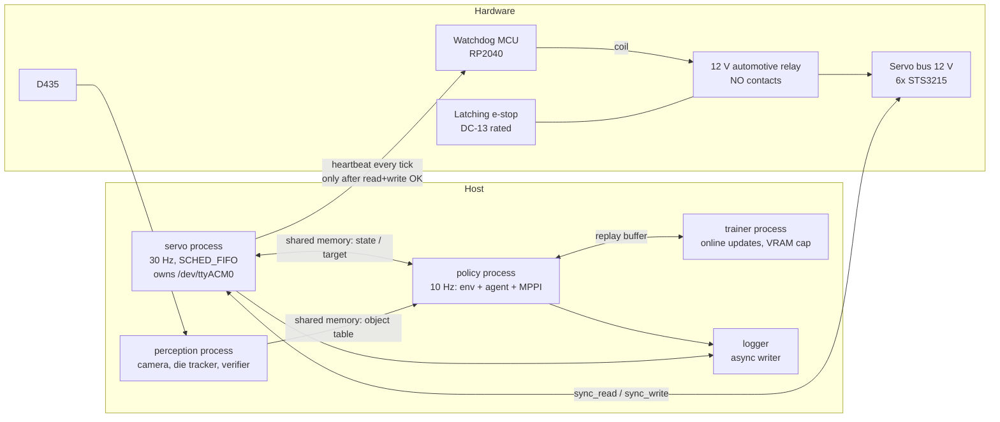

# SO-101 Self-Learning RL — Architecture

> **Status:** v0.2 (2026-09-30). This describes the *target* architecture for Stage A. Wave 0 is implemented: the package skeleton, the pixi environments, `config/`, the shared-memory primitive (`servo/shm.py`), the bus/timing/safety-type contracts, the vendored TD-MPC2 and the SO-101 MJCF assets. Everything else is still a frozen interface only.
> **Source of truth for decisions:** `so101-self-learning-rl-plan.md` §10 (decision log). This doc describes *how* the system is built; the plan describes *what* and *why*.
> **Keeping it current:** every change that adds, removes or renames a module, a process, or a cross-process interface updates this file in the same commit. See §10 at the bottom of this file.

## 1. Purpose and scope

The system is a goal-conditioned, RL-driven manipulation stack for one SO-101 arm, one fixed RealSense D435 and one RTX 3080 (10 GB). It is packaged as a single pixi package, `so101_rl`.

It goes through three stages (plan §1):

| Stage | Scope |
|---|---|
| **A: Research** | This version of the architecture. Covers the safety layer, the die tracker, the world model, and reach with SAC + HER and TD-MPC2 + HER. |
| B: Demo | Grasp, transport and release, plus the SAM2 / Grounding DINO perception and the LLM task planner. |
| C: Platform | A learned task policy and per-skill adapters. |

Everything marked *(Stage B)* or *(Stage C)* below is a placeholder. It is not built in Stage A.

## 2. Layered view

```
            Command ("move die to zone")
                      │
   ┌──────────────────▼──────────────────┐
   │ TASK LEVEL            (Stage B/C)   │  LLM planner (API) → skill sequence
   └──────────────────┬──────────────────┘
                      │ skill id + goal params
   ┌──────────────────▼──────────────────┐
   │ SKILL LEVEL                         │  goal-conditioned RL policies
   │ reach (A) · grasp/transport/        │  SAC+HER (baseline) · TD-MPC2+HER (main)
   │ release/push (B)                    │
   └──────────────────┬──────────────────┘
                      │ joint-delta action @ 10 Hz
   ┌──────────────────▼──────────────────┐
   │ SAFETY LAYER (policy-independent)   │  clamp → tracking-error clamp → limits →
   │                                     │  thermal → safe-state → deadman heartbeat
   └──────────────────┬──────────────────┘
                      │ absolute Goal_Position @ 30 Hz
   ┌──────────────────▼──────────────────┐
   │ MOTOR LEVEL                         │  world model (state first; pixels in parallel)
   └──────────────────┬──────────────────┘
                      │
         Feetech bus (6× STS3215, 1 Mbps)  ── 12 V via watchdog relay
```

Perception runs alongside all the layers. It supplies the object table, the success verifier and the reward terms.

## 3. Process view (runtime)

The load-bearing design rule is that the **safety-critical loop is its own OS process** and owns the serial port. Python's GIL would otherwise let MPPI planning and the camera starve the safety tick.



| Process | Rate | Owns | Must never |
|---|---|---|---|
| `servo` | 30 Hz, absolute-deadline, SCHED_FIFO, `gc.freeze()` | Serial port, the heartbeat, every safety check, the delta→absolute conversion | Allocate per tick, block on the policy, extrapolate a stale target |
| `policy` | 10 Hz | Gym env, agent inference, MPPI planning | Talk to the bus directly |
| `perception` | ≥ 5 Hz (Stage A colour tracker: 30 Hz) | Camera, object table, success verifier, camera-moved fiducial check | Share a CUDA context with training without a memory cap |
| `trainer` | Asynchronous | Gradient updates, checkpoints | Exceed its per-process VRAM fraction |
| watchdog MCU | 1 s timeout | Relay coil | Close the relay without heartbeat pulses. After a trip, only a physical reset re-closes it. |

**When the policy is late:** the servo process holds the last target. After N consecutive misses it trips to the safe state.

## 4. Module view (package layout)

```
rl-trainer/
├── pyproject.toml                # [project] + [tool.pixi]: features sim/perception/train/gpu/cpu, envs default/cpu/robot
├── pixi.lock
├── README.md                     # environment verdict (solved versions), entry points
├── so101-self-learning-rl-plan.md
├── docs/ARCHITECTURE.md          # this file
├── plans/                        # implementation plans per phase
├── scripts/                      # fetch_assets.py, extract_kinematics.py, vendor_tdmpc2.py (reproducible generators)
├── assets/so101/                 # official TheRobotStudio MJCF (+ licence), jaw primitives, keyframes
│   └── upstream/                 # fetched unmodified at a pinned commit (UPSTREAM.json holds sha + sha256 per file)
├── calib/                        # hand_eye.yaml, fiducial.yaml (committed artifacts)
├── firmware/watchdog_mcu/        # heartbeat deadman firmware
├── src/so101_rl/
│   ├── config/                   # single source of truth: so101.yaml, schema.py, loader.py, so101_kinematics.yaml (FK chain, generated from the MJCF)
│   ├── servo/                    # servo process, bus backends (real Feetech + fake), timing, shm protocol
│   ├── safety/                   # clamps, limits, thermal, safe-state, resume policy, calib check
│   ├── env/                      # goal-conditioned Gym env (sim + real backends, same interface)
│   ├── perception/               # D435 capture, colour+depth die tracker, verifier, fiducial check
│   ├── sim/                      # MuJoCo backend, action-delay model, domain randomization
│   ├── wm/                       # world models: state (Stage A), pixel fused encoder (parallel track)
│   ├── rl/                       # SAC+HER baseline (SB3), TD-MPC2+HER wrapper, HER relabel, toy_env, smoke_tdmpc2
│   ├── logging/                  # episode logger (applied action), artifact checks
│   └── _vendor/tdmpc2/           # vendored TD-MPC2 (MIT, LICENSE kept; PATCHES.md + UPSTREAM.json generated by scripts/vendor_tdmpc2.py)
└── tests/                        # pytest; hardware tests marked and skipped without the arm; tests/data holds the calibration copy
```

**Dependency direction** (the arrows point at what a module may import; nothing imports upward):

```
rl, wm ──► env ──► servo(shm client) , perception(shm client)
env ──► sim            safety ◄── servo
all ──► config, logging
```

`safety` has no dependency on `rl`, `wm` or `env`. That is what "policy-independent" means in the code.

## 5. Key interfaces (Stage A)

The exact signatures are frozen in `plans/phase0-implementation-plan.md` ("Frozen Interfaces": F1 config, F2 bus, F3 shared memory, F4 heartbeat, F5 safety, F6 servo core, F7 env, F8 logging, F9 perception, F10 sim, F11 rl/wm). This section only gives their shape. Implemented so far: F1 (`config/`), F2's `Bus`/`BlockRead` (`servo/bus.py`), F3 (`servo/shm.py`, including `LocalIpc`), the F6 clocks (`servo/timing.py`) and the F5 enums and `Verdict` (`safety/types.py`).

One deviation from the frozen text: F3 asserts `STATE_DTYPE.itemsize == 192`, but the listed fields need 232 bytes with natural alignment. The fields are kept as specified; the state block stride is 256 B (64-byte aligned) and the shm segment is 384 B (`servo/shm.py`).

| Interface | Between | Shape |
|---|---|---|
| Joint-state / target shared memory | servo ↔ policy | A seqlock'd struct holding the timestamp, positions, speeds, loads, temperatures, voltage and status bits, plus the latest target and its sequence number |
| Object table shared memory | perception → policy | Per object: label, 3D centroid (base frame), confidence, visibility flag and timestamp |
| Env | policy ↔ agent | Gymnasium goal-env with `Dict(observation, achieved_goal, desired_goal)` observations and **joint-delta** actions (delta on the last target) |
| Safety verdict | inside servo | `apply(action, state) -> (applied_target, trips[])`. Only the *applied* target is logged. |
| Verifier | perception → env | Per skill, one of `SUCCESS \| FAILURE \| UNKNOWN`. It returns UNKNOWN whenever the die is occluded. |
| Episode record | env → logger | Observations, the **applied** action, reward, verifier verdict, trips, and the `truncated` flag |

## 6. Safety architecture

These are ordered from the outermost layer to the innermost.

1. **Hardware (independent of all software).**
   - A latching e-stop and the watchdog MCU's relay, both in the 12 V feed.
   - A TVS diode across the bus.
   - A PSU of at least 8–10 A.
2. **Deadman.**
   - The servo process pulses the heartbeat each tick, but only after a successful read and write.
   - The MCU opens the relay if the pulses stop for 1 s.
3. **Servo-process checks, every tick.** They run in this order:
   - a NaN or range check, rejected before serialisation (0 ≤ goal ≤ 4095);
   - a per-step delta clamp;
   - the tracking-error clamp |target − present| ≤ E;
   - the joint limits and the Cartesian box, through FK;
   - the thermal trip (60 °C, resume at 50 °C or below);
   - the firmware protection bits;
   - the stuck-action monitor.
4. **Safe-state sequence, bounded to 5 s.**
   - It ramps home, rests the arm in a gravity-stable pose, then turns torque off.
   - If it cannot finish, it falls back to torque-off in place, then to the deadman.
   - All process exits go through it.
5. **Resume policy, by cause.**

   | Cause | Resume |
   |---|---|
   | Thermal | Automatic after cooldown, with at most 3 per hour |
   | NaN, stuck action, OOD | A fresh process and a checkpoint, or a human |
   | Deadman or e-stop | A human and a physical reset |

   On every re-energise: wait for all 6 IDs, run the calibration read-back, write goal = present, then enable torque.
6. **Autonomy tiers.**
   - Tier 0 is attended.
   - Tier 1 is unattended, and is allowed only after the soak gates pass: 30 minutes, then 2 hours goal-directed, with p99.9 tick overrun below 5 ms.

## 7. Data and learning flow (Stage A)

```
goal babbling ──► episode logger ──► replay buffer (RAM; ≤300k pixel steps)
                                         │
             state WM  ◄─────────────────┤
             SAC+HER (SB3 HerReplayBuffer)◄┤   ← first on real arm
             TD-MPC2+HER (vendored, relabel in _prepare_batch) ◄┘
                                         │
                   MuJoCo reach ≥90% gate before any real-arm episode
```

- **Reward and success** come from the object table and FK, never from pixels.
- **The pixel world model** is a parallel track, with a fused RGB-conv and state-MLP encoder feeding SimNorm. It may drive MPPI on the real arm only after it passes the cross-session gate: a different day, under different lighting.

## 8. Packaging and environments

| Pixi feature | Contents | Used by |
|---|---|---|
| core (default deps) | python 3.12, numpy 2.2, conda `pytorch` + torchvision (variant chosen by `gpu`/`cpu`), lerobot[feetech,grpcio-dep] 0.6.1 (PyPI), gymnasium, h5py, pyyaml, pytest, hypothesis, ruff | servo, safety, env |
| `sim` | mujoco-python (conda-forge) | sim, tests |
| `perception` | opencv (conda-forge), pyrealsense2 (PyPI) | perception |
| `train` | torchrl, tensordict, stable-baselines3, hydra-core, omegaconf, termcolor, pandas (PyPI) | rl, wm |
| `gpu` | `pytorch-gpu`, `cuda-version` 12.8 (re-pin to the driver's CUDA after H1) | training on the RTX 3080 |
| `cpu` | `pytorch-cpu` | CI, driver-less hosts, all Phase 0 acceptance |

| Environment | Features | Purpose |
|---|---|---|
| `default` | sim, perception, train, gpu | Training host (locked, but not installable while the NVIDIA driver is down) |
| `cpu` | sim, perception, train, cpu | Tests and smoke runs everywhere |
| `robot` | perception, cpu | Servo host process: no GPU stack beyond what lerobot imports |

- **Channels:** only conda-forge for torch and CUDA, and PyPI for lerobot, pyrealsense2 and the train stack. There is exactly one torch, the conda `pytorch` (`tests/test_env_sanity.py` enforces it).
- **Solver pins** (so pixi's PyPI resolver accepts lerobot 0.6.1 on top of the conda solve): `setuptools<82`, `packaging<26`, `opencv<4.14`, `gymnasium<1.3`; `[tool.pixi.system-requirements] cuda = "12"` lets the `default` environment lock without a driver; `PYTHONNOUSERSITE=1` is set on activation so `~/.local` packages never leak in. Solved versions are recorded in `README.md`.
- **Tasks:** every entry point is a `pixi run` task: `test`, `test-hw`, `lint`, `ci`, `smoke-tdmpc2`, `fetch-assets`, `extract-kinematics`, `servo`, `servo-fake`, `soak`, `calib-check`, `hand-eye`, `random-policy-sim`, `random-policy-real`, `train-reach-sac`, `train-reach-tdmpc2`, `train-wm-state`, `check-milestone`. Tasks whose module a later unit creates fail until that unit lands.

## 9. Architecture decisions (summary)

The full log is in plan §10. The decisions that shape this architecture are:

- pure Python, with no ROS2;
- a separate real-time servo process;
- clamped joint deltas at 10 Hz;
- MuJoCo with the official MJCF;
- TD-MPC2 vendored, with a SAC + HER baseline run first;
- a colour + depth tracker in Stage A;
- a pixel world model, off the critical path;
- tiered autonomy with a hardware deadman;
- a single pixi package.

## 10. Maintenance rule

Update this document in the **same change** as any of the following:

- a module is added, removed or renamed under `src/so101_rl/`;
- a process, a rate or a cross-process interface changes (§3, §5);
- a safety check changes, or the order of the checks changes (§6);
- a pixi feature, channel or task set changes (§8);
- a new §10 decision in the plan affects any section here.

Bump the version line at the top and add an entry below.

| Version | Date | Change |
|---|---|---|
| 0.1 | 2026-09-30 | First version, derived from plan v2 |
| 0.2 | 2026-09-30 | Wave 0 (U0): pixi features/environments/tasks and solver pins (§8), `scripts/`, `assets/so101/upstream/`, `config/so101_kinematics.yaml` and `tests/data` (§4), links to the plan's F-sections and the F3 state-size deviation (§5) |
