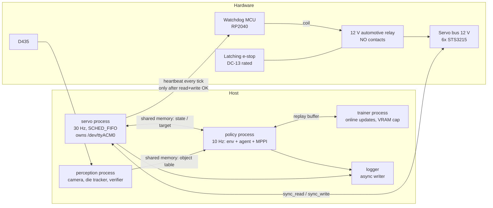

# SO-101 Self-Learning RL — Architecture

> **Status:** v0.6 (2026-10-01). This describes the *target* architecture for Stage A. **Implemented so far:**
> - *Wave 0:* the package skeleton, the pixi environments, `config/`, the shared-memory primitive, the bus, timing and safety-type contracts, the vendored TD-MPC2 and the MJCF assets.
> - *Wave 1:* the servo backends and heartbeat link (U1), the safety layer (U2), the MuJoCo backend (U4), Stage A perception (U5), episode logging (U6), and the watchdog firmware with the hardware checklist (U7).
>
> **Still interface-only:** the servo core and process (U3), the env (U8), and the RL and world-model code (U9).
> **Source of truth for decisions:** `so101-self-learning-rl-plan.md` §10 (decision log). This doc describes *how* the system is built; the plan describes *what* and *why*.
> **Keeping it current:** every change that adds, removes or renames a module, a process, or a cross-process interface updates this file in the same commit. See §10 at the bottom of this file.

## 1. Purpose and scope

The system is a goal-conditioned, RL-driven manipulation stack for one SO-101 arm, one fixed RealSense D435 and one RTX 3080 (10 GB). It is packaged as a single pixi package, `so101_rl`.

It goes through three stages (plan §1):

| Stage | Scope |
|---|---|
| **A: Research** | This version of the architecture. Covers the safety layer, the die tracker, the world model, and reach with SAC + HER and TD-MPC2 + HER. |
| B: Demo | Grasp, transport and release, plus the SAM2 / Grounding DINO perception and the LLM task planner. |
| C: Platform | A learned task policy and per-skill adapters. |

Everything marked *(Stage B)* or *(Stage C)* below is a placeholder. It is not built in Stage A.

## 2. Layered view

```
            Command ("move die to zone")
                      │
   ┌──────────────────▼──────────────────┐
   │ TASK LEVEL            (Stage B/C)   │  LLM planner (API) → skill sequence
   └──────────────────┬──────────────────┘
                      │ skill id + goal params
   ┌──────────────────▼──────────────────┐
   │ SKILL LEVEL                         │  goal-conditioned RL policies
   │ reach (A) · grasp/transport/        │  SAC+HER (baseline) · TD-MPC2+HER (main)
   │ release/push (B)                    │
   └──────────────────┬──────────────────┘
                      │ joint-delta action @ 10 Hz
   ┌──────────────────▼──────────────────┐
   │ SAFETY LAYER (policy-independent)   │  clamp → tracking-error clamp → limits →
   │                                     │  thermal → safe-state → deadman heartbeat
   └──────────────────┬──────────────────┘
                      │ absolute Goal_Position @ 30 Hz
   ┌──────────────────▼──────────────────┐
   │ MOTOR LEVEL                         │  world model (state first; pixels in parallel)
   └──────────────────┬──────────────────┘
                      │
         Feetech bus (6× STS3215, 1 Mbps)  ── 12 V via watchdog relay
```

Perception runs alongside all the layers. It supplies the object table, the success verifier and the reward terms.

## 3. Process view (runtime)

The load-bearing design rule is that the **safety-critical loop is its own OS process** and owns the serial port. Python's GIL would otherwise let MPPI planning and the camera starve the safety tick.



| Process | Rate | Owns | Must never |
|---|---|---|---|
| `servo` | 30 Hz, absolute-deadline, SCHED_FIFO, `gc.freeze()` | Serial port, the heartbeat, every safety check, the delta→absolute conversion | Allocate per tick, block on the policy, extrapolate a stale target |
| `policy` | 10 Hz | Gym env, agent inference, MPPI planning | Talk to the bus directly |
| `perception` | ≥ 5 Hz (Stage A colour tracker: 30 Hz) | Camera, object table, success verifier, camera-moved fiducial check | Share a CUDA context with training without a memory cap |
| `trainer` | Asynchronous | Gradient updates, checkpoints | Exceed its per-process VRAM fraction |
| watchdog MCU | 1 s timeout | Relay coil | Close the relay without heartbeat pulses. After a trip, only a physical reset re-closes it. |

**When the policy is late:** the servo process holds the last target. After N consecutive misses it trips to the safe state.

## 4. Module view (package layout)

```
rl-trainer/
├── pyproject.toml                # [project] + [tool.pixi]: features sim/perception/train/gpu/cpu, envs default/cpu/robot
├── pixi.lock
├── README.md                     # environment verdict (solved versions), entry points
├── so101-self-learning-rl-plan.md
├── docs/ARCHITECTURE.md          # this file
├── plans/                        # implementation plans per phase
├── scripts/                      # fetch_assets.py, extract_kinematics.py, vendor_tdmpc2.py (reproducible generators)
├── assets/so101/                 # official TheRobotStudio MJCF (+ licence), jaw primitives, keyframes
│   └── upstream/                 # fetched unmodified at a pinned commit (UPSTREAM.json holds sha + sha256 per file)
├── calib/                        # hand_eye.yaml, fiducial.yaml (committed artifacts)
├── firmware/watchdog_mcu/        # deadman watchdog. main.py: MicroPython, RP2040, a pure-logic Core plus hardware glue.
│                                 # PROTOCOL.md: the F4 wire protocol. test_vectors.json: shared by the host tests, FakeMcu and the real MCU (H3).
├── docs/HARDWARE_CHECKLIST.md    # procedures for H1–H13, BOM, power-path wiring, results table
├── src/so101_rl/
│   ├── config/                   # single source of truth: so101.yaml, schema.py, loader.py, so101_kinematics.yaml (FK chain, generated from the MJCF)
│   ├── servo/                    # servo process (U3); bus backends:
│   │                             #   feetech_bus.py: real STS3215
│   │                             #   fake_bus.py: plant, thermal and fault injection
│   │                             # heartbeat.py: MCU link + FakeMcu; timing; shm
│   ├── safety/                   # clamp, fk (pure-numpy FK + box), transit (rest<->home transit-zone planner), config_check (safe-state geometry/time-bound validation), thermal, stuck, safe_state, reenergize,
│   │                             # calib_check, state_machine, pipeline. Never imports rl, wm or env.
│   ├── env/                      # goal-conditioned Gym env (sim + real backends, same interface)
│   ├── perception/               # camera (D435 by serial, FakeCamera), die_tracker (HSV + depth, None when occluded),
│   │                             # frames (Umeyama hand-eye), fiducial (ArUco camera-moved gate), object_table (shm),
│   │                             # calibrate_hand_eye (driver)
│   ├── sim/                      # model (load_model via MjSpec, primitive jaw geoms), mujoco_bus (the F2 Bus on MuJoCo,
│   │                             # with action delay), gripper_map (0–100 % <-> rad <-> ticks), compare_real (sysid check);
│   │                             # domain randomization comes later
│   ├── wm/                       # world models: state (Stage A), pixel fused encoder (parallel track)
│   ├── rl/                       # SAC+HER baseline (SB3), TD-MPC2+HER wrapper, HER relabel, toy_env, smoke_tdmpc2
│   ├── logging/                  # schema, episode_logger (HDF5, atomic .tmp -> rename, applied action),
│   │                             # checks (artifact gates, prune, disk budget), ring_writer (preallocated tick log)
│   └── _vendor/tdmpc2/           # vendored TD-MPC2 (MIT, LICENSE kept; PATCHES.md + UPSTREAM.json generated by scripts/vendor_tdmpc2.py)
└── tests/                        # pytest; hardware tests marked and skipped without the arm; tests/data holds the calibration copy
```

**Dependency direction** (the arrows point at what a module may import; nothing imports upward):

```
rl, wm ──► env ──► servo(shm client) , perception(shm client)
env ──► sim            safety ◄── servo
all ──► config, logging
```

`safety` has no dependency on `rl`, `wm` or `env`. That is what "policy-independent" means in the code.

## 5. Key interfaces (Stage A)

The exact signatures are frozen in `plans/phase0-implementation-plan.md` ("Frozen Interfaces": F1 config, F2 bus, F3 shared memory, F4 heartbeat, F5 safety, F6 servo core, F7 env, F8 logging, F9 perception, F10 sim, F11 rl/wm). This section only gives their shape. Implemented so far: F1 (`config/`), F2's `Bus`/`BlockRead` (`servo/bus.py`), F3 (`servo/shm.py`, including `LocalIpc`), the F6 clocks (`servo/timing.py`) and the F5 enums and `Verdict` (`safety/types.py`). Wave 1 added the F2 backends, F4, F5 in full, F8, F9 and F10. The rest of this section records how they behave.

**Bus (U1).**
- `FeetechBus.read_block` issues **one** 11-byte `GroupSyncRead` at address 56 (position, speed, load, voltage, temperature, the unused byte 64, Status 65, Moving 66). The firmware protection bits are therefore checked every tick.
- On any communication error, `ok=False` and the arrays keep their previous values.
- `disconnect()` never touches torque.
- `write_registers()` writes every F1 register, including the protection registers LeRobot never writes. It refuses to run while torque is on.
- `Bus` is `@runtime_checkable`.

**Safety (U2).**
- `SafetyPipeline.apply` runs only in RUN. In every other state (HOLD, SAFE_STOPPING, TORQUE_OFF) the core must call `monitor_only(block, v)` every tick, so the thermal dwell keeps advancing.
- Call `resync(present)` when `SmOutputs.resync_target` is set.
- When `SmOutputs.reenergize_requested` is set, run `reenergize(..., tick_hook=hb)`. Then call `mark_energized()` if it succeeded, or `notify_reenergize_failed()` if it failed.
- `reenergize(bus, cfg, calibration, clock, block, *, timeout_s=5.0, tick_hook=None, heartbeat_gap_s=0.8, fk=None)`.
  - It calls `tick_hook(ok)` once per servo tick, with ok = the read succeeded AND the write was accepted. The core sends the heartbeat only when ok is true.
  - With a hook, the first good tick and every later one must come within 0.8 s.
  - It raises `UnsafeStartPose` if the start pose is neither within `rest_tolerance_ticks` of rest nor inside the box.
- `SafeStateSequencer(cfg, clock, *, tracking_error_ticks, motor_ids, fk)` has no defaults: all three arguments are required, so none of its protections can be dropped silently. `run(bus, block, *, servo_hz, tick_hook)` is the blocking driver used for shutdown.
- **Box tolerance:** BOX_PRESENT trips only when the present pose is more than `box.present_tolerance_m` (5 mm) outside the box. The commanded target is clamped to the exact box.
- **Calibration check:** `calib_check` does not compare `drive_mode`, because no servo register holds it. A motion-sign test is needed instead, on the hardware track or in U3.
- **In TORQUE_OFF** the core keeps writing goal = present and keeps sending the heartbeat. Otherwise the MCU would latch during the thermal dwell and the automatic resume would need a human.
- **Further obligations on the servo core (U3)**, found in the 2026-10-01 verification review:
  - Reset `consecutive_misses` after `mark_energized()`.
  - Do not feed `McuStatus.latched` into the state machine until the button has been pressed and ARM has succeeded, because the MCU boots latched.
  - Send a heartbeat immediately before calling `reenergize`, because `heartbeat_gap_s` is measured from when it is entered.
- **Hardware risk (H-track):** the register phase of re-energise is about 132 single-register transactions, and it must fit the 0.8 s pre-torque heartbeat budget over USB serial. Measure it. If it doesn't fit, switch to `sync_write` / `sync_read`.
- `So101FK(chain, calibration)` needs the calibration, or the `drive_mode` signs default to +1.
- The stuck monitor is fed the sanitized *commanded* delta, because under anti-windup the post-clamp delta of a blocked joint decays to 0.
- **Rest and home poses.** Both are marked NEEDS H5.
  - *rest* is the gravity-stable pose measured on 2026-09-30: [2050, 2200, 2301, 2745, 2040, 2065], tip at z = −0.012 m.
  - *home* is an in-box placeholder: [2047, 960, 2700, 2748, 2047, 2047], tip at (0.20, 0, 0.15).
- **What `safety.config_check.validate_geometry(cfg, calibration, chain)` checks.** `load_config` does not run these checks, because `config` must not import `safety`, and an AST test enforces that. **The servo entry point (U3) must call it before building the safety stack.**
  - FK(home) is at least 10 mm inside the box.
  - FK(rest) is at least 5 mm above the table and inside the box's x/y footprint. This approximates "clear of the D435", because the camera mount pose is not in the config.
  - Replaying the exact rest-to-home and home-to-rest transits tick by tick never takes the tip below the table plus 5 mm.
  - `bound_s` is at least the worst limit-to-home time plus the home-to-rest time plus 1 s. That is 15.33 s for the shipped calibration, and 19.23 s for a full 0..4095 range.
  - The loader itself checks only that `-0.2 m ≤ table_z_m < box.z[0]`.
  - The replay assumes the arm follows perfectly. At run time the time bounds end any stall with torque off.

**Sim (U4).**
- `load_model()` compiles `so101_rl_scene.xml` through `MjSpec`. It adds primitive jaw box geoms and a `gripper_tip` site, and disables collisions on the jaw meshes.
- `MujocoBus` implements `Bus` using the real calibration.
  - **Registers:** `Present_Position`, `Goal_Position`, `Torque_Enable`, `Present_Temperature` and `Present_Voltage` are live. Every other register is stored and read back.
  - **Limits and signs:** `write_goal` clips to the Min/Max_Position_Limit registers, and the reported velocity follows the `drive_mode` sign.
  - **Torque:** it starts **de-energised**, like FakeBus and the real arm. `reset_to_keyframe` energises the bus.
  - **Unstable simulation:** `step_ticks` raises `RuntimeError` if MuJoCo reports a non-finite state, instead of resetting silently.
  - **Keyframes:** the scene's `rest` and `home` keyframes follow the config ticks.
- `reenergize` is tested end to end on FakeBus and on MujocoBus (`tests/test_reenergize_backends.py`).
- The gripper uses its own linear map between the calibration `range_min`/`range_max` and the MJCF joint range.
- `so101_rl.sim` re-exports lazily, so importing it does not load `mujoco`.

**Perception (U5).**
- The object table is one seqlock'd `OBJECT_TABLE_DTYPE` record in its own shm segment. Perception creates it, and the env attaches read-only.
- `HsvDepthDieTracker.detect` returns None when the die is not reliably visible, and the verifier maps that to UNKNOWN.
- `load_hand_eye` refuses a residual above 3 mm, or fewer than 10 poses.

**Logging (U6).**
- There is one HDF5 file per episode. It is written as `.h5.tmp`, then fsynced and renamed.
- `applied_delta_ticks` (after clamping) is stored next to `action_cmd`.
- Every `check_episode` gate has a test that fails it on a deliberately broken file.

**Log convention (binding for U3).** `present_ticks[i]` is the reading taken **after** `target_ticks[i]` was applied for one policy step, which is `servo_hz / policy_hz` servo ticks. `sim.compare_real` depends on this.

F3 originally asserted `STATE_DTYPE.itemsize == 192`; the listed fields need 232 bytes with natural alignment, and the plan now says 232. The state block stride is 256 B (64-byte aligned) and the shm segment is 384 B (`servo/shm.py`).

Tick/angle conversion: `ticks_to_rad` / `rad_to_ticks` (`config/schema.py`) do **not** apply `homing_offset`. The STS3215 firmware applies the homing offset itself, so `Present_Position` and `Goal_Position` are already in the homed frame (mid-range of motion reads about 2047 for the arm joints). The calibration `homing_offset` is only read back and compared at connect (`CalibrationMismatch`, plan 2.4); `drive_mode` selects the sign. The gripper is not mid-range-centred; its 0-100 % mapping lives in `sim/` and uses the calibration `range_min/max`.

Config loading is strict (`config/loader.py`): unknown or missing keys in any section are errors, there are no hidden defaults, integer fields reject bools, strings and non-integral floats, and safety-relevant values (timeouts, velocity caps, STS3215 register values) are range-checked.

| Interface | Between | Shape |
|---|---|---|
| Joint-state / target shared memory | servo ↔ policy | A seqlock'd struct holding the timestamp, positions, speeds, loads, temperatures, voltage and status bits, plus the latest target and its sequence number |
| Object table shared memory | perception → policy | Per object: label, 3D centroid (base frame), confidence, visibility flag and timestamp |
| Env | policy ↔ agent | Gymnasium goal-env with `Dict(observation, achieved_goal, desired_goal)` observations and **joint-delta** actions (delta on the last target) |
| Safety verdict | inside servo | `apply(action, state) -> (applied_target, trips[])`. Only the *applied* target is logged. |
| Verifier | perception → env | Per skill, one of `SUCCESS \| FAILURE \| UNKNOWN`. It returns UNKNOWN whenever the die is occluded. |
| Episode record | env → logger | Observations, the **applied** action, reward, verifier verdict, trips, and the `truncated` flag |

## 6. Safety architecture

These are ordered from the outermost layer to the innermost.

1. **Hardware (independent of all software).**
   - A latching e-stop and the watchdog MCU's relay, both in the 12 V feed.
   - A TVS diode across the bus.
   - A PSU of at least 8–10 A.
2. **Deadman.**
   - The servo process pulses the heartbeat each tick, but only after a successful read and write.
   - The MCU opens the relay if the pulses stop for 1 s.
   - **Wire protocol (F4):**
     - Commands: ARM `0x5A`; HEARTBEAT `0xA5 seq ~seq`; STATUS_REQ `0xE0`; TEST_DROP `0xE1`.
     - Each complete frame gets one status byte back: bit0 relay, bit1 latched, bit2 armed, bit3 undervolt, bits4–7 reason.
     - The first heartbeat after ARM sets the sequence baseline, and every later one must be +1 mod 256.
     - A gap, a repeated seq or a bad complement latches the MCU with reason 3.
     - The MCU **boots LATCHED** with reason 6 (MCU_RESET) after every reset, whether from power, the hardware WDT or USB re-enumeration (status `0x62`). Only the physical button re-enables power.
     - Trip reasons:

       | Code | Reason |
       |---|---|
       | 1 | TIMEOUT (≥ 1000 ms) |
       | 2 | UNDERVOLT |
       | 3 | SEQ_ERROR |
       | 4 | ESTOP_PIN |
       | 5 | TEST |
       | 6 | MCU_RESET |
       | 7 | WELD |
     - A partial heartbeat frame is dropped after 100 ms.
     - The spec is `firmware/watchdog_mcu/PROTOCOL.md`. `FakeMcu` is kept byte-identical to the firmware `Core` by replaying every test vector through both.
   - **Voltage sensing (two dividers):**
     - The PSU-side divider sits before the e-stop and relay (GP26). It gates ARM on undervoltage.
     - The servo-side divider sits after the relay (GP27). It is used for drop timing, and for a "bus dead" check before ARM.
     - It also detects a welded relay: if the relay is commanded open but the servo side reads at least 1 V for 500 ms, the MCU latches with reason 7 (WELD).
   - **Host link:** `SerialHeartbeatLink.send` never raises. Any serial failure, such as a USB unplug, returns False and sets `dead`. A refused TEST_DROP raises `TestDropRefused` immediately.
   - **Latching:**
     - Trips latch in the MCU. Only the physical reset button, held for 500 ms and not while the e-stop is asserted, clears them. Serial never can.
     - The e-stop input is wired through an NC contact, so a broken wire reads as asserted.
     - The hardware WDT is 250 ms, so an MCU hang opens the relay.
3. **Servo-process checks, every tick.** This is the order as implemented in `safety/pipeline.py`:
   1. NaN sanitisation and the per-command delta clamp, both on each new command at 10 Hz.
   2. Interpolation over 3 ticks, then the joint limits, then the per-tick velocity cap, then the tracking-error clamp |target − present| ≤ E. The tracking-error clamp pulls the stored goal back, so a blocked joint cannot wind up.
   3. The Cartesian box, through FK of the target:
      - **BOX** (the commanded target is outside) is a clamp that reverts to the previous target.
      - **BOX_PRESENT** (the present position is outside) is a trip.
   4. The thermal trip:
      - It fires at 60 °C or above and latches once.
      - Resuming needs 50 °C or below for 30 s.
      - A temperature reading older than 1 s, or a raw value of 0 or 255, is also a trip.
   5. The firmware protection bits: any non-zero `Status` is a trip.
   6. The stuck-action monitor.
   7. `check_range` (integer dtype, 0..4095), always the last call before `write_goal`.

   Clamps (TRACKING, JOINT_LIMIT, BOX) never change the state-machine state.
4. **Safe-state sequence, bounded by `bound_s` (20 s).**
   - The user decided on 2026-10-01 to keep the slow 240 ticks/s ramp. `validate_geometry` computes the minimum `bound_s` from the calibration: 15.33 s for the shipped calibration.
   - The sequence ramps home, then to the gravity-stable rest pose, through the transit zone (`safety/transit.py`):
     - it lifts first;
     - the target tip never goes below the table plus 5 mm;
     - otherwise it holds.
   - It then turns torque off.
   - If it cannot finish, it falls back to torque-off in place, then to the deadman.
   - The heartbeat continues through `tick_hook`.
   - A refused torque-off (3 attempts) raises.
   - All process exits go through it.
5. **Resume policy, by cause.**

   | Cause | State path | Resume |
   |---|---|---|
   | Thermal | RUN/HOLD → SAFE_STOPPING (to rest) → TORQUE_OFF → after the dwell → CHECK (`reenergize_requested`) → full `reenergize` → RUN (resync on a good read). It never holds pose energised; COOLDOWN is unused (decided 2026-10-01). | Automatic, at most 3 per hour, counted by the state machine. A 4th trip, or a failed re-energise, needs a human. |
   | NaN, stuck action, OOD, RANGE, BOX_PRESENT, N stale commands | → SAFE_STOPPING → TORQUE_OFF | A fresh process and a checkpoint |
   | Protection bit, calibration mismatch, user stop | → SAFE_STOPPING → TORQUE_OFF | A human |
   | Heartbeat failure, MCU latched, deadman, 3 consecutive bus failures | → LATCHED (absorbing) | A human and a physical reset |

   - Every resume requires `block_ok`.
   - LATCHED and TORQUE_OFF send torque-off every tick.

   **Re-energise order** (`safety/reenergize.py`):
   1. `ping_all`
   2. calibration registers
   3. Lock = 0, check that Torque_Enable == 0, write every register, then read every register back
   4. a block read. The start pose must be near rest or inside the box, temperatures below the trip and not 0 or 255, and Status 0.
   5. goal = present (this is the first heartbeat tick)
   6. read back Goal_Position
   7. `set_torque(True)`
   8. ramp home through the transit zone, re-checking temperatures on every read

   Any failure after torque is on turns torque off (3 attempts), then re-raises.
6. **Autonomy tiers.**
   - Tier 0 is attended.
   - Tier 1 is unattended, and is allowed only after the soak gates pass: 30 minutes, then 2 hours goal-directed, with p99.9 tick overrun below 5 ms.

## 7. Data and learning flow (Stage A)

```
goal babbling ──► episode logger ──► replay buffer (RAM; ≤300k pixel steps)
                                         │
             state WM  ◄─────────────────┤
             SAC+HER (SB3 HerReplayBuffer)◄┤   ← first on real arm
             TD-MPC2+HER (vendored, relabel in _prepare_batch) ◄┘
                                         │
                   MuJoCo reach ≥90% gate before any real-arm episode
```

**Sysid** fitting is a parallel track. Phase 0 only *checks* the error: `pixi run compare-real` must stay within 5 % RMS of each joint's range.

- **Reward and success** come from the object table and FK, never from pixels.
- **The pixel world model** is a parallel track, with a fused RGB-conv and state-MLP encoder feeding SimNorm. It may drive MPPI on the real arm only after it passes the cross-session gate: a different day, under different lighting.

## 8. Packaging and environments

| Pixi feature | Contents | Used by |
|---|---|---|
| core (default deps) | python 3.12, numpy 2.2, conda `pytorch` + torchvision (variant chosen by `gpu`/`cpu`), lerobot[feetech,grpcio-dep] 0.6.1 (PyPI), gymnasium, h5py, pyyaml, pytest, hypothesis, ruff | servo, safety, env |
| `sim` | mujoco-python (conda-forge) | sim, tests |
| `perception` | opencv (conda-forge), pyrealsense2 (PyPI) | perception |
| `train` | torchrl, tensordict, stable-baselines3, hydra-core, omegaconf, termcolor, pandas (PyPI) | rl, wm |
| `gpu` | `pytorch-gpu`, `cuda-version` 12.8 (re-pin to the driver's CUDA after H1) | training on the RTX 3080 |
| `cpu` | `pytorch-cpu` | CI, driver-less hosts, all Phase 0 acceptance |

| Environment | Features | Purpose |
|---|---|---|
| `default` | sim, perception, train, gpu | Training host (locked, but not installable while the NVIDIA driver is down) |
| `cpu` | sim, perception, train, cpu | Tests and smoke runs everywhere |
| `robot` | perception, cpu | Servo host process: no GPU stack beyond what lerobot imports |

- **Channels:** only conda-forge for torch and CUDA, and PyPI for lerobot, pyrealsense2 and the train stack. There is exactly one torch, the conda `pytorch` (`tests/test_env_sanity.py` enforces it).
- **Solver pins** (so pixi's PyPI resolver accepts lerobot 0.6.1 on top of the conda solve): `setuptools<82`, `packaging<26`, `opencv<4.14`, `gymnasium<1.3`; `[tool.pixi.system-requirements] cuda = "12"` lets the `default` environment lock without a driver; `PYTHONNOUSERSITE=1` is set on activation so `~/.local` packages never leak in. Solved versions are recorded in `README.md`.
- **Tasks:** every entry point is a `pixi run` task: `test`, `test-hw`, `lint`, `ci`, `smoke-tdmpc2`, `fetch-assets`, `extract-kinematics`, `servo`, `servo-fake`, `soak`, `calib-check`, `hand-eye` (runs `perception.calibrate_hand_eye`), `compare-real`, `random-policy-sim`, `random-policy-real`, `train-reach-sac`, `train-reach-tdmpc2`, `train-wm-state`, `check-milestone`. Tasks whose module a later unit creates fail until that unit lands.

The vendored TD-MPC2 tree is generated by `scripts/vendor_tdmpc2.py`. The upstream tarball cache is verified against the recorded `tarball_sha256` on every read, and `scripts/vendor_tdmpc2.manifest.json` records the sha256 of every vendored file so hand-edits fail an offline test.

## 9. Architecture decisions (summary)

The full log is in plan §10. The decisions that shape this architecture are:

- pure Python, with no ROS2;
- a separate real-time servo process;
- clamped joint deltas at 10 Hz;
- MuJoCo with the official MJCF;
- TD-MPC2 vendored, with a SAC + HER baseline run first;
- a colour + depth tracker in Stage A;
- a pixel world model, off the critical path;
- tiered autonomy with a hardware deadman;
- a single pixi package.

## 10. Maintenance rule

Update this document in the **same change** as any of the following:

- a module is added, removed or renamed under `src/so101_rl/`;
- a process, a rate or a cross-process interface changes (§3, §5);
- a safety check changes, or the order of the checks changes (§6);
- a pixi feature, channel or task set changes (§8);
- a new §10 decision in the plan affects any section here.

Bump the version line at the top and add an entry below.

| Version | Date | Change |
|---|---|---|
| 0.1 | 2026-09-30 | First version, derived from plan v2 |
| 0.2 | 2026-09-30 | Wave 0 (U0): pixi features/environments/tasks and solver pins (§8), `scripts/`, `assets/so101/upstream/`, `config/so101_kinematics.yaml` and `tests/data` (§4), links to the plan's F-sections and the F3 state-size deviation (§5) |
| 0.3 | 2026-09-30 | U0 review fixes: strict config/calibration validation (§5), homing_offset semantics in ticks<->rad documented (§5), F3 state size now 232 in the plan, shm attach/create hardening, vendor tarball checksum and committed vendored-file manifest (§8) |
| 0.4 | 2026-09-30 | Wave 1 integrated (U1, U2, U4, U5, U6, U7): the servo backends and heartbeat link, the safety layer, the MuJoCo backend, Stage A perception, episode logging, and the watchdog firmware with its hardware checklist (§4). Interface behaviour and the binding log convention (§5). The F4 wire protocol and latch semantics, the implemented check order, and the resume state paths (§6). The sysid check (§7). The `hand-eye` task fixed and `compare-real` added (§8). |
| 0.5 | 2026-10-01 | Wave-1 review fixes (`plans/reviews/2026-09-30-wave1-review.md`). §4: `safety/transit.py`. §5: the `reenergize` and sequencer signatures, `tick_hook`, the TORQUE_OFF duties, the measured rest pose and in-box home, the loader geometry and time-bound checks, the box tolerance, live MujocoBus registers with a de-energised start. §6: the MCU boots latched, the two voltage dividers and weld detection, the never-raising host link, the 20 s safe-state bound and transit zone, thermal → rest → torque off → re-energise, and the hardened re-energise order. |
| 0.6 | 2026-10-01 | Verification-review follow-ups. §4: `safety/config_check.py`. §5: the safe-state geometry and time-bound checks move from the `config` loader to `safety.config_check.validate_geometry`, restoring the dependency direction; U3 must call it. The bound is 15.33 s for the shipped calibration. Further U3 obligations are recorded: reset the miss counter, handle the boot latch, send a heartbeat before re-energise. The re-energise timing risk is noted. |
