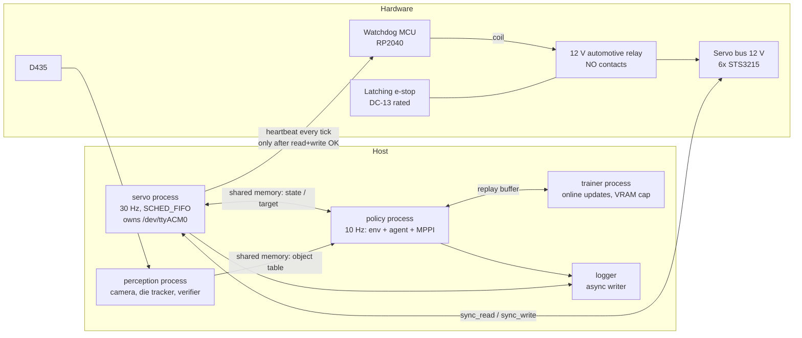

# SO-101 Self-Learning RL — Architecture

> **Status:** v0.15 (2026-10-06). This describes the *target* architecture for Stage A. **Implemented so far:**
> - *Wave 0:* the package skeleton, the pixi environments, `config/`, the shared-memory primitive, the bus, timing and safety-type contracts, the vendored TD-MPC2 and the MJCF assets.
> - *Wave 1:* the servo backends and heartbeat link (U1), the safety layer (U2), the MuJoCo backend (U4), Stage A perception (U5), episode logging (U6), and the watchdog firmware with the hardware checklist (U7).
> - *Wave 2:* the servo core, the servo process and CLI, the soak harness and gate, and the latency hooks (U3). Exercised on the fake and MuJoCo backends only; nothing has run on the real arm yet.
>
> - *Sim-first track SU0 (S0, 2026-10-05; `plans/sim-track-implementation-plan.md`):* one MuJoCo 3.14 / torch 2.11 in every env, MuJoCo Warp (`sim/warp_model.py`, failing overflow detector, S0 gate passed), and the frozen FS3 observation layout (`env/obs.py`) and FS4 task specs (`env/tasks.py`, modular non-positive reward in `env/reward.py` after the SU0 review, 2026-10-06).
>
> **Still interface-only:** the env itself (SR1/SU1: `So101GoalEnv`, `BatchedGoalEnv`), and the RL and world-model code (U9 → SU4/SR2).
> **Source of truth for decisions:** `so101-self-learning-rl-plan.md` §10 (decision log). This doc describes *how* the system is built; the plan describes *what* and *why*.
> **Keeping it current:** every change that adds, removes or renames a module, a process, or a cross-process interface updates this file in the same commit. See §10 at the bottom of this file.

## 1. Purpose and scope

The system is a goal-conditioned, RL-driven manipulation stack for one SO-101 arm, one fixed RealSense D435 and one RTX 3080 (10 GB). It is packaged as a single pixi package, `so101_rl`.

It goes through three stages (plan §1):

| Stage | Scope |
|---|---|
| **A: Research** | This version of the architecture. Covers the safety layer, the die tracker, the world model, and reach with SAC + HER and TD-MPC2 + HER. |
| B: Demo | Grasp, transport and release, plus the SAM2 / Grounding DINO perception and the LLM task planner. |
| C: Platform | A learned task policy and per-skill adapters. |

Everything marked *(Stage B)* or *(Stage C)* below is a placeholder. It is not built in Stage A.

## 2. Layered view

```
            Command ("move die to zone")
                      │
   ┌──────────────────▼──────────────────┐
   │ TASK LEVEL            (Stage B/C)   │  LLM planner (API) → skill sequence
   └──────────────────┬──────────────────┘
                      │ skill id + goal params
   ┌──────────────────▼──────────────────┐
   │ SKILL LEVEL                         │  goal-conditioned RL policies
   │ reach (A) · grasp/transport/        │  SAC+HER (baseline) · TD-MPC2+HER (main)
   │ release/push (B)                    │
   └──────────────────┬──────────────────┘
                      │ joint-delta action @ 10 Hz
   ┌──────────────────▼──────────────────┐
   │ SAFETY LAYER (policy-independent)   │  clamp → tracking-error clamp → limits →
   │                                     │  thermal → safe-state → deadman heartbeat
   └──────────────────┬──────────────────┘
                      │ absolute Goal_Position @ 30 Hz
   ┌──────────────────▼──────────────────┐
   │ MOTOR LEVEL                         │  world model (state first; pixels in parallel)
   └──────────────────┬──────────────────┘
                      │
         Feetech bus (6× STS3215, 1 Mbps)  ── 12 V via watchdog relay
```

Perception runs alongside all the layers. It supplies the object table, the success verifier and the reward terms.

## 3. Process view (runtime)

The load-bearing design rule is that the **safety-critical loop is its own OS process** and owns the serial port. Python's GIL would otherwise let MPPI planning and the camera starve the safety tick.



| Process | Rate | Owns | Must never |
|---|---|---|---|
| `servo` | 30 Hz, absolute-deadline, SCHED_FIFO, `gc.freeze()` | Serial port, the heartbeat, every safety check, the delta→absolute conversion | Allocate per tick, block on the policy, extrapolate a stale target |
| `policy` | 10 Hz | Gym env, agent inference, MPPI planning | Talk to the bus directly |
| `perception` | ≥ 5 Hz (Stage A colour tracker: 30 Hz) | Camera, object table, success verifier, camera-moved fiducial check | Share a CUDA context with training without a memory cap |
| `trainer` | Asynchronous | Gradient updates, checkpoints | Exceed its per-process VRAM fraction |
| watchdog MCU | 1 s timeout | Relay coil | Close the relay without heartbeat pulses. After a trip, only a physical reset re-closes it. |

**When the policy is late:** the servo process holds the last target. After N consecutive misses it trips to the safe state.

**The servo process as built (U3).**
- **Entry point:** `python -m so101_rl.servo.main --backend {feetech,fake,mujoco} [--port] [--heartbeat-port] [--no-mcu] [--shm-name] [--require-rt] [--max-ticks N] [--tick-log PATH] [--summary PATH] [--calibration PATH] [--config PATH] [--arm-timeout-s S] [--fake-start {home,rest}]` (pixi tasks `servo`, `servo-fake`).
  - `fake`: FakeBus powered up at home (`--fake-start rest`: at rest, so the boot re-energise ramps for a few seconds), plus an in-process FakeMcu that boots latched and a simulated operator who presses the reset button.
  - `mujoco`: MujocoBus, limp at the `rest` keyframe, with the physics stepped in real time.
  - `feetech`: the real arm. It refuses to start without a watchdog port unless `--no-mcu` is given explicitly.
- **Start-up (as built, U3 review item 1):** RT setup → the single-instance locks (the shm segment, then every serial port the servo owns) → the bus and heartbeat factories → `build_servo_core`, which runs `validate_geometry` → open the bus port **without a handshake** (the servo side of the relay is unpowered before ARM) → BOOT, waiting for the physical button with no bus traffic (the operator message repeats every 10 s) → ARM closes the relay → ping until every motor answers → one good read, goal write and **ACKED** heartbeat, all within 0.8 s of ARM → `reenergize` → RUN. lerobot's `connect(handshake=True)` before ARM would fail on every real start; `FakeBus(power=FakeMcu.relay_closed)` models that, and the fake backend uses it.
- **RT setup:** `mlockall` (only under an RLIMIT_MEMLOCK of at least 512 MB), `SCHED_FIFO` priority 50, and pinning to one CPU (`SO101_SERVO_CPU`, else the last CPU). It is best effort. `rt_active` = SCHED_FIFO and mlockall both worked. `--require-rt` or `REQUIRE_RT=1` turns a failure into exit code 3.
- After start-up: `gc.collect(); gc.freeze(); gc.disable()`.
- **Loop:** absolute deadlines (`deadline += period`). A tick that ends a full period or more past its *next* deadline (two periods after its own) skips to the next grid point (a resync, counted) instead of bursting. Overruns are counted in the state record and the tick log and reported on stderr at most once per second.
- **Exits:** SIGINT, SIGTERM, SIGHUP (the ssh session closed) and SIGQUIT only set a flag; a running `reenergize` polls it once per tick (`should_abort`), and a thermal resume never starts after it. A stop before `set_torque(True)` never energises; a stop during the re-energise ramp hands over to the bounded safe-state sequence back to rest, heartbeat continuing (plan §10, 2026-10-02 "Stop during re-energise"). A **second** stop signal escalates (`ServoRunner.immediate`, passed as `ServoCore.start(immediate_stop=...)`): the next tick of any safe-state run (shutdown or hand-over) cuts torque in place. The summary records `stop_signals` and `immediate_stop`. `--max-ticks`, a signal and an exception all leave through `ServoCore.shutdown`. Exit codes: 0 normal, 1 exception (after the shutdown), 2 start-up failed (bad geometry, calibration mismatch, re-energise failed, MCU never armed), 3 RT required but unavailable, 4 another servo owns the shm segment.
- **Single instance (review carry-forward C1, U3 review item 14):** `ServoShm.create` holds an exclusive `flock` on `/dev/shm/<name>.so101.lock` until `close()`, and `run(..., serial_ports=...)` holds a `SerialPortLock` on `/dev/shm/so101-serial<resolved path>.lock` for every serial port it owns (the feetech bus and the watchdog port; the device itself is never opened for the lock). A second servo gets `ServoAlreadyRunning` (exit 4), also when it uses another shm name or another alias of the same port. The kernel releases the locks when the owner dies, even by `kill -9`, so a crashed servo's stale segment is still replaced.
- **Outputs:** a binary tick log (`servo.core.TICK_LOG_DTYPE`, one record per tick, written through `RingWriter`) and a JSON summary at exit.
- **Soak:** `python -m so101_rl.servo.soak --backend B --minutes M` (pixi task `soak`; `soak-fake` adds `--backend fake` and the repository calibration) runs the servo as a child process plus a random-policy shm client, then writes `runs/soak-<ts>/report.json`. `check_soak_report(strict=rt_active)` is the Tier-1 gate: at least 30 minutes, p99.9 tick jitter below 5 ms, no heartbeat gap over 200 ms (the window's start and end count as gap endpoints), no HOLD entry, no thermal trip and no calibration mismatch. On a non-RT host the gate is advisory: failures become warnings. A run that is not a valid soak fails on any host: a nonzero servo exit, no summary, a safe-state entry while the policy drove it, less than 90 % of the requested minutes, or less than 90 % of the expected loop-tick samples or policy steps (an empty run never passes).

## 4. Module view (package layout)

```
rl-trainer/
├── pyproject.toml                # [project] + [tool.pixi]: features sim/perception/train/gpu/cpu, envs default/cpu/robot
├── pixi.lock
├── README.md                     # environment verdict (solved versions), entry points
├── so101-self-learning-rl-plan.md
├── docs/ARCHITECTURE.md          # this file
├── plans/                        # implementation plans per phase
├── scripts/                      # fetch_assets.py, extract_kinematics.py, vendor_tdmpc2.py (reproducible generators),
│                                 # bench_warp.py (MuJoCo Warp throughput/VRAM/overflow/parity + the S0 gate)
├── assets/so101/                 # official TheRobotStudio MJCF (+ licence), jaw primitives, keyframes
│   └── upstream/                 # fetched unmodified at a pinned commit (UPSTREAM.json holds sha + sha256 per file)
├── calib/                        # hand_eye.yaml, fiducial.yaml (committed artifacts)
├── firmware/watchdog_mcu/        # deadman watchdog. main.py: MicroPython, RP2040, a pure-logic Core plus hardware glue.
│                                 # PROTOCOL.md: the F4 wire protocol. test_vectors.json: shared by the host tests, FakeMcu and the real MCU (H3).
├── docs/HARDWARE_CHECKLIST.md    # procedures for H1–H13, BOM, power-path wiring, results table
├── src/so101_rl/
│   ├── config/                   # single source of truth: so101.yaml, schema.py, loader.py, so101_kinematics.yaml (FK chain, generated from the MJCF)
│   ├── servo/                    # core.py: ServoCore.tick / start / shutdown; process.py: RT runner, deadline loop, exit codes;
│   │                             # main.py: so101-servo CLI; soak.py: soak harness + gate; latency.py: latency hooks;
│   │                             # bus backends: feetech_bus.py (real STS3215), fake_bus.py (plant, thermal, fault injection);
│   │                             # heartbeat.py: MCU link + FakeMcu; timing; shm (seqlock + single-instance lock)
│   ├── safety/                   # clamp, fk (pure-numpy FK + box), transit (rest<->home transit-zone planner), config_check (safe-state geometry/time-bound validation), thermal, stuck, safe_state, reenergize,
│   │                             # calib_check, state_machine, pipeline. Never imports rl, wm or env.
│   ├── env/                      # goal-conditioned Gym env (sim + real backends, same interface); built: obs (FS3 frozen
│   │                             # policy/critic layout, numpy + torch builders), tasks (FS4 REACH / DIE_TO_ZONE: the
│   │                             # one success / settle-debounce definition for sim and real, built from the `tasks:`
│   │                             # config section), reward (FS4 modular reward terms, validator: every step reward < 0)
│   ├── perception/               # camera (D435 by serial, FakeCamera), die_tracker (HSV + depth, None when occluded),
│   │                             # frames (Umeyama hand-eye), fiducial (ArUco camera-moved gate), object_table (shm),
│   │                             # calibrate_hand_eye (driver)
│   ├── sim/                      # model (load_model via MjSpec, primitive jaw geoms), mujoco_bus (the F2 Bus on MuJoCo,
│   │                             # with action delay), gripper_map (0–100 % <-> rad <-> ticks), compare_real (sysid check),
│   │                             # warp_model (WarpSim: MuJoCo Warp, N worlds on the GPU, torch views, failing overflow
│   │                             # detector; FS2); domain randomization comes later
│   ├── wm/                       # world models: state (Stage A), pixel fused encoder (parallel track)
│   ├── rl/                       # SAC+HER baseline (SB3), TD-MPC2+HER wrapper, HER relabel, toy_env, smoke_tdmpc2
│   ├── viz/                      # training visualisation (SUV, FS11): monitor, live_viewer, video, demo, dashboard
│   ├── logging/                  # schema, episode_logger (HDF5, atomic .tmp -> rename, applied action),
│   │                             # checks (artifact gates, prune, disk budget), ring_writer (preallocated tick log)
│   └── _vendor/tdmpc2/           # vendored TD-MPC2 (MIT, LICENSE kept; PATCHES.md + UPSTREAM.json generated by scripts/vendor_tdmpc2.py)
└── tests/                        # pytest; hardware tests marked and skipped without the arm; tests/data holds the calibration copy
```

**Dependency direction** (the arrows point at what a module may import; nothing imports upward):

```
rl, wm ──► env ──► servo(shm client) , perception(shm client)
env ──► sim            safety ◄── servo
env/batched_env ──► sim (WarpSim, batched servo chain)
sim ──► safety.types, safety.fk   (constants only: TripCause, KinematicChain; D-DEPS)
all ──► config, logging
```

`safety` has no dependency on `rl`, `wm` or `env`. That is what "policy-independent" means in the code. Sim-first additions (plan §10 2026-10-05, D-DEPS): `rl → env`; `rl/` and `env/` never import the `safety/` clamps (the batched sim re-implements the chain in `sim/batched_servo.py`, pinned to `safety/pipeline.py` by the parity test); `env/obs.py`, `env/tasks.py` and `env/reward.py` import only `config` and each other (test-enforced).

## 5. Key interfaces (Stage A)

The exact signatures are frozen in `plans/phase0-implementation-plan.md` ("Frozen Interfaces": F1 config, F2 bus, F3 shared memory, F4 heartbeat, F5 safety, F6 servo core, F7 env, F8 logging, F9 perception, F10 sim, F11 rl/wm). This section only gives their shape. Implemented so far: F1 (`config/`), F2's `Bus`/`BlockRead` (`servo/bus.py`), F3 (`servo/shm.py`, including `LocalIpc`), the F6 clocks (`servo/timing.py`) and the F5 enums and `Verdict` (`safety/types.py`). Wave 1 added the F2 backends, F4, F5 in full, F8, F9 and F10. The rest of this section records how they behave.

**Bus (U1).**
- `FeetechBus.read_block` issues **one** 11-byte `GroupSyncRead` at address 56 (position, speed, load, voltage, temperature, the unused byte 64, Status 65, Moving 66). The firmware protection bits are therefore checked every tick.
- On any communication error, `ok=False` and the arrays keep their previous values.
- `connect()` opens the port **without** lerobot's handshake (U3 review item 1); `connect(handshake=True)` is for bench tools on an externally powered bus.
- `write_goal` is an un-acked `sync_write`: True means *transmitted*, not received (U3 review item 13). The next block read is the evidence. FakeBus matches this: a dropped or unpowered motor never makes `write_goal` fail, only an injected transmit fault does, while the acked `set_torque` / `read_reg` / `write_reg` fail on a silent motor.
- `FakeBus(power=callable, boot_ms=...)`: with `power=FakeMcu.relay_closed` the motors are silent while the relay is open (torque drops to off on power loss) and answer `boot_ms` after it closes.
- `disconnect()` never touches torque.
- `write_registers()` writes every F1 register, including the protection registers LeRobot never writes. It refuses to run while torque is on.
- `Bus` is `@runtime_checkable`.

**Safety (U2).**
- `SafetyPipeline.apply` runs only in RUN. In every other state (HOLD, SAFE_STOPPING, TORQUE_OFF) the core must call `monitor_only(block, v)` every tick, so the thermal dwell keeps advancing.
- Call `resync(present)` when `SmOutputs.resync_target` is set.
- When `SmOutputs.reenergize_requested` is set, run `reenergize(..., tick_hook=hb)`. Then call `mark_energized()` if it succeeded, or `notify_reenergize_failed()` if it failed.
- `reenergize(bus, cfg, calibration, clock, block, *, timeout_s=5.0, tick_hook=None, heartbeat_gap_s=0.8, fk=None, should_abort=None, hand_over_on_abort=False)`.
  - `should_abort()` is polled once per tick in every waiting loop and in the ramp; when true it raises `ReenergizeAborted` (U3 review item 7). Before `set_torque(True)` the arm is never energised (`torque_on=False`). During the ramp the default turns torque off first; with `hand_over_on_abort=True` (the servo core) torque is left on and `ReenergizeAborted.torque_on` is True: the caller must run the safe-state sequence at once (plan §10, 2026-10-02). Every other failure after torque-on still turns torque off.
  - The core's hand-over: `SafeStateSequencer.run(..., tick_hook=<shutdown hook>)` from present (home, then rest, bounded by `bound_s`), then torque off; the re-energise then counts as failed (`notify_reenergize_failed`; at boot `StartupError`, exit 0 when a signal caused it).
  - Escalation: in every safe-state run the shutdown hook checks `immediate_stop()` (a second stop signal) and the MCU's `last_status.latched` (relay open, e-stop) first; either raises `ImmediateStop` out of the sequencer and torque goes off on that tick.
  - It calls `tick_hook(ok)` once per servo tick, with ok = the read succeeded AND the write was accepted. The core sends the heartbeat only when ok is true.
  - With a hook, the first good tick and every later one must come within 0.8 s.
  - It raises `UnsafeStartPose` if the start pose is neither within `rest_tolerance_ticks` of rest nor inside the box.
- `SafeStateSequencer(cfg, clock, *, tracking_error_ticks, motor_ids, fk)` has no defaults: all three arguments are required, so none of its protections can be dropped silently. `run(bus, block, *, servo_hz, tick_hook)` is the blocking driver used for shutdown.
- **Box tolerance:** BOX_PRESENT trips only when the present pose is more than `box.present_tolerance_m` (5 mm) outside the box. The commanded target is clamped to the exact box.
- **Calibration check:** `calib_check` does not compare `drive_mode`, because no servo register holds it. A motion-sign test is needed instead, on the hardware track or in U3.
- **In TORQUE_OFF** the core keeps writing goal = present and keeps sending the heartbeat. Otherwise the MCU would latch during the thermal dwell and the automatic resume would need a human.
- **Further obligations on the servo core (U3)**, found in the 2026-10-01 verification review, are implemented in `servo/core.py` and tested in `tests/test_servo_core.py`:
  - Reset `consecutive_misses` after `mark_energized()`.
  - Do not feed `McuStatus.latched` into the state machine until the button has been pressed and ARM has succeeded, because the MCU boots latched.
  - Send a heartbeat immediately before calling `reenergize`, because `heartbeat_gap_s` is measured from when it is entered.
- **Hardware risk (H-track):** the register phase of re-energise is about 132 single-register transactions, and it must fit the 0.8 s pre-torque heartbeat budget over USB serial. Measure it. If it doesn't fit, switch to `sync_write` / `sync_read`.
- `So101FK(chain, calibration)` needs the calibration, or the `drive_mode` signs default to +1.
- The stuck monitor is fed the sanitized *commanded* delta, because under anti-windup the post-clamp delta of a blocked joint decays to 0.
- **Rest and home poses.** Both are marked NEEDS H5.
  - *rest* is the gravity-stable pose measured on 2026-09-30: [2050, 2200, 2301, 2745, 2040, 2065], tip at z = −0.012 m: **inside the box** since the floor moved to table + 5 mm (plan §10 2026-10-06; it was 2 cm below the old 0.010 m floor). The rest-or-in-box start rule of `reenergize` and the table-based transit checks are unchanged (a pose near rest can still sag below the box).
  - *home* is an in-box placeholder: [2047, 960, 2700, 2748, 2047, 2047], tip at (0.20, 0, 0.15).
- **What `safety.config_check.validate_geometry(cfg, calibration, chain)` checks.** `load_config` does not run these checks, because `config` must not import `safety`, and an AST test enforces that. **The servo entry point (U3) must call it before building the safety stack.**
  - FK(home) is at least 10 mm inside the box.
  - FK(rest) is at least 5 mm above the table and inside the box's x/y footprint. This approximates "clear of the D435", because the camera mount pose is not in the config.
  - Replaying the exact rest-to-home and home-to-rest transits tick by tick never takes the tip below the table plus 5 mm.
  - `bound_s` is at least the worst limit-to-home time plus the home-to-rest time plus 1 s. That is 15.33 s for the shipped calibration, and 19.23 s for a full 0..4095 range.
  - The loader itself checks only that `-0.2 m ≤ table_z_m < box.z[0]` (shipped: table −0.020 m, box floor −0.015 m).
  - The replay assumes the arm follows perfectly. At run time the time bounds end any stall with torque off.

**Servo core (U3).**
- **Construction:** `build_servo_core(cfg, calibration, bus, ipc, heartbeat, clock, *, chain=None, tick_log=None, log=None)` is the one place the safety stack is wired. It calls `validate_geometry` first. Use it: the `ServoCore` constructor validates nothing.
- `ServoCore(cfg, bus, ipc, heartbeat, pipeline, sm, safe, clock, tick_log=None, *, calibration, fk, thermal, log=None)`. The keyword-only arguments extend F6, because `reenergize` needs the calibration and the FK, and the state machine needs `ThermalMonitor.may_resume()`.
- **`tick()` order:**
  1. `read_block`.
  2. `read_cmd`, deduplicated by `seq`.
  3. Outside RUN, `monitor_only` first. Then `sm.step`.
  4. In RUN with `use_policy`: `resync`, then `new_command`, then `apply`. If `apply` reports a state-machine cause (anything except the TRACKING, JOINT_LIMIT and BOX clamps), the machine is stepped again on the same tick, so that target is never written.
  5. The state's duty:
     - RUN: `check_range`, then `write_goal`.
     - HOLD: re-write the target latched on entry (the last RUN target).
     - SAFE_STOPPING: `SafeStateSequencer.start` / `next`, then `notify_safe_done`.
     - TORQUE_OFF, CHECK and BOOT: torque off, and goal = present.
     - LATCHED: torque off, with **no goal write and no heartbeat**, so the MCU drops the relay too.
  6. The heartbeat, only if the read succeeded and every write of the tick was accepted. `max_bus_failures` consecutive ticks with a good read but a refused write add BUS_FAIL to the next step (the state machine itself only counts failed reads), so a bus that reads but no longer writes latches even without an MCU.
  7. `write_state` (every tick, in every state) and one tick-log record.
- **Command timing:** a command's age is measured on the servo clock from when the servo received it. `consecutive_misses` = age // policy period. Both restart at `mark_energized()`.
- **Heartbeat link (plan §10, 2026-10-02; U3 review items 2 and 5):** `HeartbeatLink.send(seq) -> HbSend` is tri-state: `NOT_DELIVERED` (write timeout, dead link: the core reuses the sequence number), `DELIVERED_NO_ECHO` (written, no acknowledging echo, or the echo reports the MCU not armed: the number is consumed, since repeating it would also latch) and `ACKED`. Links expose `last_status` (the MCU's last reported status). In normal running (RUN, HOLD, SAFE_STOPPING, TORQUE_OFF, CHECK) a send that is not ACKED is a miss; the core passes `SmInputs.hb_misses` (consecutive misses) and, after ARM only, `SmInputs.mcu = last_status`. The machine latches after `HB_MISS_BUDGET` = 5 consecutive misses (about 150 ms, HEARTBEAT_FAIL) or at once when the MCU reports latched (DEADMAN). Re-energise stays strict: the heartbeat right before it and every heartbeat inside it must be ACKED, one miss aborts it (`HeartbeatLost`, torque off), and then `hb_ok = False` latches. The shutdown ramp is lenient: misses do not stop it.
- **Thermal resume:** on `reenergize_requested` the core runs the full `reenergize` right after that tick's heartbeat, but only if it was ACKED and no stop was requested (STOP_REQ or the runner's flag). Otherwise it retries on the next CHECK tick.
- **Commands (U3 review item 8):** only a RUN-mode command is fresh for the state machine, so an IDLE or HOLD command never turns HOLD into RUN. A RUN delta that arrives on a tick without `use_policy` (failed read) stays pending until the next tick that applies it; a newer command replaces it; any stop drops it. After every `mark_energized()` the command block is drained, so a command written while waiting for ARM (or during the dwell) is not fresh on the first RUN tick (a STOP_REQ in it still counts).
- **`tick()` returns the same preallocated `TickResult` every call.** A `tracemalloc` test shows no net allocation in `servo/core.py`, `safety/` and `servo/shm.py` over 1000 RUN ticks after warm-up.
- **State record:** `present_ticks` is read at the start of tick *k*, and `target_ticks` is written in tick *k*. `read_ok` = this tick's block read succeeded; when it is 0, `present_ticks` … `moving` repeat the last good reading (boot-wait records always have `read_ok = 0`). `applied_delta_ticks` and `clamped_mask` are zero on every tick where `pipeline.apply` did not run (HOLD, SAFE_STOPPING, TORQUE_OFF, …). `fault_bits` = the state-machine faults plus this tick's non-clamp trips. `hb_ok` = a heartbeat was sent and ACKED this tick. `servo.core.log_row(last record of step i, first record of step i+1)` produces the F8 row that satisfies the log convention below.
- **Tick log:** one record per tick, including the re-energise and shutdown ticks. It holds the jitter, duration, state, ok/wrote/hb flags, trips, present, target, temperatures, `obs_to_cmd_ns` (state publish → command apply) and `cmd_age_ns` (policy write → servo receipt). `servo.latency.measure_obs_to_cmd` summarises it.
- `FakeBus(record_writes=False)` turns off the `written_goals` / `torque_events` intercepts for long runs.

**Sim (U4).**
- `load_model()` compiles `so101_rl_scene.xml` through `MjSpec`. It adds primitive jaw box geoms and a `gripper_tip` site, and disables collisions on the jaw meshes.
- **Timestep (S0.2, D-TIMESTEP):** the scene sets `timestep = 1/510 s`, so `MujocoBus.steps_per_tick` = 17 substeps are exactly one 1/30 s servo tick and one policy step exactly 100 ms (with upstream's 0.002 s a tick was 34 ms). CPU MuJoCo and MuJoCo Warp use the same substep count.
- **`jaw_col` margin = 0 (S0.2):** MuJoCo Warp rejects non-zero margins on box pairs; both engines run the same model.
- `MujocoBus` implements `Bus` using the real calibration.
  - **Registers:** `Present_Position`, `Goal_Position`, `Torque_Enable`, `Present_Temperature` and `Present_Voltage` are live. Every other register is stored and read back.
  - **Limits and signs:** `write_goal` clips to the Min/Max_Position_Limit registers, and the reported velocity follows the `drive_mode` sign.
  - **Torque:** it starts **de-energised**, like FakeBus and the real arm. `reset_to_keyframe` energises the bus.
  - **Unstable simulation:** `step_ticks` raises `RuntimeError` if MuJoCo reports a non-finite state, instead of resetting silently.
  - **Keyframes:** the scene's `rest` and `home` keyframes follow the config ticks.
- `reenergize` is tested end to end on FakeBus and on MujocoBus (`tests/test_reenergize_backends.py`).
- The gripper uses its own linear map between the calibration `range_min`/`range_max` and the MJCF joint range.
- `so101_rl.sim` re-exports lazily, so importing it does not load `mujoco`.

**MuJoCo Warp (S0.3, FS2 of `plans/sim-track-implementation-plan.md`).**
- `WarpSim(model, cfg.sim_warp, nworld, *, device="cuda:0", capture_graph=True)` holds one MJWarp `Model` + `Data` for N worlds. `qpos`, `qvel`, `ctrl`, `actuator_force` and `site_xpos` / `body_xpos` / `body_xquat` are zero-copy torch views (`wp.to_torch`). `step(nsteps)` replays one captured CUDA graph per distinct `nsteps`; Warp runs on its own stream, fenced both ways against torch's current stream with events (no host sync).
- **Sizes come from the `sim_warp:` config section** (FS1, `SimWarpConfig`: `njmax` 256 per world, `nconmax_per_world` 32 with `naconmax = 32 × N` shared by all worlds, `nworld_default`, `overflow_check_every_steps`, `overflow_policy: fail`). The loader is strict: every key required, `njmax ≥ 64`, the others ≥ 1, and `overflow_policy` has no value other than `fail`.
- **Overflow fails.** MJWarp only prints on overflow and silently drops rows/contacts. `check_overflow()` reads MJWarp's sticky per-world `Data.overflow` bitmask (folded into an accumulator before any reset clears it) plus `nefc` / `nacon` in one device→host copy and raises `ContactBufferOverflow` on any capacity bit. Solver iteration-limit bits are counted, not raised. `close()` runs the check too, so a run cannot end with an undetected overflow; the batched env (S1) calls it every `overflow_check_every_steps` policy steps.
- `reset_worlds(mask, qpos, qvel, ctrl)` (full-size tensors, masked rows applied) then `mjw.forward`; `set_world_params(BatchedSimParams, *, validate=True)` writes per-world kp/kv (gainprm/biasprm), damping/armature/frictionloss, forcerange, die mass (inertia scaled) and die/table friction into model arrays allocated with a world dimension (`put_model(batch_sizes=...)`), then `mjw.set_const`. Every FS7 field batches in MJWarp 3.14, including `geom_size` (die-size DR). `stat.meaninertia` is outside `batch_sizes` (it lives in `Model.stat`) but every kernel indexes it per world, so the wrapper replaces it with an `[N]` array before any capture. Writes are in place, so a captured step graph sees parameters changed after the capture (test-pinned). `validate` rejects non-finite values, `kp`/`forcerange`/`die_mass` ≤ 0 and negative others before writing: host inputs (the samplers' output) cost no device sync, GPU inputs one sync for all fields; `validate=False` for callers that validated at the sampler.
- Leaving `with WarpSim(...)` with an exception never masks it: a failing final overflow check is added to the original exception as a note. Not bitwise deterministic: the shared contact pool is filled with atomics (two identical 256-world runs differed by up to 0.041 rad after 1020 steps); short smooth runs agree to float32 rounding.
- `contact_count(geoms_a, geoms_b) -> int32[N]` (geom-set masks cached per pair), `copy_world_to(world, MjData)` (rendering), `vram_bytes` (Warp mempool only).
- `scripts/bench_warp.py` (`pixi run bench-warp`) measures env-steps/s, process VRAM, peak `nefc`/`nacon` and CPU-vs-Warp parity. Exit 0 = S0 gate PASS, 1 = FAIL (N=1024: ≥ 500k env-steps/s, ≤ 1.5 GB, no overflow at njmax 256 / nconmax 32, arm parity ≤ 1e-6 rad over 300 steps), 2 = NOT EVALUATED (N=1024 not run, `--no-parity`, `--njmax`/`--nconmax` overrides, or `--steps` < 2000). Measured 2026-10-05: 731k env-steps/s and 786 MB at N=1024, parity 3.9e-7 rad, peak nefc 188/256.
- `so101_rl.sim` stays lazy: importing it loads neither `mujoco`, `mujoco_warp` nor `warp` (test-enforced).

**Sim-first interfaces (FS-series, `plans/sim-track-implementation-plan.md`).** FS1 (`SimWarpConfig`, the `sim_warp:` section) and FS2 (`WarpSim`) are built (S0.3, above). FS3 and FS4 are frozen in code (S0.4):
- **FS3 observation** (`env/obs.py`, `OBS_LAYOUT_VERSION = 1`, supersedes F7's 15-D layout): `q_norm` 6 = (present − 2047)/2048, `dq_norm` 6 = Present_Speed [ticks/s] / servo_hz / `max_ticks_per_tick` clipped ±2, `last_applied` 6 = `applied_delta_ticks / max_delta_ticks` clipped ±1, `tip_xyz` 3 (FK of present); die tasks add `die_xyz` 3 (last-known, held), `die_visible` 1, `die_age` 1 = min(frames since seen, 30)/30. Reach 21, die 26; policy input + 3 goal = 24 / 29. `build_policy_obs_np` / `build_policy_obs_torch` agree to 1e-6 (test). `PRIV_OBS` (61, critic only, sim only) is a layout.
- **FS4 tasks** (`env/tasks.py`, `env/reward.py`; plan §10 2026-10-06): `REACH` (50 steps, γ 0.97, success |tip − goal| ≤ 15 mm, debounce 1) and `DIE_TO_ZONE` (100 steps, γ 0.98, debounce 2 + settle, zone (0.22, 0.10) ± 30 mm from the scene site, die start well (0.20, −0.05) σ 5 mm, `measured_on_hardware: false` until H9). The configurable part is the strict `tasks:` section of `so101.yaml` (`config.parse_tasks` → `TasksConfig`; `task_from_config(name, cfg.tasks)`; the module constants come from the shipped yaml). **Reward** = Σ weight × term over named, non-positive terms, each a pure function of one step's (achieved, desired, visible, info): `distance` (−dist/`scale_m`, optionally 0 on success steps), `success` (−1 until the instantaneous predicate holds), `clamp` (−`info["action_clamped"]`), `action_l2` (−mean(`info["applied_action"]`²)), `time` (constant −1, not zeroed on in-zone steps). Default for both tasks: −dist/0.30 − 1 off success, 0 on success, minus 0.05 (`time`) on every step. `validate_reward_spec` (run by every `TaskSpec` constructor) proves every step reward ≤ −w_time < 0 and unsuccessful steps ≤ −(w_success + w_time) (known terms, weights ≥ 0, every term ≤ 0, `success` and `time` weight > 0), so finishing beats dipping in and out of the zone, hiding the die, or keeping it moving inside the zone forever (tests: discounted returns over 3000 steps, and a hypothesis property test). `reward_*` / `reward_terms_*` in numpy and torch agree. The die predicate uses the **tracker-reported** position and needs `visible` (missing `visible` is an error; invisible is UNKNOWN, never SUCCESS), the centroid's xy inside the zone square around `desired` and the centroid at most `max_height_m` = 16 mm above `desired` (relative to `desired`, so HER-relabelled goals stay consistent; 25 mm up fails). Termination (`debounce_*`): 2 consecutive predicate steps **and** ≤ `settle_mm` = 3 mm tracker displacement between them (a slide at 0.05 m/s or a nudge out never terminates); termination only, the reward stays instantaneous. SB3 HER's `compute_reward` takes the stored transition's visibility from `info["tracker_visible"]` (`visible_from_info`; never defaults to visible) and passes the stored `info` for the info terms. `GoalBounds` = `cfg.box` shrunk by 20 mm, z ≥ 30 mm, radius ≤ 0.30 m (shared by the numpy and torch goal samplers).

**Perception (U5).**
- The object table is one seqlock'd `OBJECT_TABLE_DTYPE` record in its own shm segment. Perception creates it, and the env attaches read-only.
- `HsvDepthDieTracker.detect` returns None when the die is not reliably visible, and the verifier maps that to UNKNOWN.
- `load_hand_eye` refuses a residual above 3 mm, or fewer than 10 poses.

**Logging (U6).**
- There is one HDF5 file per episode. It is written as `.h5.tmp`, then fsynced and renamed.
- `applied_delta_ticks` (after clamping) is stored next to `action_cmd`.
- Every `check_episode` gate has a test that fails it on a deliberately broken file.

**Log convention (binding for U3).** `present_ticks[i]` is the reading taken **after** `target_ticks[i]` was applied for one policy step, which is `servo_hz / policy_hz` servo ticks. `sim.compare_real` depends on this.

F3 originally asserted `STATE_DTYPE.itemsize == 192`; the listed fields need 232 bytes with natural alignment, and the plan now says 232. The state block stride is 256 B (64-byte aligned) and the shm segment is 384 B (`servo/shm.py`). Layout version 2 (2026-10-02, plan §10) adds `read_ok` (u1) at offset 225, directly after `hb_ok`, in what was alignment padding: the size, the stride and every other offset are unchanged, and `attach` refuses a version-1 segment.

Tick/angle conversion: `ticks_to_rad` / `rad_to_ticks` (`config/schema.py`) do **not** apply `homing_offset`. The STS3215 firmware applies the homing offset itself, so `Present_Position` and `Goal_Position` are already in the homed frame (mid-range of motion reads about 2047 for the arm joints). The calibration `homing_offset` is only read back and compared at connect (`CalibrationMismatch`, plan 2.4); `drive_mode` selects the sign. The gripper is not mid-range-centred; its 0-100 % mapping lives in `sim/` and uses the calibration `range_min/max`.

Config loading is strict (`config/loader.py`): unknown or missing keys in any section are errors, there are no hidden defaults, integer fields reject bools, strings and non-integral floats, and safety-relevant values (timeouts, velocity caps, STS3215 register values) are range-checked.

| Interface | Between | Shape |
|---|---|---|
| Joint-state / target shared memory | servo ↔ policy | A seqlock'd struct holding the timestamp, positions, speeds, loads, temperatures, voltage and status bits, plus the latest target and its sequence number |
| Object table shared memory | perception → policy | Per object: label, 3D centroid (base frame), confidence, visibility flag and timestamp |
| Env | policy ↔ agent | Gymnasium goal-env with `Dict(observation, achieved_goal, desired_goal)` observations and **joint-delta** actions (delta on the last target) |
| Safety verdict | inside servo | `apply(action, state) -> (applied_target, trips[])`. Only the *applied* target is logged. |
| Verifier | perception → env | Per skill, one of `SUCCESS \| FAILURE \| UNKNOWN`. It returns UNKNOWN whenever the die is occluded. |
| Episode record | env → logger | Observations, the **applied** action, reward, verifier verdict, trips, and the `truncated` flag |

## 6. Safety architecture

These are ordered from the outermost layer to the innermost.

1. **Hardware (independent of all software).**
   - A latching e-stop and the watchdog MCU's relay, both in the 12 V feed.
   - A TVS diode across the bus.
   - A PSU of at least 8–10 A.
2. **Deadman.**
   - The servo process pulses the heartbeat each tick, but only after a successful read and write.
   - The MCU opens the relay if the pulses stop for 1 s.
   - The host latches the state machine after 5 consecutive unacknowledged heartbeats, or as soon as the MCU reports itself latched (plan §10, 2026-10-02). During re-energise one miss aborts.
   - **Wire protocol (F4):**
     - Commands: ARM `0x5A`; HEARTBEAT `0xA5 seq ~seq`; STATUS_REQ `0xE0`; TEST_DROP `0xE1`.
     - Each complete frame gets one status byte back: bit0 relay, bit1 latched, bit2 armed, bit3 undervolt, bits4–7 reason.
     - The first heartbeat after ARM sets the sequence baseline, and every later one must be +1 mod 256.
     - A gap, a repeated seq or a bad complement latches the MCU with reason 3.
     - The MCU **boots LATCHED** with reason 6 (MCU_RESET) after every reset, whether from power, the hardware WDT or USB re-enumeration (status `0x62`). Only the physical button re-enables power.
     - Trip reasons:

       | Code | Reason |
       |---|---|
       | 1 | TIMEOUT (≥ 1000 ms) |
       | 2 | UNDERVOLT |
       | 3 | SEQ_ERROR |
       | 4 | ESTOP_PIN |
       | 5 | TEST |
       | 6 | MCU_RESET |
       | 7 | WELD |
     - A partial heartbeat frame is dropped after 100 ms.
     - **Host side** (`SerialHeartbeatLink`):
       - A heartbeat counts as delivered only once all 3 bytes are out. A partial write returns NOT_DELIVERED, and the next send with the same seq completes the tail.
       - A tail older than 80 ms is dropped, never sent. The link writes nothing until 120 ms after the last byte, so a stale tail can't be read as commands (for example seq 0x5A as ARM).
     - The spec is `firmware/watchdog_mcu/PROTOCOL.md`. `FakeMcu` is kept byte-identical to the firmware `Core` by replaying every test vector through both.
   - **Voltage sensing (two dividers):**
     - The PSU-side divider sits before the e-stop and relay (GP26). It gates ARM on undervoltage.
     - The servo-side divider sits after the relay (GP27). It is used for drop timing, and for a "bus dead" check before ARM.
     - It also detects a welded relay: if the relay is commanded open but the servo side reads at least 1 V for 500 ms, the MCU latches with reason 7 (WELD).
   - **Host link:** `SerialHeartbeatLink.send` never raises and returns an `HbSend`. A write timeout is `NOT_DELIVERED` (the sequence number is reused); any other serial failure, such as a USB unplug, is `NOT_DELIVERED` and sets `dead`. A missing echo, or one that reports the MCU not armed or latched, is `DELIVERED_NO_ECHO`. A refused TEST_DROP raises `TestDropRefused` immediately.
   - **Latching:**
     - Trips latch in the MCU. Only the physical reset button, held for 500 ms and not while the e-stop is asserted, clears them. Serial never can.
     - The e-stop input is wired through an NC contact, so a broken wire reads as asserted.
     - The hardware WDT is 250 ms, so an MCU hang opens the relay.
3. **Servo-process checks, every tick.** This is the order as implemented in `safety/pipeline.py`:
   1. NaN sanitisation and the per-command delta clamp, both on each new command at 10 Hz.
   2. Interpolation over 3 ticks, then the joint limits, then the per-tick velocity cap, then the tracking-error clamp |target − present| ≤ E. The tracking-error clamp pulls the stored goal back, so a blocked joint cannot wind up.
   3. The Cartesian box (`box:` in `so101.yaml`: x 0.08–0.34, y ±0.22, **z −0.015–0.28 m**; the floor is table + 5 mm since plan §10 2026-10-06, so the jaws reach a die resting on the table), through FK of the target:
      - **BOX** (the commanded target is outside) is a clamp that reverts to the previous target.
      - **BOX_PRESENT** (the present position is outside) is a trip.
   4. The thermal trip:
      - It fires at 60 °C or above and latches once.
      - Resuming needs 50 °C or below for 30 s.
      - A temperature reading older than 1 s, or a raw value of 0 or 255, is also a trip.
   5. The firmware protection bits: any non-zero `Status` is a trip.
   6. The stuck-action monitor.
   7. `check_range` (integer dtype, 0..4095) as the pipeline's last step. The servo core repeats it immediately before every `write_goal`, including the safe-state targets. A target that fails it is never written, and the RANGE trip stops the arm on the same tick. A limit above 4095 is caught there too (`tests/test_action_units.py`, Test 3).

   Clamps (TRACKING, JOINT_LIMIT, BOX) never change the state-machine state.
4. **Safe-state sequence, bounded by `bound_s` (20 s).**
   - The user decided on 2026-10-01 to keep the slow 240 ticks/s ramp. `validate_geometry` computes the minimum `bound_s` from the calibration: 15.33 s for the shipped calibration.
   - The sequence ramps home, then to the gravity-stable rest pose, through the transit zone (`safety/transit.py`):
     - it lifts first;
     - the target tip never goes below the table plus 5 mm;
     - otherwise it holds.
   - It then turns torque off.
   - If it cannot finish, it falls back to torque-off in place, then to the deadman.
   - The heartbeat continues through `tick_hook`.
   - A refused torque-off (3 attempts) raises.
   - All process exits go through it, and so does a stop during the re-energise ramp (plan §10, 2026-10-02).
   - Escalation: a second stop signal, or the MCU reporting latched (e-stop, relay open), cuts torque in place on the next tick.
5. **Resume policy, by cause.**

   | Cause | State path | Resume |
   |---|---|---|
   | Thermal | RUN/HOLD → SAFE_STOPPING (to rest) → TORQUE_OFF → after the dwell → CHECK (`reenergize_requested`) → full `reenergize` → RUN (resync on a good read). It never holds pose energised; COOLDOWN is unused (decided 2026-10-01). | Automatic, at most 3 per hour, counted by the state machine. A 4th trip, or a failed re-energise, needs a human. |
   | NaN, stuck action, OOD, RANGE, BOX_PRESENT, N stale commands | → SAFE_STOPPING → TORQUE_OFF | A fresh process and a checkpoint |
   | Protection bit, calibration mismatch, user stop | → SAFE_STOPPING → TORQUE_OFF | A human |
   | Heartbeat failure (5 consecutive missed acks in normal running; 1 during re-energise), MCU latched, deadman, 3 consecutive bus failures | → LATCHED (absorbing) | A human and a physical reset |

   - Every resume requires `block_ok`.
   - LATCHED and TORQUE_OFF send torque-off every tick.
   - TORQUE_OFF keeps writing goal = present and sending the heartbeat. LATCHED does neither, so the MCU also opens the relay.

   **Re-energise order** (`safety/reenergize.py`):
   1. `ping_all`
   2. calibration registers
   3. Lock = 0, check that Torque_Enable == 0, write every register, then read every register back
   4. a block read. The start pose must be near rest or inside the box, temperatures below the trip and not 0 or 255, and Status 0.
   5. goal = present (this is the first heartbeat tick)
   6. read back Goal_Position
   7. `set_torque(True)`
   8. ramp home through the transit zone, re-checking temperatures on every read

   Any failure after torque is on turns torque off (3 attempts), then re-raises. The exception is a stop during step 8: the servo core hands over to the safe-state sequence (layer 4) instead, so the arm is ramped to rest rather than dropped. A stop before step 7 never energises.
6. **Autonomy tiers.**
   - Tier 0 is attended.
   - Tier 1 is unattended, and is allowed only after the soak gates pass: 30 minutes, then 2 hours goal-directed, with p99.9 tick overrun below 5 ms.

## 7. Data and learning flow (Stage A)

**Sim-first** (plan §10, 2026-10-05; plan §5 "Sim-first track"). Status: **S0 built** (2026-10-05): version pin, MuJoCo Warp backend with the S0 gate passed (N=1024: ~0.73–0.80 M env-steps/s, 786 MB, no overflow at `sim_warp` njmax 256 / nconmax 32, CPU-vs-Warp arm parity 3.9e-7 rad over 300 steps), FS3/FS4 interface freeze. S1–S5 are planned. Grasp-level contact parity (Layer C) is still open.

```
 SIM (RTX 3080, MuJoCo Warp, 1024–2048 envs)                REAL ARM (ServoCore)
 ┌───────────────────────────────────────────┐            ┌──────────────────────────┐
 │ batched servo-parity env (S1)              │            │ zero-shot eval (N eps)   │
 │  same tick rules: 3 ticks/step, clamps,    │  policy    │        │                 │
 │  delay FIFO, applied action, sim tracker   │──────────► │ SAC+HER fine-tune (real) │
 │ massively parallel SAC, privileged critic  │            │ TD-MPC2+HER fine-tune    │
 │ DR centred on sysid fit (S2/S3)            │  rollouts  │  (WM + critic pre-trained│
 │ exit gate ≥95 % over 1000 DR episodes      │──────────► │   offline from sim logs) │
 └───────────────────────────────────────────┘            └──────────────────────────┘
           ▲ sysid fit (CMA-ES / Optuna, parallel worlds)          │ real logs
           └───────────────── compare-real ≤5 % RMS ◄──────────────┘
```

- **Parity rule:** the batched sim env must reproduce `ServoCore` + `MujocoBus` exactly. A parity test requires identical goal sequences for the same actions.
- **Sysid is a gate (S2), not a parallel track.** `pixi run compare-real` checks the error, and the fitted parameters become the centre of the domain randomisation.

- **Reward and success** come from the object table and FK, never from pixels.
- **The pixel world model** is a parallel track, with a fused RGB-conv and state-MLP encoder feeding SimNorm. It may drive MPPI on the real arm only after it passes the cross-session gate: a different day, under different lighting.

## 8. Packaging and environments

| Pixi feature | Contents | Used by |
|---|---|---|
| core (default deps) | python 3.12, numpy 2.2, conda `pytorch` + torchvision (variant chosen by `gpu`/`cpu`), lerobot[feetech,grpcio-dep] 0.6.1 (PyPI), gymnasium, h5py, pyyaml, pytest, hypothesis, ruff | servo, safety, env |
| `sim` | `mujoco-python 3.14.*`, `mujoco-warp 3.14.*`, `warp-lang >=1.17,<2` (conda-forge): **one MuJoCo version in `cpu` and `default`** (S0.1, 2026-10-05; resolved 3.14.0 / 3.14.0 / 1.17.0 cuda129) | sim, tests, GPU pre-training (`default` env) |
| `perception` | opencv (conda-forge), pyrealsense2 (PyPI) | perception |
| `train` | torchrl, tensordict, stable-baselines3, hydra-core, omegaconf, termcolor, pandas, cma (CMA-ES for sysid) (PyPI) | rl, wm, sim/sysid |
| `gpu` | `pytorch-gpu 2.11.*`, `cuda-version 12.9.*` (D-CUDA; matches the cuda129 warp build; fallback 12.8 / 12.6) | training and GPU tests on the RTX 3080 |
| `cpu` | `pytorch-cpu 2.11.*` | CI, driver-less hosts, all Phase 0 acceptance |

| Environment | Features | Purpose |
|---|---|---|
| `default` | sim, perception, train, gpu | Training host and GPU tests (`pixi run test-gpu`); the driver works since H1 |
| `cpu` | sim, perception, train, cpu | Tests and smoke runs everywhere |
| `robot` | perception, cpu | Servo host process: no GPU stack beyond what lerobot imports |

- **Channels:** only conda-forge for torch, CUDA, MuJoCo and Warp, and PyPI for lerobot, pyrealsense2 and the train stack. There is exactly one torch, the conda `pytorch` 2.11 in every env, and one MuJoCo, 3.14 in every sim-capable env (`tests/test_env_sanity.py` enforces both).
- **Version pins (S0.1):** `pytorch 2.11.*` and `numpy 2.2.*` everywhere, because lerobot 0.6.1 needs torch < 2.12 and numpy < 2.3; `torchvision >=0.26,<0.27`.
- **Solver pins** (so pixi's PyPI resolver accepts lerobot 0.6.1 on top of the conda solve): `setuptools<82`, `packaging<26`, `opencv<4.14`, `gymnasium<1.3`; `[tool.pixi.system-requirements] cuda = "12"` lets the `default` environment lock without a driver; `PYTHONNOUSERSITE=1` is set on activation so `~/.local` packages never leak in. Solved versions are recorded in `README.md`.
- **Tasks:** every entry point is a `pixi run` task: `test`, `test-hw`, `lint`, `ci`, `smoke-tdmpc2`, `fetch-assets`, `extract-kinematics`, `servo`, `servo-fake`, `soak`, `soak-fake`, `calib-check`, `hand-eye` (runs `perception.calibrate_hand_eye`), `compare-real`; sim-first track (S0.1): `test-gpu` (`pytest -m "gpu and not hardware"`), `ci-gpu` (lint + test + test-gpu), `bench-warp`. Planned tasks (`random-policy-sim`/`-real`, `train-reach-sac`, `train-reach-tdmpc2`, `train-wm-state`, `check-milestone`, `sim-parity`, `tray-check`, `sysid-excite`, `sysid-fit`, `sim-gates`, `train-sim-sac`, `eval-sim`, `export-policy`, `deploy-policy`, `pretrain-tdmpc2`, `gap-report`) are listed in a `pyproject.toml` comment and are added in the same commit as their module; `tests/test_pixi_tasks.py` fails if a task's module, script or test path is missing. `servo-fake` and `soak-fake` pass `--calibration tests/data/so101_follower.calib.json` (the repository copy of the arm's calibration), so the fake runs are reproducible on any host.

The vendored TD-MPC2 tree is generated by `scripts/vendor_tdmpc2.py`. The upstream tarball cache is verified against the recorded `tarball_sha256` on every read, and `scripts/vendor_tdmpc2.manifest.json` records the sha256 of every vendored file so hand-edits fail an offline test.

## 9. Architecture decisions (summary)

The full log is in plan §10. The decisions that shape this architecture are:

- pure Python, with no ROS2;
- a separate real-time servo process;
- clamped joint deltas at 10 Hz;
- MuJoCo with the official MJCF. **GPU sim-first pre-training with MuJoCo Warp** (2026-10-05) trains SAC at scale in sim, then fine-tunes on the real arm;
- TD-MPC2 vendored, with a SAC + HER baseline run first;
- a colour + depth tracker in Stage A;
- a pixel world model, off the critical path;
- tiered autonomy with a hardware deadman;
- a single pixi package.

## 10. Maintenance rule

Update this document in the **same change** as any of the following:

- a module is added, removed or renamed under `src/so101_rl/`;
- a process, a rate or a cross-process interface changes (§3, §5);
- a safety check changes, or the order of the checks changes (§6);
- a pixi feature, channel or task set changes (§8);
- a new §10 decision in the plan affects any section here.

Bump the version line at the top and add an entry below.

| Version | Date | Change |
|---|---|---|
| 0.1 | 2026-09-30 | First version, derived from plan v2 |
| 0.2 | 2026-09-30 | Wave 0 (U0): pixi features/environments/tasks and solver pins (§8), `scripts/`, `assets/so101/upstream/`, `config/so101_kinematics.yaml` and `tests/data` (§4), links to the plan's F-sections and the F3 state-size deviation (§5) |
| 0.3 | 2026-09-30 | U0 review fixes: strict config/calibration validation (§5), homing_offset semantics in ticks<->rad documented (§5), F3 state size now 232 in the plan, shm attach/create hardening, vendor tarball checksum and committed vendored-file manifest (§8) |
| 0.4 | 2026-09-30 | Wave 1 integrated (U1, U2, U4, U5, U6, U7): the servo backends and heartbeat link, the safety layer, the MuJoCo backend, Stage A perception, episode logging, and the watchdog firmware with its hardware checklist (§4). Interface behaviour and the binding log convention (§5). The F4 wire protocol and latch semantics, the implemented check order, and the resume state paths (§6). The sysid check (§7). The `hand-eye` task fixed and `compare-real` added (§8). |
| 0.5 | 2026-10-01 | Wave-1 review fixes (`plans/reviews/2026-09-30-wave1-review.md`). §4: `safety/transit.py`. §5: the `reenergize` and sequencer signatures, `tick_hook`, the TORQUE_OFF duties, the measured rest pose and in-box home, the loader geometry and time-bound checks, the box tolerance, live MujocoBus registers with a de-energised start. §6: the MCU boots latched, the two voltage dividers and weld detection, the never-raising host link, the 20 s safe-state bound and transit zone, thermal → rest → torque off → re-energise, and the hardened re-energise order. |
| 0.6 | 2026-10-01 | Verification-review follow-ups. §4: `safety/config_check.py`. §5: the safe-state geometry and time-bound checks move from the `config` loader to `safety.config_check.validate_geometry`, restoring the dependency direction; U3 must call it. The bound is 15.33 s for the shipped calibration. Further U3 obligations are recorded: reset the miss counter, handle the boot latch, send a heartbeat before re-energise. The re-energise timing risk is noted. |
| 0.7 | 2026-10-01 | Wave 2 (U3). §3: the servo process as built: CLI and backends, start-up order, RT setup and `rt_active`, the deadline loop with resync, signals and exit codes, the single-instance shm lock, the tick log and summary, and the soak harness and gate. §4: `servo/core.py`, `process.py`, `main.py`, `soak.py`, `latency.py`. §5: the servo core: `build_servo_core`, the keyword-only extension of the F6 `ServoCore` signature, the tick order and per-state duties, command timing, heartbeat and boot-latch handling, the thermal resume, the state-record semantics with `log_row`, the tick log, and `FakeBus(record_writes=False)`. §6: the core repeats `check_range` before every write, and LATCHED sends no heartbeat. §8: `servo-fake` uses the repository copy of the calibration. |
| 0.8 | 2026-10-02 | U3 review fixes (`plans/reviews/2026-10-01-u3-review.md`) and the 2026-10-02 plan §10 decisions. §3: the real-arm start order (port without handshake → button + ARM → ping → re-energise), the serial-port locks, SIGHUP/SIGQUIT and the re-energise abort, the overrun wording, the soak gate's validity checks, gap endpoints and HOLD count, the `soak-fake` task. §5: `Bus.connect` without handshake and `write_goal` = transmitted, `FakeBus(power=, boot_ms=)`, `reenergize(should_abort=)` / `ReenergizeAborted`, the tri-state `HeartbeatLink.send -> HbSend` with `last_status`, `SmInputs.hb_misses` and the 5-miss budget (re-energise strict), command freshness / pending delta / drain, the state record's `read_ok` (F3 layout v2) and zeroed applied delta. §6: the host-side miss budget and the LATCHED row. §8: `soak-fake`. |
| 0.9 | 2026-10-02 | Plan §10 decision "Stop during re-energise". §3: a stop during the boot re-energise ramp hands over to the safe-state sequence; a second stop signal cuts torque immediately (`ServoRunner.stop_signals` / `immediate`, summary fields); `--fake-start {home,rest}`. §5: `reenergize(hand_over_on_abort=)` and `ReenergizeAborted.torque_on`, the core's hand-over, `ServoCore.start(immediate_stop=)` and `ImmediateStop`. §6: the safe-state escalation and the re-energise abort exception. |
| 0.10 | 2026-10-05 | Plan §10 sim-first decisions (2026-10-05). §7: the target sim-first data flow with MuJoCo Warp, the servo-parity rule, and sysid as gate S2. §8: the `sim` feature gains mujoco-warp and warp-lang, with one MuJoCo version pinned across envs. §9: the new decision. This is target design only; nothing is implemented yet. |
| 0.11 | 2026-10-05 | U3 verification follow-ups. §6: host-side heartbeat partial-frame rule (delivered only when the frame is complete; stale tails over 80 ms dropped). New tests cover the strict re-energise heartbeat on a lost or latched echo, and the abort check just before torque-on. |
| 0.12 | 2026-10-05 | Sim-first track SU0 (`plans/sim-track-implementation-plan.md`). §8: S0.1 version pin — `mujoco-python 3.14.*`, `mujoco-warp 3.14.*`, `warp-lang >=1.17,<2` in `sim`, `pytorch 2.11.*` in every env (`pytorch-gpu 2.11.*` + `cuda-version 12.9.*` in `gpu`), `cma` in `train`, the sim-track pixi tasks incl. `test-gpu` / `ci-gpu`. §5 Sim: S0.2 scene timestep 1/510 s (17 substeps = one servo tick) and `jaw_col` margin 0. §4/§5: S0.3 `sim/warp_model.py` (`WarpSim`, failing overflow detector, per-world params), the `sim_warp:` config section (`SimWarpConfig`), `scripts/bench_warp.py` and the S0 gate. Header: SU0 status. §4: `env/obs.py`, `env/tasks.py`; dependency arrows per D-DEPS (`sim → safety.types/fk` constants only, `env/batched_env → sim`, `rl → env`). §5: FS1–FS4 pointers and behaviour. §7: status "S0 built" with the measured gate values. |
| 0.13 | 2026-10-06 | SU0 review fixes (plan §10 2026-10-06 rows). §4: `env/reward.py` (modular reward). §5 FS4: the reward is a weighted sum of named non-positive terms from the new strict `tasks:` config section (`TasksConfig`, `RewardSpec`), `validate_reward_spec` on every `TaskSpec` (no step reward > 0; finishing strictly best), `TaskSpec.reward` / `settle_m` replace `success_bonus` / `dense_scale`, die height bound 16 mm above the goal, settled-die debounce (≤ 3 mm between the 2 steps), `debounce_*(…, achieved=, prev_achieved=)`, `reward_*(…, info=)`. §5 Sim: per-world `stat.meaninertia`, `set_world_params(validate=)`, graph replay picks up changed params, `__exit__` never masks an exception, determinism note, bench gate NOT EVALUATED (exit 2). §8: pixi tasks for modules that do not exist yet removed (listed as planned), guarded by `tests/test_pixi_tasks.py`. |
| 0.14 | 2026-10-06 | FS4 reward: new `time` term (constant −1 per step, default weight 0.05 for both tasks, not zeroed on in-zone steps, instantaneous so HER-safe). `validate_reward_spec` requires `time.weight > 0`; `RewardBounds.max_step` = −w_time, `max_unsuccessful_step` = −(w_success + w_time). Every non-terminal step is now strictly negative, so a die kept moving inside the zone forever no longer ties with finishing. |
| 0.15 | 2026-10-06 | Sim wave-1 integration (SU1, SU2, SR1, SUV) and the 2026-10-06 plan §10 decisions. **Box floor** = table + 5 mm (z −0.015 m; §5 rest pose now inside the box, §6 box values); Layer C grasp parity runs on the shipped config. §4: `viz/`. |
